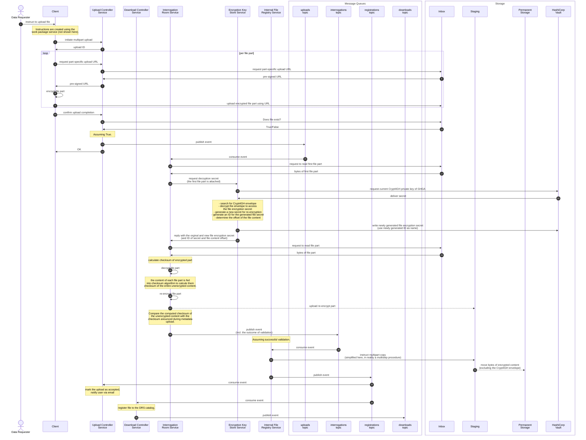
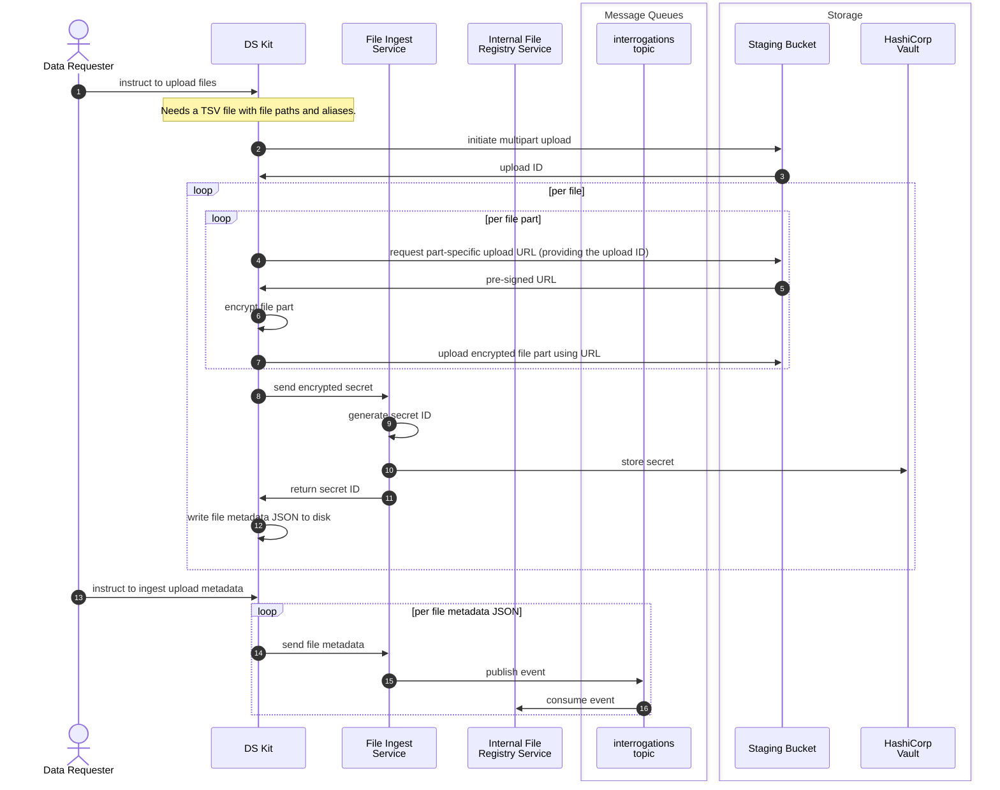
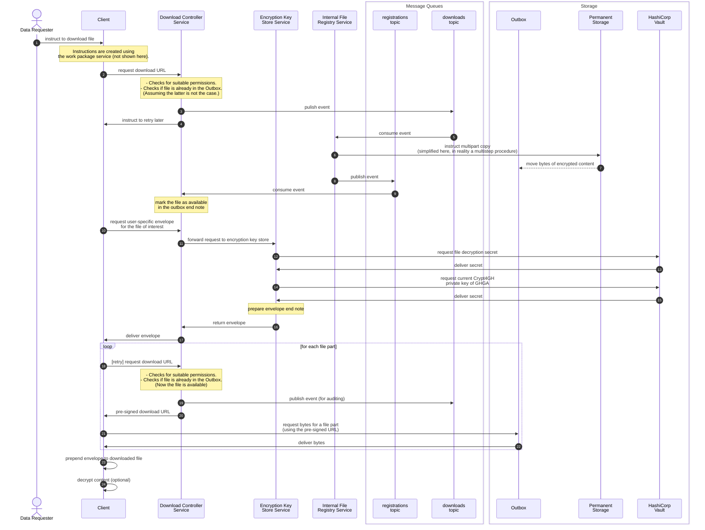
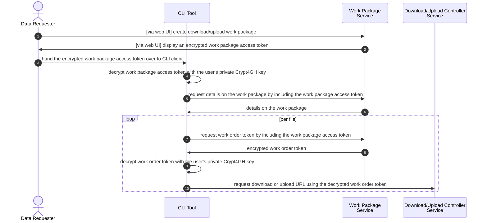

# AC-0001 — File transfer and storage

This document describes implementation details for the upload and download of Research Data.

## File upload

This section describes the two different upload paths currently envisioned in GHGA.
The first path uses the connector CLI tool and upload controller service to allow normal GHGA users to upload their files.
The second path is a preliminary solution and uses the datasteward kit and file ingest service and does not support normal user upload, i.e. the upload is done by a data steward.
In the future, the connector based upload shall replace the preliminary datasteward kit upload functionality.
This section solely describes the upload process.
For details on authorization see [Client configuration and authorization](#client-configuration-and-authorization).

### Upload via GHGA Connector

The checksums of unencrypted sensitive files are announced as part of the metadata submission.
Later, each sensitive file is encrypted on the client side using the CLI tool.
Under the hood, the CLI tool uses an existing implementation of Crypt4GH, currently Python based.
Then the CLI tool initiates a multipart upload by talking to the upload controller service.
Thereafter, the Crypt4GH object is read part by part, each part is encrypted and then uploaded to the S3-based inbox bucket using part-specific pre-signed URLs requested from the upload controller service (possibility for parallelization).
Upon completion of all part uploads, the CLI tool confirms the upload completion to the upload controller service.
The upload controller service checks for the existence of the announced file and publishes an event informing other services of the newly received upload.

This event is received by the interrogation room service.
The interrogation room service performs two tasks: Checksum validation and re-encryption.
To this end, it reacts to the event by reading the first part of the uploaded file into memory.
It is assumed that this first file part (the first sixteen megabytes) contains the entire Crypt4GH envelope at its start.
Via an HTTP request, the interrogation room service forwards this file part to the encryption key store service.
The encryption key store service searches for a Crypt4GH envelope in the provided file part and tries to decrypt it with one of the active Crypt4GH secret keys of GHGA.
This original file secret is not stored and instead a new file secret is generated and stored in HashiCorp Vault using a randomly generated ID (the encryption key store does not know which file the encryption secret belongs to).
The old and new file secret, the newly generated ID, and the start position of the encrypted content are provided as a response to the interrogation room service.
The interrogation room service downloads the encrypted content from the inbox part by part starting at the offset reported by the encryption key store service.
The interrogation room service calculates the checksum of each file part individually (these file parts are different from the original file parts because of the new offset introduced by ignoring the envelope).
Thereafter, the file part is decrypted using the original secret reported by the encryption key store service and the decrypted bytes are fed into a checksum algorithm used to calculate the checksum of the entire decrypted file (not just the individual parts).
In addition, the now decrypted file part is re-encrypted using the new secret and uploaded to an intermediate staging bucket.
The checksum calculation, decryption and re-encryption process is demonstrated in the following pseudo-code:

```python
# intialize lists used to store checksums of individual parts of the encrypted
# content:
sha_sums_encr_parts: list[str] = list()
md5_sums_encr_parts: list[str] = list()

# initialize a object used to calculate the checksum of the entire unencrypted
# content:
sha_calc_raw = hashlib.sha256()

# iterate through the encrypted bytes part by part:
for encr_part in encrypted_content:
    raw_part = decrypt(encr_part, decryption_secret)

    # feed decrypted part into the checksum calculator initialized above:
    sha_calc_raw.update(raw_part)

    # re-encrypt and upload file
    re_encrypted_part = re_encrypt_part(raw_part, new_secret)
    upload_to_staging(re_encrypted_part)

    # calculate checksum of the individual encrypted file part:
    sha_sum_encr_part = hashlib.sha256(re_encrypted_part).hexdigest()
    sha_sums_encr_parts.append(sha_sum_encr_part)
    md5_sum_encr_part = hashlib.md5(re_encrypted_part).hexdigest()
    md5_sums_encr_parts.append(md5_sum_encr_part)

# get the checksum of the raw content from the calculator:
sha_sum_raw = sha_calc_raw.hexdigest()
```

After processing the entire uploaded content, the interrogation room service compares the newly calculated checksum of the decrypted content with the checksum reported by the user upon metadata submission.
An event is published informing other services of the outcome of the validation, if applicable.
In case of an unsuccessful validation, the event is processed by the upload controller service which marks the corresponding upload as failed and publishes a corresponding message via e-mail to the user.
If the validation was successful, the event contains the checksum of the unencrypted content, the secret ID obtained from the Encryption Key Store Service, the offset of the content, the part size used by the Interrogation Room Service, and the checksums of the corresponding unencrypted parts.
This event is processed by the internal file registry service.
The service performs a multipart copy of the encrypted content from the staging bucket to an S3 bucket used for permanent storage using the same part size as the interrogation room service.
After copying, the part checksums calculated by S3 are compared with the checksums announced by the interrogation room service to ensure a complete and error-free copy.
Moreover, the service persists the essential file metadata in its private database and publishes an event informing other services of the successful registration in the permanent storage.
This event is received by the download controller service, which registers the new file in its own database (and maybe assigns a new DRS ID, see the file ID discussion below), as well as the upload controller, which marks the corresponding upload as successful and notifies the uploading user via e-mail.



### (Preliminary) Upload via Datasteward Kit

The datasteward kit splits file upload functionality into two separate parts:

1. Upload of the file object to target S3 storage
2. Populating downstream service databases

File paths and aliases chosen for those files need to be provided for the upload.
A file alias in this context is a submitter-defined identifier.
It will later be mapped to an unique accession generated for each file during the submission of file-related metadata (described elsewhere).
File data is uploaded directly to an S3 bucket that is accessible to the internal file registry service.

During the upload process each file is read in parts of a specificed size which corresponds to the part size used for the multipart upload to the configured S3 bucket.
Each part is encrypted using a common symmetric secret generated for the file and subsequently uploaded.
At the same time, checksums are computed for the encrypted parts and for the unencrypted file content.
After the encrypted file parts have been uploaded successfully, integrity is verified by downloading the file again and comparing checksums.
In case of success, the secret is exchanged for a secret ID by calling the corresponding endpoint of the file ingest service and providing the secret as base64 encoded, asymetrically encrypted payload.

The secret ID and other file related data and metadata, like checksums and file ID are written to an output JSON file identified by the chosen file alias.
In a separate, final step, these output files need to be sent to the correct file ingest service endpoint to populate downstream services with the correct data.
The file ingest services performs some necessary transformations on the received data and fires an event that the internal file registry is subscribed to.
From here on processing continues as described for the GHGA connector based upload.



## File download

This section solely describes the download process.
For details on authorization see [Client configuration and authorization](#client-configuration-and-authorization).

After a user has been granted access to a dataset of interest, the user utilizes the CLI tool to perform the download.
The CLI tool fulfills the download request by communicating with two different endpoints of the download controller service.
One of the endpoints allows to retrieve a personalized envelope, using the DRS ID of the file and the user's public key.
To this end, the download controller service contacts the encryption key stores service in a synchronous HTTP request to obtain a user-specific Crypt4GH envelope for the file of interest.
The encryption key store service will verify the permissions of the user (the user's passport or at least its access token has to be forwarded as part of the HTTP request).
It will then retrieve the corresponding file decryption secret along with the current GHGA Crypt4GH secret key from HashiCorp Vault.
Moreover, the user's public Crypt4GH key is retrieved from the service's private database (the public user keys are published by the user registry service in an event stream).
Using that information, the file encryption key store service assembles a new user-specific Crypt4GH envelope and delivers it as a response to the download controller.
The other, DRS compliant endpoint returns a short-lived pre-signed download URL (expiring after 30 seconds) for the requested file.
Using that pre-signed URL, the CLI tool downloads the file content part by part (possibility for parallelization) and saves them to the client's file system.
At service side, the following is happening for this endpoint: The download controller service receives the download request for the file of interest and checks whether the user has suitable permissions.
If the checks pass, the download controller checks whether the required file content is already present in the outbox.
If not, it publishes an event that requests the staging of the corresponding file from the internal file registry and responds to the client instructing it to retry the same request after a specified waiting period.
The internal file registry service receives the event and performs a multipart copy of the encrypted content to the outbox.
The part checksums calculated by S3 upon arrival in the outbox are compared to the checksums of encrypted parts originally determined by the interrogation room service to validate the successful copy of the content.
If the client now retries the download request, the download controller service finds the requested file in the outbox and a pre-signed URL is delivered to the client as a response to its HTTP request.
After the download is completed, the encrypted file is present on the user machine, but can not yet be decrypted.
In a separate step, the envelope is prepended to the encrypted file to produce the final file that can be decrypted using Crypt4GH, the user's private key and the current public key of GHGA.
Finally, on the client side, the content is decrypted, and its checksum is calculated and compared to the checksum announced in the metadata to validate the error-free download of the file.
With this service design, we do not need to store user-specific file copies in the outbox while still delivering full Crypt4GH objects to the client.



## Support for multiple Object Storage Locations

To allow the production deployment of GHGA to support multiple hubs at which data can be stored, all file related backend services allow to configure multiple S3 endpoints.
Each endpoint is identified by a chosen, fixed alias.
The only exception to this is the file ingest service used in the datasteward kit upload.
While the file ingest service does not communicate with S3-compatible object storage, the storage alias of data uploaded in this way still needs to be propagated to downstream services to address the correct storage node.

This imposes a limitation on the preliminary upload path as all incoming file metadata is modified to use the storage alias configured for the file ingest service and special care needs to be taken to ensure this assumption holds.
If a different storage location is populated using this upload path, the file ingest service needs to be reconfigured and restarted or another instance needs to be deployed.

As mentioned previously, storage aliases are chosen and fixed.
Furthermore, configuration across services has to match exactly with regard to which storage alias points to which S3 endpoint.
This means all database entries in a service store the storage alias in addition to all other necessary data to be able to address the the storage location.
This allows for data to be migrated to a new location with only the endpoint configuration addressed by the storage alias needing change.
Partial migrations and changing the alias after the fact is not supported.
Inconsistencies between actual storage location and the stored alias will lead to critical exceptions when an affected object is accessed.

## File Data Deletion

To be able to support possible file deletion requests according to GDPR, an additional service dedicated to this functionality has been created, the purge controller service (PCS).
An internal endpoint only usable by data stewards is provided by this service that expects as payload the file ID for which all information stored in the file backend services shall be deleted.
In addition, a token needs to be provided to authorize the file deletion request.
Functionality to make a call to the PCS endpoint is implemented in the `delete_file` command of the datasteward kit.

As a response to a valid request, the PCS fires a `FileDeletionRequested` event that all file backend services holding relevant data are subscribed to.
As response to this event, all services remove data pertaining to the file ID from both their databases as well as removing the actual (encrypted) file data from their object storage bucket.
Furthermore, the symmetric file secret stored in the vault is also removed, rendering remaining file data unencryptable.

If transient errors are encountered during this deletion process in any service, the call to the PCS endpoint can be repeated.
Full deletion is guarantueed after the backup retention period is reached and file content cannot be recovered once no vault backup contains the file secret.

## The lifetime of Pre-signed S3 URLs

Pre-signed URLs may have a long lifetime (in the order of days) because there is no possibility to directly retrieve sensitive data from a leaked URL:

- Pre-signed upload URLs can generally not be used to retrieve sensitive data.
  A leaked URL might only be used to corrupt an ongoing upload by depositing unexpected bytes.
  This corruption will however be detected by our system upon checksum calculation.
  Thus the upload would be rejected.
- In case of a stolen download URL, the attacker would only be able to download encrypted bytes.
  They would not be able to decrypt these bytes without the secret key of the intended recipient.
  This key is however never shared across public networks.
  Thus the likelihood that this secret key is stolen is very small as well.

## Client configuration and authorization

To make using the CLI tool as easy as possible, the so-called work package service together with a corresponding web UI provides assistance.
Users can log into the web UI to create new so-called upload or download work packages which are managed by the work package service.
Each work package is linked to the following information:

- The list of files to be up- or downloaded
- The user's identity (the internal user ID)
- The user's public Crypt4GH key to use

In the web UI, the user selects the files and pastes their Crypt4GH public key to create a new work package.
The work package service verifies that the user has access to the selected files via the standard authorization mechanism that is explained in [AC-0003](ac-0003-authentication-and-authorization.md).
If the verification succeeds, the service responds to the frontend with a so-called work package access token that is linked to the work package.
The work package access token is a random alphanumeric string and has a lifetime that is long enough to complete the upload or download of all corresponding files (in the order of days or even months).
The token is only displayed to the user once in an encrypted state so that only the holder of the user's private Crypt4GH key can decrypt it.
A hash of the token is stored by the work package service together with its expiration date.
The user passes the encrypted work package access token to the CLI tool by pasting it onto the command line.
The CLI tool may cache the encrypted work package access token on the local file system to resume the upload or download in case it is interrupted.
In the first step, the CLI tool decrypts the work package access token and uses it to contact the work package service to get details on the work package.
The CLI tool will continue with the download or upload of the files listed in the work package.
To authenticate for the upload or download of a single file, the CLI client contacts the work order token service by presenting the work package access token along with the intent of downloading or uploading a single file listed in the work package.
The work package service again verifies that the user has access to the specified file to make sure that the access has not been revoked by the data access committee in the meantime.
If the validation succeeds, the work package service prepares a so-called work order token.
This token is a JWT that documents the intent to upload or download a file, the identity of the user, as well as the user's public Crypt4GH key.
The token is signed by the work package service and has a short lifetime (in the range of seconds).
Before sending the work order token back to the client, the work package service encrypts the token so that only the holder of the user's private Crypt4GH key can decrypt it.
The CLI client uses the user's private Crypt4GH key to decrypt the work order token.
Finally, the CLI client uses the work order token to authorize a request for a pre-signed URL to upload or download the corresponding file directly to or from the S3 storage system.

> [!NOTE]
> The holder of the work package access token is assumed to be the user associated with the work package.
> The user's private Crypt4GH key is used as a second factor to secure the long-lived work package access token.



## Crypt4GH Key Generation and Distribution

Secret Crypt4GH keys should never be transferred over the network between devices (a shared network drive for instance in a compute cluster maybe be an exception) to prevent leakage of the key.
Users should create a key pair per device and are thus allowed to have multiple active key pairs.
The users' public keys are only communicated to GHGA on demand, for instance, when creating a new work package (see above).
Crypt4Gh key pairs of GHGA are generated by the encryption key store service.
Thereby, secret keys are stored in HashiCorp Vault.
Public keys are stored in the service's database and are broadcasted to other services using an event stream.
This event stream is for instance received by the work package service.
To allow for rolling updates of the key pair, GHGA has to maintain multiple active key pairs.
Thereby the key pair that was generated last should be seen as the recommended one.
However, older key pairs might still be used for a limited amount of time for instance during file upload.
The decision of when to deprecate an old key pair remains with the encryption key store service.
In such an automated system, key pairs can be updated frequently (for instance every day).

## File Identifiers

Two different file identifiers are used across the file services: The file ID and the object ID.
The file ID is used in communication across the services and corresponds to the upload ID from the metadata-service and to the DRS ID and is thus also the public facing ID.
Therefore, the DRS URI contains both the file ID (as DRS ID) and the location of the file (the DRS hostname).
The object ID takes the form of version 4 UUID, is used to identify the S3 object corresponding to a file id and is used purely internally.

## Checksum Algorithm

We have evaluated all checksum algorithms currently supported by S3, including MD5, SHA-1, SHA-256, and CRC-based solutions.
The criteria were speed on large content, support, collision probability, and security:

- **Security:** MD5 and SHA-1 are considered too weak.
  CRC-based algorithms are generally not applicable to sensitive data, as they are not guaranteed to work as a one-way function.
- **Collision probability:** SHA-256 can be seen as effectively collision-free.
- **Support:** SHA-256 is widely supported: by S3, by `hashlib` in Python's standard library, by the tools built into most Linux distributions, and by Local EGA for file integrity checking.
- **Speed:** remains to be benchmarked with the relevant implementations.

We have decided to use SHA-256, as this is the only option that provides sufficient cryptographic protection against inferring details on the hashed content from the checksum.
For backwards compatibility with different S3 implementations, part checksums in MD5 format are provided for validation of internal multipart copy operations.
