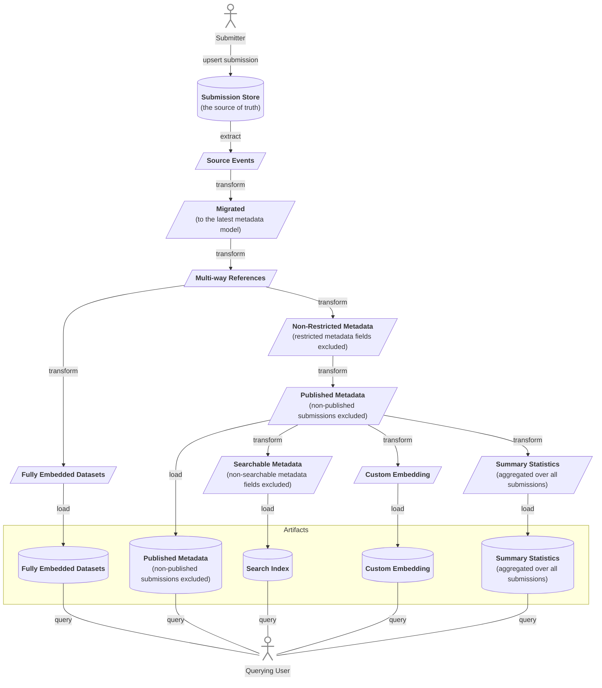

# AC-0002 — Metadata lifecycle

This document discusses general concepts for handling metadata.
It discusses the full lifecycle of metadata including its submission, modification, and deletion.
Moreover, it gives examples of which metadata representations (artifacts) might be needed and explains the principles of how they can be derived.
The proposed concepts are defined following the boundaries and assumptions that were outlined in GRFC002 (Metadata Lifecycle).
This document is restricted to the life cycle of the metadata.
It does not discuss the implications of metadata changes for file and permission management.

## One Write and Multiple Read Representations

Instead of having just a single copy of metadata in a database that supports all CRUD actions needed by all the different user groups, we propose to follow the CQRS pattern by having one representation that is optimized for write operations and multiple use case-specific representations for querying metadata.
Thereby, the write-specific representation is the source of truth and fuels all read-specific representations through an ETL process.
In the following, the read-specific representations are referred to as artifacts.

This setup with one write and multiple read representation has the following advantages:

- Different subsets of the entire metadata catalog can be prepared with the needs and the permissions of different user audiences in mind.
- It allows for independent scalability of read and write operations.
- The metadata can be packaged in multiple different formats required and optimized for different technologies and use cases, such as indexed searching with ElasticSearch vs. REST or GraphQL queries supported by MongoDB.
- Complex write-optimized representations, which are inconvenient for querying such as event histories, can be used as the source of truth.
- Often used metadata aggregations and summary statistics can be precomputed leading to increased performance.
- Artifacts may contain rich annotations that are not immediately available in the write-specific representation.
  For instance, the write-specific representation may only contain one-way relationships between metadata elements (e.g. a sample might define a `has_experiment` attribute, while an experiment defines no `has_sample` attribute), however, an artifact may contain two-way relationships (e.g. a sample defines a `has_experiment` attribute and an experiment defines a `has_sample` attribute).

However, there are also disadvantages that are linked to this setup that should be considered:

- The write and read representations are only eventually consistent.
- Adds more complexity to the backend compared with a CRUD setup (while reducing complexity for clients)

## Submission-centric Store as The Source of Truth

In the write-specific representation, metadata is packaged into submissions.
Each submission is fully self-contained and linking between metadata of different submissions is not possible.
A submission can have one of the following statuses:

- __pending__ the construction of the submission is in progress, the submitter may still change its content.
- __in-review__ the submitter declared the submission as complete and is waiting for it to be reviewed, however, both the submitter and the reviewer can set this submission back to pending to enable further changes.
- __canceled__ the submission was canceled before its completion, its content was deleted.
- __completed__ the submission has been reviewed and approved, the content of the submission is frozen, and accessions are generated for all relevant metadata elements.
- __deprecated-prepublication__ the submission was deprecated before being published and it cannot be published anymore, however, its content is not deleted from the system.
- __emptied-prepublication__ the submission was deprecated and its content was deleted from the system prior to publication, however, the accessions are not deleted.
- __published__ the submission was made available to other users.
- __deprecated-postpublication__ the submission was deprecated and it should not be used anymore, however, its content stays available to users.
- __hidden-postpublication__ the submission was deprecated and its content is hidden from users but it is not deleted from the system, the accessions stay available, the submission can be set to deprecated-postpublication to make its content available again.
- __emptied-postpublication__ the submission was deprecated and its content was deleted from the system, however, the accessions stay available.

The following status transitions are allowed:

- pending → in-review
- pending → canceled
- in-review → completed
- in-review → canceled
- in-review → pending
- completed → published
- completed → deprecated-prepublication
- completed → emptied-prepublication
- deprecated-prepublication → emptied-prepublication
- published → deprecated-postpublication
- published → hidden-postpublication
- published → emptied-postpublication
- deprecated-postpublication → hidden-postpublication
- deprecated-postpublication → emptied-postpublication
- hidden-postpublication → deprecated-postpublication
- hidden-postpublication → emptied-postpublication

A deprecated submission may or may not be succeeded by a new submission.
Thereby, the new submission may reuse (a part of) the metadata from the deprecated submission.
The reused metadata including the already existing accessions is copied over to the new submission so that the contents of the deprecated submission and the new submission can be handled independently, for instance, the deprecated submission being emptied.

> [!NOTE]
> Only pending and completed are set today: the other statuses are defined but never used, and no submission replaces another yet ([AC-0008](ac-0008-metadata-and-file-journeys.md#the-submission-object--store)).
> [Epic 0093](../epics/epic-0093-giraffe.md) changes this.

## Event Sourcing to Generate Artifacts

To implement the ETL processes that generate read-specific artifacts from the write-specific representation explained above, we propose an event-sourcing mechanism.

The creation and each status change of a given submission (and accommodating changes to the submission's content) are translated into events.
The events are cumulative and idempotent so you only have to consume the latest event for a given submission in order to get the latest state of that submission and a replay of the events will lead to the same result.
Thus, the event history only needs to keep the latest event for each submission as implemented in the compacted topics offered by Apache Kafka.

Moreover, since submissions are self-contained and do not depend on the content of other submissions, events of different submissions can be processed independently.

Multiple transformations (as in the ETL pattern) are applied to these so-called source events to generate altered metadata representations that are in turn published as events.
These derived events can be again subjected to further transformations.

Finally, the derived events are subject to load operations (as in the ETL pattern) that aggregate the events and bring them into queryable format (an artifact) that is accessible to users through an API.

## Metadata Modeling

Structural metadata requirements are modeled using [schemapack](https://github.com/ghga-de/schemapack).
Thereby, mutliple models might co-exist.
This allows to have different models for different purposes.
E.g. different models for might be used for different data types.
New models for new use cases can be added at any time.
Moreover, the multi-model support also allows to have mutliple versions of the same model (whereby each version is represented as an independent model).
This allowing models to evolve without requiring changes to already submitted metadata.

Manually defined metadata models always describe the structure of metadata upon submission.
Based on these models, further models are derived as part of the transformation process that describe artifacts.

## Transformation Workflows

Transformation workflows consist of a directed acyclic graph of transformation steps.
Each step is an imperative instruction of how to mutate the input.
A transformation workflow outputs one ore more artifacts.

While a transformation workflow is not necessarily specific to a model.
Each transformation step (and thus the workflow as a whole) defines requirements regarding the input model that must be matched for the transformation to be applicable.
Thus, not all transformation workflows work with all models or the transformation workflow can only be partially executed so that only a subset of the artifacts potentially produced by the workflow are available for the given model.

There are two options to produce equivalent artifacts from different models: (1) Provide transformation workflows with enough inherent flexibility to support the different models.
(2) Provide multiple transformations workflows for different models that result in equivalent artifacts.

## Example Transformations and Artifacts

The following figure lists examples of transformations and resulting artifacts that might be useful.

## Extendability

The proposed ETL-based setup can be implemented incrementally.
Once the submission store, which acts as the source of truth is implemented, the generation of artifacts can be added step by step.
This allows a fine-grained prioritization of planned features as well as adapting to newly upcoming use cases.
