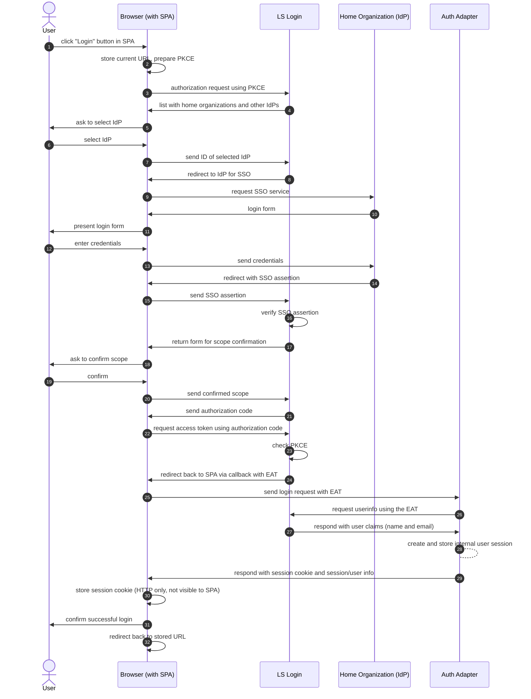
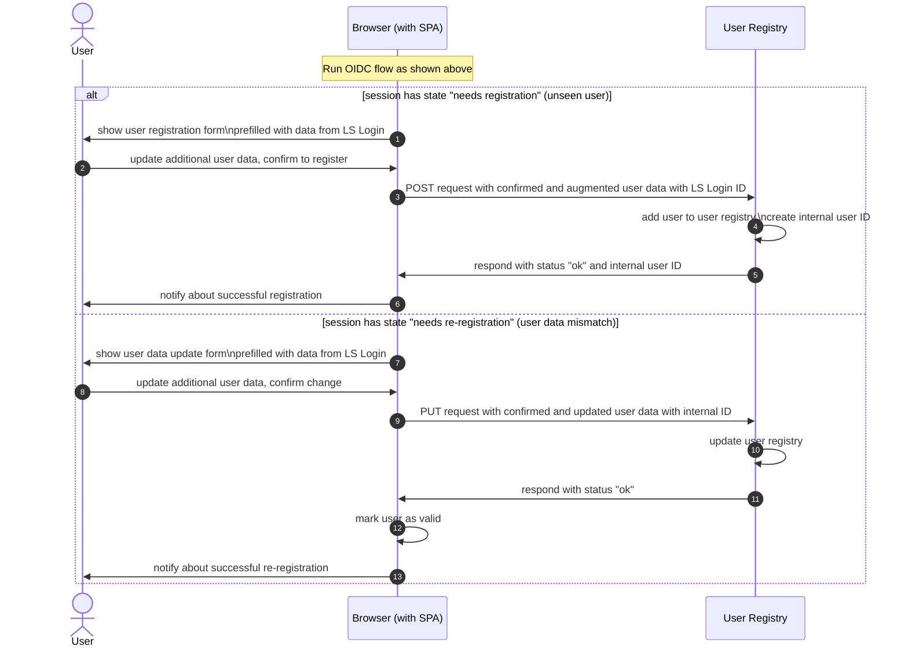
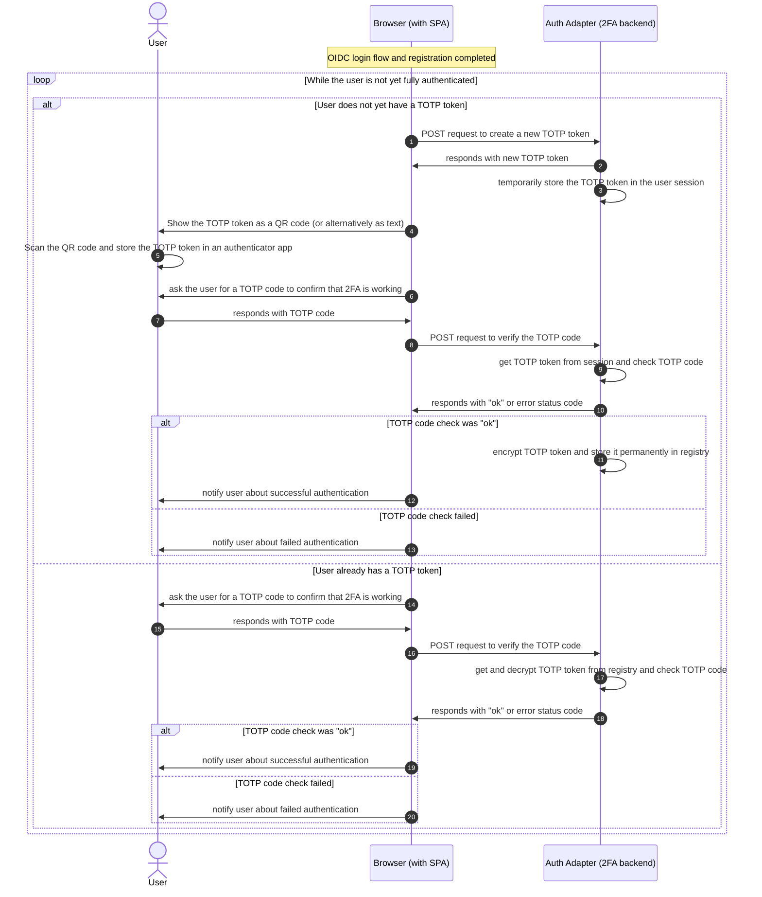
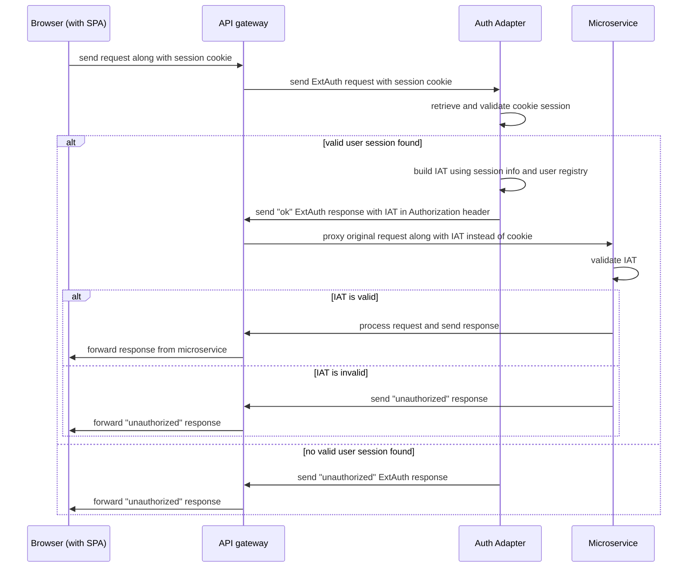
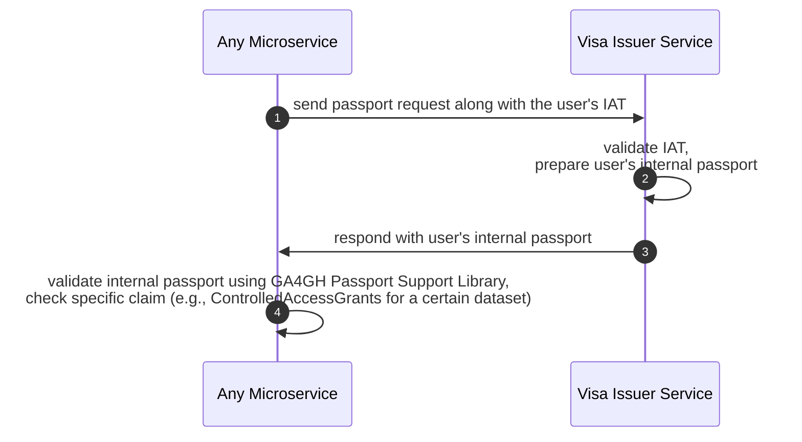

# AC-0003 — Authentication and authorization

This document describes how users (researchers accessing the GHGA data portal UI) are authenticated and authorized to use the provided services.

The concept for Authentication and Authorization is based on four pillars:

1. [LS Login](https://lifescience-ri.eu/ls-login/) (Life Science Login, aka LS AAI), which is the federated authentication service from EOSC-Life,

2. the [GA4GH Passport standard](https://github.com/ga4gh-duri/ga4gh-duri.github.io/blob/master/researcher_ids/ga4gh_passport_v1.md), which integrates well with GHGA's Kubernetes-powered microservices infrastructure and zero trust security model

3. using a [TOTP (Time-based One-Time Password)](https://datatracker.ietf.org/doc/html/rfc6238) as a second factor for authentication, (2FA) which is an established Internet standard, and

4. using an Independent Verification Address (IVA) as a way to securely identify a user independently of their LS Login account, and binding GA4GH claims to IVAs.

The last two pillars are covered in more detail in the GHGA white paper on Two-Factor Authentication and Identity Verification Enablement.

## The GA4GH Passport standard

The GA4GH Passport standard defines a machine-readable digital identity that conveys and describes roles and data access permissions ("Visas") for individual users.
Currently, Visas are used only internally where we are using the following Visa types:

- Standard:

  - `ControlledAccessGrants`

    for granting download access for individual datasets to users,

    with values `https://ghga.de/datasets/{accession}`

- Custom:

  - `https://www.ghga.de/GA4GH/VisaTypes/Role/v1.0`

    for assigning GHGA roles to users,

    with value `data_steward@ghga.de`

  - `https://www.ghga.de/GA4GH/VisaTypes/Upload/v1.0`

    for granting upload access for individual research data upload boxes to users,

    with values `https://ghga.de/upload/{box-id}`

The concept of GA4GH Passports would also allow us to consume Visas (e.g., of type `AffiliationAndRole`) from LS Login or to emit Visas for external consumption, and we may consider that when integrating GHGA into the Federated EGA.

## OIDC Flow with LS Login

The following diagram gives a rough overview of the [OpenID Connect](https://openid.net/connect/) (OIDC) flow used to authenticate a researcher as a user of the [GHGA Data Portal](https://data.ghga.de/) single page application (SPA) running in the web browser.

The actual authentication is done using an identity provider (IdP) selected by the user that is supported by LS Login.
This is usually the home organization of the user (e.g., the DKFZ), but LS Login also supports Google, Apple, ORCID or its own "Hostel Login" with LS username and corresponding password.
No user passwords are stored in GHGA.

The diagram assumes that the user is already registered with LS Login before interacting with our system.
This can be done explicitly using the "LS Register" service, or LS Login will ask the user to register if they log in for the first time.

The result of the OIDC flow is an access token that allows retrieving some claims about the user via the userinfo endpoint of LS Login.
We refer to this access token as the "external access token" (EAT) since we are not using it directly in our backend services.
Instead, an internal service that we call "Auth Adapter" will provide a GHGA-specific "internal access token" (IAT) to the backend services for authentication when the Auth Adapter recognizes that a user was successfully logged in using a valid EAT.

The EAT is a JSON Web Token (JWT) which is signed with a private key of LS Login.
This allows to verify the authenticity of the token using the corresponding public key of LS Login which is accessible in a key set using a well-known endpoint.

The EAT provided by LS Login contains the user's LS Login ID (in the "sub" claim), but no further claims about the user like name and email address.
These additional claims have to be retrieved from the userinfo endpoint, using the EAT in the authorization header.
The EAT also has an expiry date (currently the expiration time is one hour).

In the future, however, we may want to fetch additional information about the user from the userinfo endpoint of LS Login, which can be requested using additional OIDC scopes, in particular the scope for GA4GH Passports.
A [list of available attributes](https://docs.google.com/document/d/1N8naf9Oaams0S1f6S8igXVm2HjY6fyvwRaggN_5MsrY/) that can be received via LS Login is provided as part of the LS Login [Documentation for Relying Parties](https://lifescience-ri.eu/ls-login/relying-parties/how-to-register-and-integrate-a-relying-party-to-ls-login.html).

After this process, users are logged in with their first factor (their LS Login account), but not yet fully authenticated.
A TOTP token is required as their second factor, as described in the next section.

LS Login can optionally remember requested data from user input forms using a cookie-based session or user profile settings; the corresponding prompts will be skipped on subsequent logins.

For preview deployments of the GHGA Data Portal that should not be publicly accessible, we require Basic access authentication in addition to LS Login.
This also covers pages that are normally public in the Data Portal and do not require any form of login.
When the `Authorization` header is already used for Basic authentication, we pass the EAT in the `X-Authorization` header instead.

After this login process, authentication relies only on the session cookie provided by the Auth Adapter.
The EAT will no longer be passed around, which makes the process more secure, since the session cookie is an HTTP-only cookie that is not accessible to JavaScript running in the browser.
In the future, we want to move the OIDC login flow completely to our backend, so that the EAT will never be seen by the web browser, even during the login process.

In other words, the Auth Adapter also takes the role of an "auth backend-for-frontend".
We discarded alternative approaches to mitigate the limitation of access tokens, particularly regarding the extension of their lifetime.
Silent renewal caused cross-origin issues with inline frames, and X-Frame-Options headers were missing in LS Login.
Using refresh tokens, even with measures like using web workers or refresh token rotation, is also less secure, since all of these approaches require keeping a token somewhere in the browser.

## User sessions

User sessions are stored in the backend, and session state and information such as the user name are passed to the frontend when the user logs in and then also kept in the frontend.

Currently, the session backend is implemented as part of the Auth Adapter and stored in memory.
We are planning to store the sessions in a separate backend for scalability and stability, and to be able to remove sessions immediately when users are deactivated.

The Auth Adapter also provides a logout endpoint that completely removes the user session from the backend.

## User registration

After a user is logged in as above, the frontend checks the state of the user session information provided by the backend.
In the case that a user is seen for the first time, the state will be "needs registration".
If the user had been registered already, but the user information is different from what was provided by LS Login in the OIDC login flow, the state will be "needs re-registration".

In both cases, the user will be asked to confirm the user information provided by LS Login and entering some minimal additional user data (currently only the academic title of the user).

## Logging in via TOTP as second factor

After the login and making sure the user is properly registered, the frontend checks whether the user already has set up a TOTP token as a second factor for authentication.
If this is the case, the user is asked to log in using a TOTP code.
Otherwise, a new TOTP token is created for the user and presented to the user for future use.

## Internal token generation via Auth Adapter

The microservice infrastructure of GHGA is deployed in a Kubernetes cluster, and its public APIs are made accessible via an API gateway.
Using an API gateway has many benefits.
It decouples the clients (e.g., the Data Portal running in the browser or the CLI client) from the backend implementation, can support authentication and provide coarse-grained authorization, stabilization and load balancing, rate limiting, monitoring, logging, analytics, etc.

We use the API gateway here also to decouple the OIDC authentication mechanism as well as the choice of OIDC provider from the authentication that needs to happen in individual microservices.
Once the user is logged in, the Auth Adapter uses a cookie-based session to remember authenticated users and their authentication state.
This also allows user sessions to have a different expiration from what is specified in the external authentication token, and removes the need for a mechanism to create refresh tokens and to store tokens in the frontend, which can be a surface for XSS attacks.

To this end, we use the [external authorization](https://gateway.envoyproxy.io/docs/tasks/security/ext-auth/) (ExtAuth) protocol to validate both the external access token (EAT) passed once during the login process, and the session cookie passed by logged in users with every request, and in case of a successful authentication, create an internal access token (IAT) that contains the basic and internally relevant information necessary for a microservice to identify a user and their internal roles.
The ExtAuth protocol is used by the API gateway to ask the Auth Adapter whether a user is authenticated and to alter request headers in that case, replacing the EAT Authorization header or Cookie header with an IAT Authorization header.
The Auth Adapter is developed by GHGA and deployed as a microservice running in the Kubernetes cluster.

The advantage of using an IAT is that the microservices only get the necessary information to identify the user (data minimization).
They do not need to know about the specifics of the EAT and how to validate it (decoupling), and even if the IAT leaks, it cannot be used from outside, because the API gateway ignores it on ingress (security).
Also, a request to a protected endpoint with an invalid EAT or session cookie will already be rejected by the Auth Adapter and will never reach the internal services.

The IAT can also be augmented with useful data that is not provided by LS Login (like the internal role or the academic title of the user).
The SPA never sees or uses the IAT, and IAT creation and consumption happens transparently to requests from outside.
Another advantage of using IATs is that it allows testing microservices that require authentication more easily, since arbitrary IATs for testing can be easily created, whereas EATs can only be produced for existing accounts using LS Login.
Yet another advantage is that the lifetime of the IAT can be made shorter than the lifetime of the EAT or the session cookie.

The following diagram shows roughly how the IAT generation happens when a request to a microservice API endpoint that requires authentication is made.
In the case that the EAT is invalid, the Auth Adapter sends an error status code in the response to the API Gateway, which will then reject the request with the same error status code.
In the case that the microservice cannot validate the IAT, it responds with an authorization error status code which is then proxied to the SPA.

## Internal Access Tokens

The internal access token (IAT) normally contains the GHGA internal user ID, the user status (essentially "active" or "inactive"), the user's name and email address, the user's academic title for properly addressing the user in email, the internal roles (e.g., "data steward") (if any) and an expiration date.
If the user is not yet registered in GHGA, the user's LS Login ID instead of the (not yet existing) internal user ID will be passed in the internal token to the user registration and user info endpoints of the GHGA user registry.
When the user registers with GHGA, the user's name, email and academic title are stored along with the user's LS Login ID, and a newly created internal user ID.
Upon registration, the user status will be automatically set to "active" without approval by a data steward.
However, a data steward can set the user status to "inactive", and this status can only be reset to "active" by a data steward again.
The user status in the token might also be set to "invalid" if the user's name or email as registered in GHGA differ from the user's name or email as provided by LS Login.
In this case the user must first confirm the change, thereby updating the data in the GHGA user registry.

For the validation of IATs, a GHGA internal key pair is generated.
The private key is provided to the Auth Adapter, and the public key is provided to all microservices that require authentication.
In order to validate an IAT, the microservice must check the signature of the JWT using the GHGA internal public key and also check that the user status is "active."

## Authorization using the Visa Issuer

In case a microservice needs more fine-grained authorization beyond checking the user's internal registration status and role, like if the microservice needs to give access to a certain dataset, it must request the user's internal GA4GH Passport using an internal Visa Issuer service.
This is done in a synchronous request as follows:

The GA4GH Passport Support Library provides capabilities to validate GA4GH Passports and check individual claims and conditions.

As a shortcut, until the GA4GH Passport Support Library and the Visa Issuer Service are implemented, the already implemented Claims Repository will provide additional custom endpoints to check data access for a given GHGA dataset or research data upload box in a simpler way.

## Visa Revocation

Visa objects can be revoked at any time.
To implement this, we follow these guidelines:

- Visa revocation happens by removing or terminating certain visa objects from the claims repository.
- When requested from the Visa Issuer, no Visa Token will be returned.
- Existing Visa tokens cannot be revoked; their lifetime should be reasonably short (e.g., 1 hour).
- Visas should not be passed between services; they should contact the Visa Issuer directly.
- Visas are sent by the Visa Issuer using the "visa document token format."
- For long-running tasks (several hours or days), Visas should not only be requested and validated at the beginning of the task, but also at the end, before returning results to the user (and optionally at intermediate steps of a workflow).
