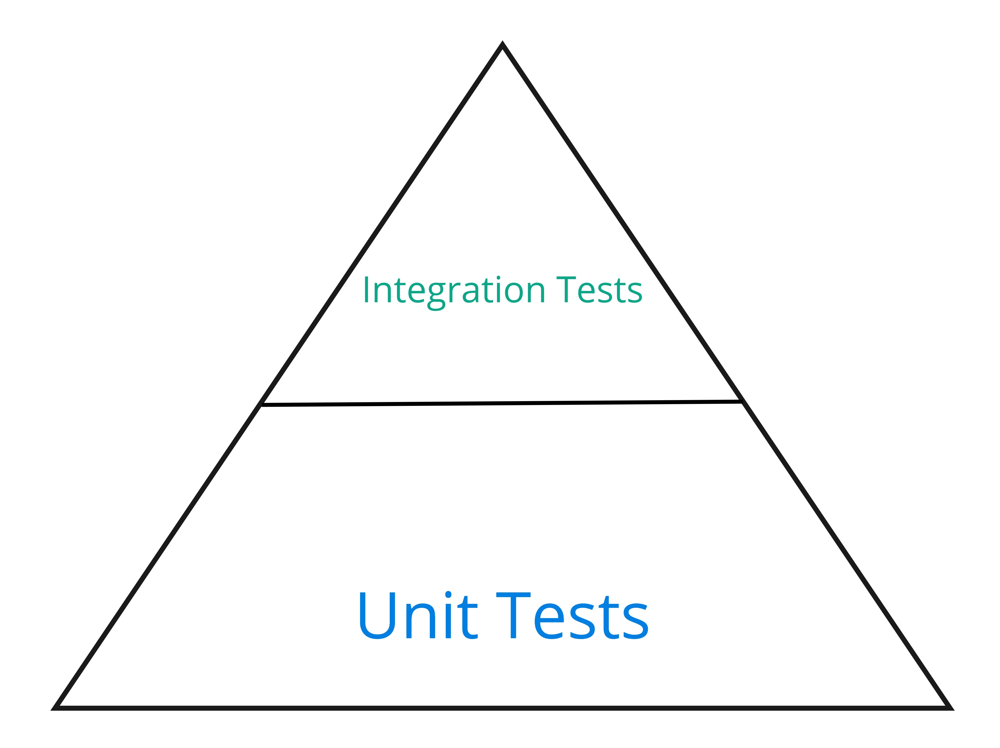
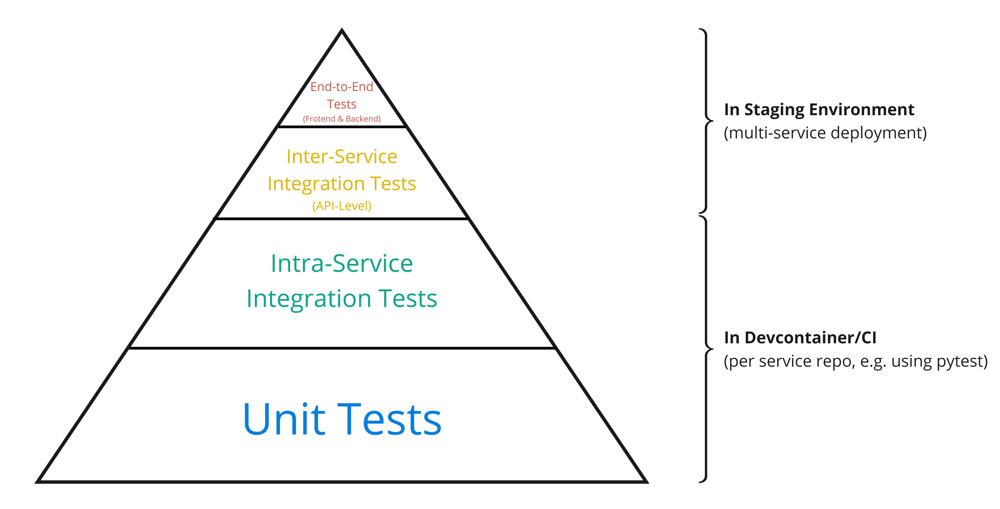

# AC-0005 — Testing strategy

## Making Code Unit Testable

Unit tests should test each component of your code, i.e. a function or a class, in isolation.
To make that possible, all external dependencies of a component (function/class) should be injected as input arguments.
This is not only true for dependencies coming from external packages, but also for dependencies coming from the same code base.

By doing so, while testing, a mock or a test-specific implementation of the dependencies can be injected into the class.

### Example

Consider the following example:

```python
import os
import json
from kafka import KafkaProducer


def create_user(user_name: str, email: str, password: str):
    """Create a new user account."""

    user_dao = UserDAO()

    if user_dao.does_user_exist(user_name=user_name):
        raise RuntimeError(f"User with name '{user_name}' does already exist.")

    user_dao.save_new_user(user_name=user_name, email=email, password=password)

    event_publisher = EventPublisher(
        kafka_server=os.environ["KAFKA_SERVER"], client_id=os.environ["KAFKA_CLIENT_ID"]
    )
    event_publisher.publish_user_created(user_name=user_name, email=email)


class UserDAO:
    """A DAO for interacting with user account entries in the database."""

    def does_user_exist(self, user_name: str) -> bool:
        """Check if a user with the given name already exists."""
        ...  # implementation goes here (skipped in this example)

    def save_new_user(self, user_name: str, email: str, password: str) -> None:
        """Saves the details on a new user account."""
        ...  # implementation goes here (skipped in this example)


class EventPublisher:
    """Publishing events."""

    def __init__(self, kafka_server: str, client_id: str):
        """Initialize"""

        self._producer = KafkaProducer(
            bootstrap_servers=kafka_server,
            client_id=client_id,
            key_serializer=lambda event_key: event_key.encode("ascii"),
            value_serializer=lambda event_value: json.dumps(event_value).encode(
                "ascii"
            ),
        )

    def publish_user_created(self, user_name: str, email: str):
        """Publish an event informing on the newly created user."""

        payload = {
            "type": "user_created",
            "user_name": user_name,
            "email": email,
        }

        self._producer.send("users", key=user_name, value=payload)
```

There is a function `create_user` that is called to create a new user account.
Internally, this function is first using an instance of a `UserDAO` to make sure that the specified user name is not already in the database.
Then it is saving the new user account to the database, again using the DAO.
Finally, it publishes an event using an instance of `EventPublisher` class to inform other services of the newly created user account.

This code is highly problematic for multiple reasons:

(1) The `create_user` function is tightly coupled to the `UserDAO` and the `EventPublisher` classes.
Moreover, the `EventPublisher` is tightly coupled to the `KafkaProducer` class imported from the `kafka` client library.
So it is impossible to test the `create_user` and `EventPublisher` components in isolation from their dependencies.

(2) The `create_user` function has the responsibility to construct instances of the `UserDAO` and the `EventPublisher` classes.
Especially, in case of the `EventPublisher`, that was problematic since the create_user function has to decide on the `kafka_server` and `client_id` arguments which doesn't naturally fit into the scope/role of this function.

Both issues can be addressed by injecting dependencies as demonstrated in the following code:

```python
import os
import json
from kafka import KafkaProducer


def create_user(
    user_name: str,
    email: str,
    password: str,
    user_dao: UserDAO,
    event_publisher: EventPublisher,
):
    """Create a new user account."""

    if user_dao.does_user_exist(user_name=user_name):
        raise RuntimeError(f"User with name '{user_name}' does already exist.")

    user_dao.save_new_user(user_name=user_name, email=email, password=password)

    event_publisher.publish_user_created(user_name=user_name, email=email)


class UserDAO:
    """A DAO for interacting with user account entries in the database."""

    def does_user_exist(self, user_name: str) -> bool:
        """Check if a user with the given name already exists."""
        ...  # implementation goes here (skipped in this example)

    def save_new_user(self, user_name: str, email: str, password: str) -> None:
        """Saves the details on a new user account."""
        ...  # implementation goes here (skipped in this example)


class EventPublisher:
    """Publishing events."""

    def __init__(
        self, kafka_server: str, client_id: str, kafka_producer_cls=KafkaProducer
    ):
        """Initialize"""

        self._producer = kafka_producer_cls(
            bootstrap_servers=kafka_server,
            client_id=client_id,
            key_serializer=lambda event_key: event_key.encode("ascii"),
            value_serializer=lambda event_value: json.dumps(event_value).encode(
                "ascii"
            ),
        )

    def publish_user_created(self, user_name: str, email: str):
        """Publish an event informing on the newly created user."""

        payload = {
            "type": "user_created",
            "user_name": user_name,
            "email": email,
        }

        self._producer.send("users", key=user_name, value=payload)
```

In this improved version, instantiated objects of the `UserDAO` and the `EventPublisher` are injected into the `create_user` function as arguments.
During testing, these dependencies can now be replaced with mocks or test-specific implementation thus allowing for truly isolated unit tests.

Moreover, the create_user function doesn't have to handle the burden of constructing/instantiating the dependencies anymore.
The construction of dependencies can now be outsourced e.g. to a dependency injection framework such as [dependency_injector](https://python-dependency-injector.ets-labs.org/).

Sometimes it is not useful or possible to outsource the dependency instantiation.
In that case, instead of injecting the instantiated dependency objects, corresponding classes can be injected as demonstrated by the `kafka_producer_cls` argument of the `EventPublisher`.

## Testing Libraries



**Figure 1: Testing pyramid for library development.**

Functionality that is not bound to a specific service (and is used across services) should go into a service-independent library.
I.e. a package that cannot be deployed on its own.
For testing such libraries, there are only two layers to distinguish: unit and integration testing.

Unit tests should happen in complete isolation from external libraries and technologies.
As outlined above, dependency injection might be helpful.
Unit tests should cover all edge cases, e.g. all conditions that result in specific exceptions shall be tested.
A 100 % code coverage is anticipated.

By contrast, integration testing should explicitly make use of external dependencies and should try to be as close as possible to the eventual runtime environment and technologies.
E.g. real databases, event brokers, object storages, etc. should be used during integration testing.
The [testcontainers-python](https://github.com/testcontainers/testcontainers-python) package might help with the setup and teardown of these infrastructure dependencies.
Generally, integration tests mostly check the behavior of the codebase in standard usage scenarios, it is typically not required to cover all edge cases.

Both unit and integration tests should be packaged inside the git repository of the library so that they can be easily run locally in a `.devcontainer` environment and automatically in CI (specifically GitHub Actions).
For testing of Python code, the `pytest` framework shall be used.

## Testing Services



**Figure 2: Testing pyramid for service development.**

The unit and integration test guidelines outlined for testing libraries also apply to testing services.
Again, unit testing should focus on individual code components (functions/classes) in isolation.
Integration testing should integrate components of a service's codebase.
Thereby, a special focus should be set on checking the compliance of the codebase with the agreed-upon service API.
Importantly, while performing these API tests, other services should be mocked.
It should be avoided by all means that service-level integration tests use actual implementations of other services.

However, in addition to these git repository-bounded tests that are running in local `.devcontainer` or CI environments, services testing also include two additional layers: inter-service integration tests as well as end-to-end tests.
These additional test layers are not bound to specific services or repositories but are integrating across multiple codebases.
Thus, these tests are executed in a "staging" environment where multiple services are deployed to.
This staging environment should be as similar as possible to the actual production environment.

Inter-service integration tests ensure that the services communicate correctly with each other and with the production-like infrastructure.
These tests can be realized via scripts that execute a sequence of requests against the multi-service API landscape.
Thereby, it is intended to mimic different user journeys without involving the front end.
In addition to the anticipated usage of the system, these tests should also make sure that misuse (intentionally or accidentally) of our system is prevented.

End-to-end tests are similar to inter-service integration tests as they should mimic user journeys, too.
However, end-to-end tests start at the front end instead of the API level.
Since these tests are associated with a high implementation cost, they should only check selected anticipated user journeys.
They should be seen as basic smoke tests that check whether the overall user experience is working without going into much detail.

### Triple Hexagonal Components

Special testing guidelines apply to code that involves triple hexagonal components.
Thereby, we distinguish between the strategy used for testing providers, which are typically implemented in a service-independent library such as the [hexkit](https://github.com/ghga-de/hexkit), and translators, which are defined in the service repositories.

Providers are connecting a specific technology/infrastructure to a specific protocol.
Because of this strong tie to a specific technology, integration tests that use real infrastructure (e.g. via the [testcontainers](https://github.com/testcontainers/testcontainers-python) package) are especially important.
Therefore, in contrast to the general library testing guidelines, integration tests of providers should also cover the most important edge cases.
The tests should ensure that the provider fully supports the operations possible with the protocol using the associated technology.

The main goal is that these tests convey sufficient trust in the providers, so that associated translators (in service repositories) only need to be tested for correct usage of the protocols.
Integration tests that specifically verify that the translators work with a specific provider and associated technology should not be necessary.
That greatly simplifies the testing required in individual service repositories.
Moreover, the execution time for translator tests is greatly reduced since the setup and teardown of real infrastructure (e.g. via `testconatiners`) is not required.

In addition to production-grade providers, libraries like the `hexkit` might also offer test or mock providers for protocols.
These test providers do not communicate with real infrastructure and offer utilities that further simplify the testing of translators.
