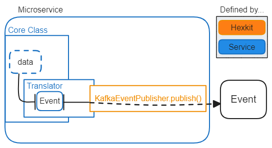
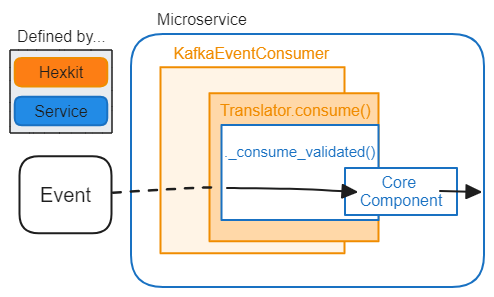
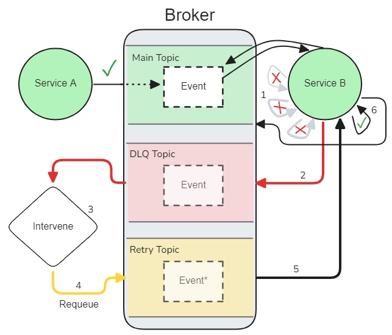

# AC-0006 — Asynchronous interservice communications

This document provides an overview of the communication methods between microservices in GHGA using Apache Kafka.
It offers both a high-level explanation of how information is sent and received and a look at the layers of abstraction that are ubiquitous in the GHGA codebase.
The document also outlines how a design pattern called the outbox pattern is employed to solve certain challenges.
Finally, this document covers the configuration and use of dead letter queues as a mechanism to help resolve failures in message processing.

## Event-driven Architecture with Apache Kafka

> See the [Kafka documentation](https://kafka.apache.org/intro) for in-depth information on concepts and Kafka's inner workings.

Event-driven architecture refers to a protocol where information is exchanged indirectly and often asynchronously by interacting with a broker.
Rather than making direct API calls from one service to another, one service, called the *producer*, publishes information to a broker in the form of an *event* (sometimes called a *message*), and is ignorant of all downstream processing of the event.
It is essentially "fire and forget".
Other services, called *consumers*, can consume the event once it has been published.
The same way the producer is ignorant of an event's fate, the consumers are ignorant of its origin.
This has important implications for design considerations.
In Kafka, events have metadata headers, a timestamp, a *key*, and a *payload*.
GHGA defines a `type` field in the metadata headers to further distinguish events.
Events are organized into configurable *topics*, and further organized within each topic by key.
A topic can have any number of producers and consumers, and messages are not deleted after consumption (enabling rereads).

In the context of microservices, event-driven architecture addresses several critical challenges:

1. **Decoupling of Service Dependencies:** Services communicate by emitting events, rather than direct requests, reducing service coupling.
   Keeping contractual definitions (i.e. payload schemas) in a dedicated library means services can evolve with minimal change propagation.
2. **Asynchronous Communication:** Kafka facilitates asynchronous data processing, allowing services to operate independently without waiting for responses.
   This improves performance and fault tolerance, as services can continue functioning even if one component is slow or temporarily unavailable.
3. **Consistency and Order Guarantee:** Kafka maintains the order of events within a partition for a given key, crucial for consistency in processing events that are related or dependent on each other.

Some disadvantages associated with event-driven architecture include the following:

1. **Duplicate processing:** Because the event consumers have no way to know whether an event is a duplicate or a genuinely distinct event with the same payload, the consumers must be designed to be idempotent.
2. **Data Duplication:** If service A needs to access the data maintained by service B, the options are essentially an API call (which introduces security and coupling concerns) or duplicating the data for service A. GHGA has opted mitigate this issue via data duplication by way of the outbox pattern, described later in this document.
3. **Tracing:** A single request flow can span many services with a multitude of a messages being generated along the way.
   The agnostic nature of producers and consumers makes it harder to tag requests than with traditional API calls, and several consumers can process a given message in parallel, sometimes leading to complex request flows.
   GHGA enables tracing by generating and propagating a *correlation ID* (also called a request ID) inside event metadata.

## Abstraction Layers

This section aims to provide developers with a high-level understanding of how Kafka is used in GHGA's codebase.
The GHGA-developed library `hexkit` features protocols and providers to simplify using Kafka in services.
Instead of writing the functionality from scratch in every new project, `hexkit` provides the `KafkaEventPublisher` and `KafkaEventSubscriber` provider classes, in addition to an accompanying `KafkaConfig` Pydantic config class.

> For more information about `hexkit` and its terminology, please see [Triple Hexagonal Architecture](https://ghga-de.github.io/ghga/hexkit/user-guide/arch_concepts/triple_hexagonal_arch.html) in the hexkit User Guide.

To use any of the Kafka providers, a service must also use the `KafkaConfig` class.

### Producers

When a service must publish an event, it will use the `KafkaEventPublisher` provider class along with a service-defined *translator* (a class implementing the `EventPublisherProtocol`).
The purpose of the translator is to provide a domain-bound API to the core of the service for publishing an event without exposing any of the specific provider-related details.
The core alls a method like `publish_user_created()` on the translator, and the translator provides the requisite payload, topic, type, and key to the `KafkaEventPublisher`.
The translator's module usually features a config class for defining the topics and event types used.
It's important to note that a translator is not strictly required in order to use the `KafkaEventPublisher`.
As long as the required configuration is provided, there's nothing to stop the core from using it directly.
However, it would go against GHGA's architectural design principles.

A diagram illustrating the process of event publishing, starting with arbitrary data in the core:

### Consumers

While the `KafkaEventPublisher` can be used in isolation, the `KafkaEventSubscriber` requires a *translator* to deliver event payloads to the service's core components.
The translator is defined outside of hexkit (i.e. in the service code), but implements hexkit's `EventSubscriberProtocol`.
The provider hands off the event to the translator through the protocol's `consume` method, which in turn calls an abstract method implemented by the translator.
The translator receives the event and examines its attributes (the topic, payload, key, headers, etc.) to determine processing.
Naturally, the actual processing logic varies, but usually the payload is validated against the expected schema and used to call a method in the service's core.
When control is returned to the `KafkaEventSubscriber`, the underlying consumer (from `AIOKafka`) saves its offsets, declaring that it has successfully handled the event and is ready for the next.

A diagram illustrating the process of event consumption:

## Outbox Pattern

> See [this Architecture Decision Request](https://github.com/ghga-de/adrs/blob/main/docs/adrs/adr005_db_event_consistency.md) for information about the decision to use the outbox pattern.

Sometimes services need to access data owned by another service.
For example, the Notification Orchestration Service needs to know user account details, which are owned by the Auth Service.
The challenge of enabling this kind of linkage involves ensuring data consistency and avoiding coupling.The outbox pattern provides a way to mitigate these risks by publishing persisted data as Kafka events for other services to consume as needed.
Some advantages include:

- Kafka data can be republished from the database as needed (fault tolerance)
- The coupling between services is minimized
- The data producer remains the single source of truth
- Kafka events no longer need to be backed up separately from the database

### Topic Compaction & Idempotence

Topic compaction means retaining only the latest event per key in a topic.
Why do this?
In GHGA's implementation of the outbox pattern, published events are categorized as one of two event types: `upserted` or `deleted`.
The entire state of the object, insofar as it is exposed by the producer, is represented in every event.
Consumers interpret the event type and act accordingly, based on their needs (although this typically translates to at least upserting or deleting the event in their own database).
When combined with topic compaction, the result is that consumers only have to get the latest event to be up to date with the originating service.

### Implications

One requirement of using the outbox pattern as implemented at GHGA is that consumers must be idempotent.
The state of Kafka is stored in the database and can be republished as needed, so services must be prepared to consume the same event more than once.
Event republishing might need to occur at any time, so it is possible that events representing points in a user journey might be re-consumed out of sequence.
Considering the combinatorics, it's difficult to foresee all the potential cases where out-of-order events could be problematic.
That's why it's paramount to perform robust testing and use features like topic compaction where necessary.

## Tracing

Request flows are traced with a `correlation ID`, or request ID, which is generated at the request origin.
The correlation ID is propagated through subsequent services by adding it to the metadata headers of Kafka events.
When a service consumes an event, the provider automatically extracts the correlation ID and sets it as a [context variable](https://docs.python.org/3.9/library/contextvars.html#context-variables) before calling the translator's `consume()` method.
In the case of the outbox mechanism, the correlation ID is stored in the document metadata.
When initial publishing occurs, the correlation ID is already set in the context.
For republishing, however, the correlation ID is extracted and set before publishing the event, thereby maintaining traceability for disjointed request flows.

## Dead Letter Queues

Inevitably, a consumer will receive and attempt to process an event that results in unhandled exceptions when consumed.
Such errors can be caused by an array of things, and may or may not be a problem with the event payload itself.
Events that fail cannot always be outright discarded, so there is a need for a way to set the events aside (disengage them from the request flow) and allow for investigation.
After looking into why the event failed and performing any required intervention, the event can be either discarded or reintroduced into the request flow as the situation warrants.

As an example, there was a situation in the Archive Test Bed where the `notification-orchestration-service` consumed an event that required it to look up a non-existent record in the database and crashed.
Ideally, this should not prevent the service from functioning.
Instead, the error should be logged and the problematic event dealt with in a way that allows for answering two questions before possibly requeing the event:

1. *Should* this event be tried again?
2. If so, does anything have to change first?

One of the most common mechanisms for achieving this capability is called a Dead Letter Queue (DLQ).
In a DLQ, failed events are sent to a separate location.
In the context of Kafka, this is usually another topic, but it could also be a database collection or anywhere that preserves the event and prevents further processing.

> [!NOTE]
> **Automating DLQ Event Resolution**
>
> It's important to note that using a DLQ *does not* remove the need for manual intervention.
> It merely provides the means to perform diagnostics and corrective action while allowing the service to continue processing events in the background.
>
> `Hexkit` provides a way to partially automate DLQ event resolution through a callback parameter in the `KafkaDLQSubscriber`, but it is likely that at least some interventions will require manual work.

### Dead Letter Queues in Kafka

The flow diagram above demonstrates the use of a DLQ in a given service:

1. Failed events are retried a configurable number of times.
2. Upon final failure, they are published to the service-specific DLQ topic (the original topic name is preserved), where they await review.
3. Events in the DLQ are manually reviewed.
   To ignore or reprocess the next event in the DLQ, the corresponding command is sent to a dedicated DLQ consumer.
4. If the DLQ consumer is instructed to retry the event, it will publish it to a DLQ Retry topic, to which the main consumer actively listens.
5. Upon consuming an event from the retry queue, the main consumer restores the original topic name and proceeds with the normal request flow.
6. The event is consumed again, this time successfully.
   - If the event fails again for some reason, the DLQ process restarts.

### Implementation of DLQ in `hexkit`

**`KafkaEventSubscriber`**  
This is the main Kafka subscriber provider in `hexkit`.
Upon catching an unhandled error during event consumption, it does the following:

1. Retries handling the event until the configured number of retries is exhausted (using exponential backoff).
   - This reduces the likelihood of transient errors populating the DLQ.
2. Publishes the event to the configured DLQ topic, if DLQ functionality is configured.
   - The original topic is preserved in the headers of the Kafka event, and extracted when the event is consumed from the configured retry topic.
3. Commits the topic offsets to avoid infinitely reprocessing the failed event.
4. Upon consuming an event from the configured retry topic, extracts/removes the original topic from the headers and proceeds with processing as if it were any other event (reentry).

**`KafkaDLQSubscriber`**  
This is a specialized provider that will, upon instruction, consume one event from the configured DLQ topic and either:

1. Ignore the event (do nothing), or
2. Process the event, which might involve modifications to the event, and either ignore the event or publish it to the configured retry topic.
   The original topic name should still be preserved in the headers.

This class is potentially not required if requeueing is done through a 3rd party tool like Kafka UI.
However, if requeueing is done through either the different services or an in-house dedicated DLQ service, then this type of consumer will be helpful.
