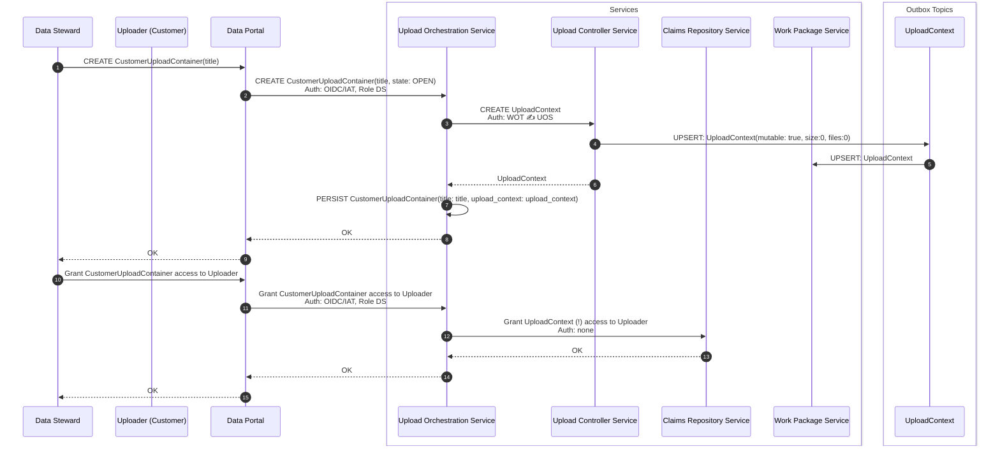
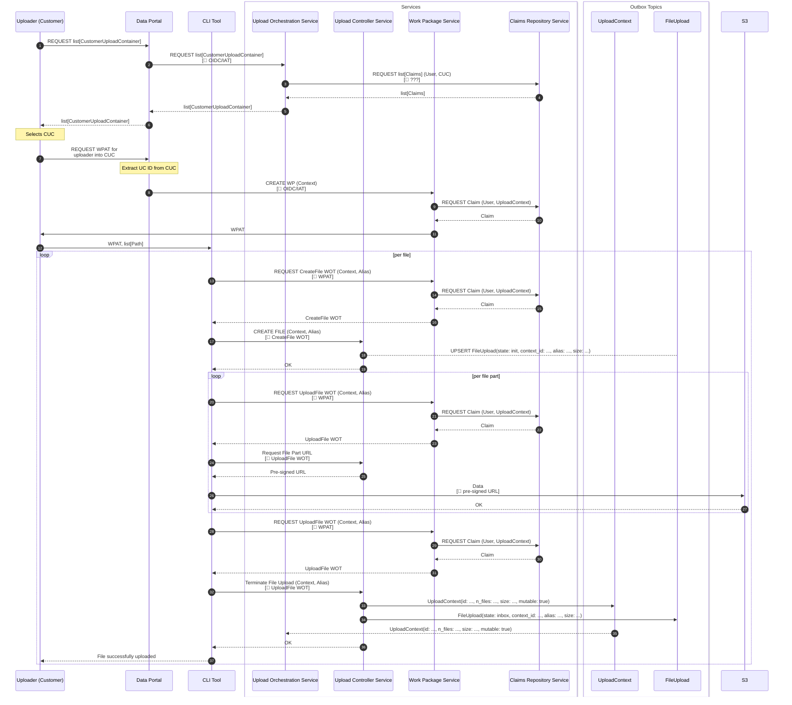
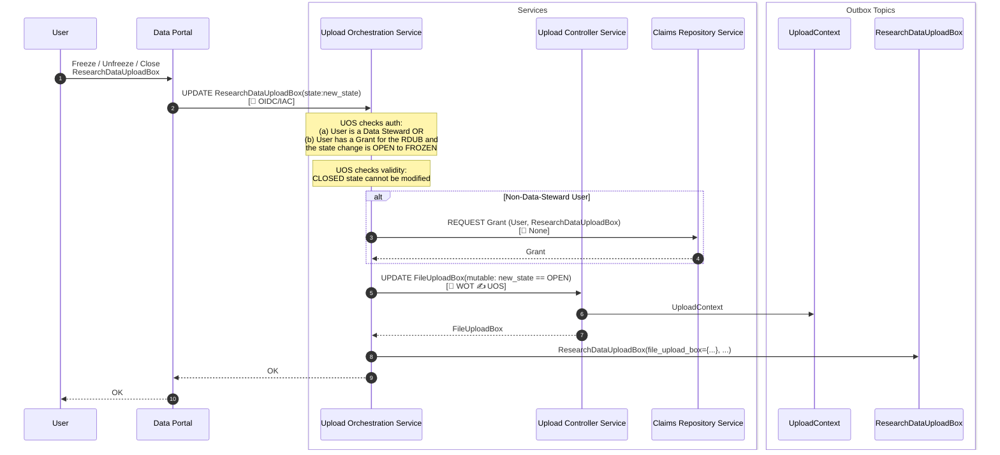
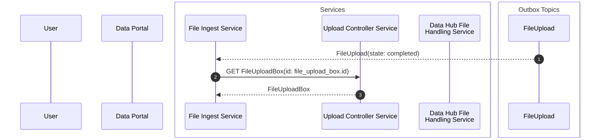
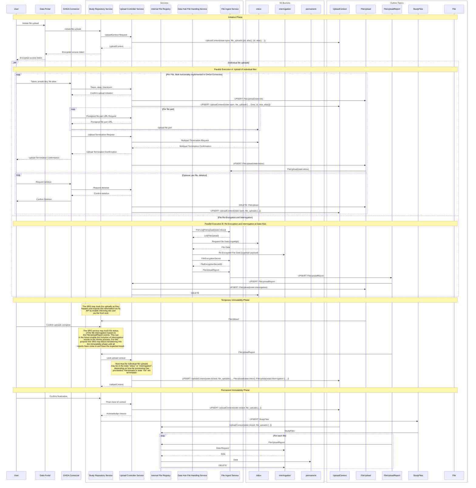

# AC-0007 — File upload

This architecture concept describes the file upload process after its integration into the Data Portal, i.e. the replacement for the currently practiced manual upload by data stewards via the datasteward kit.

> [!WARNING]
> The content of this document is outdated and needs to be rewritten.
> The terminology changed (UploadContext = Upload Box), and the concept has been extended and refined in a series of epics: [76](../epics/epic-0076-lynx-boreal/README.md), [80](../epics/epic-0080-hedgehog-seahorse.md), [84](../epics/epic-0084-sarcastic-fringehead/README.md), [86](../epics/epic-0086-archaeopteryx/README.md) and [88](../epics/epic-0088-pistol-shrimp.md).

## Goals

* The integration of the file upload into the GHGA Data Portal back end and front ends (Connector, WebUI)
* The delegation of file re-encryption and potential interrogation to the data hubs' infrastructures

## Concepts

### Data Models and their Roles

This concept introduces the following data models, each owned by a respective service and broadcasted in an outbox fashion.

| Name             | Properties (excerpt)                                                | Owning Service         | Description                                                                                                      |
| ---------------- | ------------------------------------------------------------------- | ---------------------- | ---------------------------------------------------------------------------------------------------------------- |
| UploadContext    | `state: OPEN | LOCKED | CLOSED`                                     | Upload Controller      | Models the scope of an upload process that may span multiple files.                                              |
| FileUpload       | `state: INIT | COMPLETED`                                           | Upload Controller      | Models the upload of a single file until it is completely uploaded and the corresponding UploadContext is closed |
| FileUploadReport | `upload_id`, `secret_id`, `result: FAILED | PASSED`, `details`      | Data Hub File Handling | Models the result of the file re-encryption and potentially additional interrogation                             |
| StudyFiles       | `study_id`, `accession_map: Map[(UploadContextId, FileAlias), PID]` | Study Repository       | Models the files that are associated with a study (revision). Maps (UploadContext, FileAlias) pairs to PIDs      |
| File             |                                                                     | Internal File Registry | Models a file archived in GHGA                                                                                   |

### Upload Contexts

We define an Upload Context as a scope in which an uploader can perform file uploads.
An Update Context is always issued for a specific study and can be used to upload an arbitrary number of files.
It is a logical unit managed by the Upload Controller Service which technically brokers writing the files to the `inbox` bucket of the respective data hub, while enabling multi-tenancy by separating independent upload processes into Upload Contexts.
The Upload Context can have different states which correspond to guarantees with respect to the mutability of the files that have been uploaded so far.

### Parallel Execution of Uploads and Re-Encryption

This concept aims to enable the parallel execution of file uploads and file re-encryption / interrogation.
That is, as soon as an uploader completes the upload of a single file, the file undergoes subsequent processing.
In contrast to processing all uploaded files after a bulk upload / study update completes, this approach supports (a) a faster, real-time processing of files with no significant delay after the file uploads and therefore (b) enables the possibility to include potential file interrogation results in the review process before concluding a study update without imposing long delays on the uploader.

### Early Assumption of Archival

With the decoupling of the file re-encryption and interrogation from the central services we can, but might not want to make the completion of the re-encryption process a necessity for study updates to be completed.
If the interrogation result is not required for the decision to accept a study update or not, it would be desirable to complete the study update as early as possible and to consider the files archived as soon as an upload process has completed.
This is in principle enabled by this concept as file processing can happen independently and files can be ingested by the central services as they are processed at the Data Hubs.
This is largely equivalent to the previously practiced manual execution of the local file processing.

### Alias-Based File Matching

While the file, metadata and dataset management is largely decoupled in the GHGA software architecture, uploaded files must eventually be mapped to their description in the metadata.
For this purpose, every file that is uploaded into an upload context has a unique alias.
The (upload context, alias) tuples have to be mapped to file annotations in the experimental metadata.
How this mapping process is implemented is not part of this architecture concept.
Neither does this concept cover the details on how these aliases are generated.
They might be user-specified, such that an upload tool interface may look as follows:

```text
$ ghga upload MY_FILE_ALIAS ./my_file_path.fastq.gz
Enter Upload Token: ABC123
Token valid.
Uploading file './my_file_path.fastq.gz' as 'MY_FILE_ALIAS'... OK
Upload completed.
```

or the tool may offer some means of automatically setting the file alias to a specific value, for example to the source file path, which would make specifying an alias obsolete and enable simpler interfaces such as

```text
$ ghga upload *.fastq.gz
Enter Upload Token: ABC123
Token valid.
Uploading file '001.fastq.gz'... OK
Uploading file '002.fastq.gz'... OK
Uploading file '003.fastq.gz'... OK
Uploading file '004.fastq.gz'... OK
Uploading file '005.fastq.gz'... OK
Upload completed.
```

## Services and their Roles

### Upload Controller

The *Upload Controller Service (UCS)* is responsible for brokering the interaction between the uploader and the S3 storage.
Whenever an uploader wants to upload data in the context of a study, it creates an *Upload Context* for the uploader.
The uploader can then upload files as long as the Upload Context is in the state `OPEN`.
For every single file, the UCS creates a *File Upload* object, which tracks the state of the upload which can be either `INITIALIZED` or `COMPLETED`.
When the uploader uploads files, they or the tool they use specify a file alias that is unique within the upload context.
The UCS references all File Upload objects in the Upload Context object, including the alias of each file.
The UCS prevents uploaders from uploading two files with the same alias within the same Upload Context.

### Study Repository

The Study Repository Service (SRS) is the central service for managing studies in GHGA.
All changes to a study, including the upload of files, is orchestrated by the SRS at the highest level.
When the user requests to upload files via the SRS (via the Web UI), the SRS synchronously requests the creation of a new Upload Context from the UCS.
The UCS then reports back information about the Upload Context to the SRS, which then provides authentication information for access to the Upload Context back to the user.
For the individual file uploads the user then directly communicates with the UCS, using the authentication information provided by the SRS.
When the upload is completed and the Upload Context shall be frozen or closed, this exchange is again brokered by the SRS.

### File Ingest Service

The File Ingest Service (FIS) is the broker between the file management at the Central services and the file management at the Data Hubs.
It exposes a public HTTP API to be used by the Data Hubs (see Data Hub File Handling).
It furthermore owns File Upload Report objects on behalf of the Data Hubs which contain information about the processing of each file on the Data Hub side.
Via the FIS API, Data Hubs can request a list of files that have been uploaded to their inbox bucket, and later submit File Upload Reports detailing the results of re-encryption and integrity checks.
In addition, the FIS brokers the deposition of secrets at the encryption key store.
For this purpose, Data Hubs can deposit any secret key they generate in exchange for an identifier for that secret.
Their access to secrets is write-only.

### Data Hub File Handling

The Data Hub File Handling Service (DHFS) runs locally at each Data Hub.
It does not participate in asynchronous, event-based communication.
It communicates with GHGA Central via the File Ingest Service and with the local S3 storage at the Data Hub.
The DHFS polls the FIS for completed file uploads to the Data Hub it is responsible for.
It then fetches these files from the inbox bucket, re-encrypts (and potentially examines) the files and writes the re-encrypted file to the interrogation bucket.
When performing re-encryption, it does not store the generated encryption secret but directly submits it to the secret ingest API of the FIS, obtaining a secret ID.
It then sends a File Upload Report back to the FIS, including the secret ID and the examination report.

### Internal File Registry

The Internal File Registry Service (IFRS) is a central service responsible for managing the files archived in GHGA.
Its role in the upload process starts when an Upload Context changes its state to `CLOSED`, which guarantees that all File Uploads that are part of the Upload Context have completed and cannot be deleted anymore.
It then starts monitoring the File Upload Reports for the corresponding files and as soon as a File Upload Report is received for a completed Upload Context, the IFRS moves the re-encrypted file from the `interrogation` bucket to the `permanent` bucket.
If that is successful, it also deletes the original file from the `inbox` bucket.

## Complete Ingress Sequence (Data-Steward Centric Version)

### Initiation Phase

The UploadContext is being created and permissions are granted for one regular user to upload files to the UploadContext and to change it's state from OPEN to LOCKED.



### File Upload

An authorized user creates a work package for the upload of files into the previously created UploadContext and transfers the files.



### Customer Upload Container State Change



### Re-Encryption and Interrogation



## Complete Ingress Sequence (Final Version)


