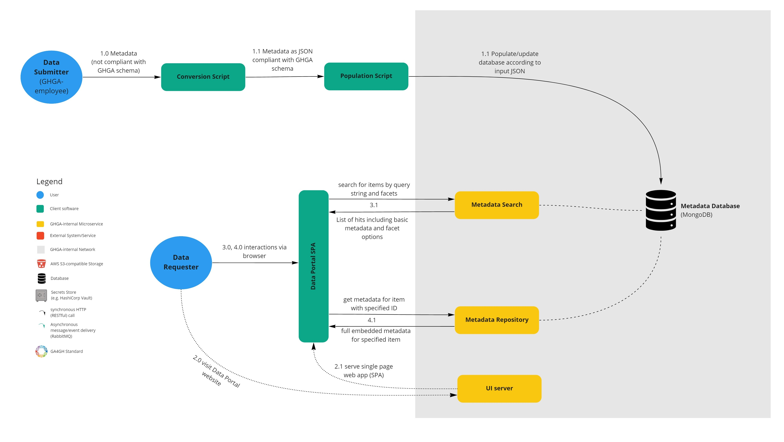

# Basic Metadata Catalog & UI (Blobfish)

**Epic Type:** Implementation Epic

**Attention: Please do not put any confidential content here.**

## Scope

### Outline

The goal for this epic is to build a minimal backend for storing, querying, and searching metadata along with a corresponding UI.

### Included/Required

- metadata submission realized via a script
- metadata storage in MongoDB-based database
- search metadata items by keyword and by applying filters
- query full (embedded) metadata for an item given its ID
- UI for browsing, filtering, and searching the metadata catalog

### Optional

- implement Elasticsearch to power the search API

### Not included

- metadata submission API
- user authentication & authorization
- file-handling
- async messaging via RabbitMQ
- notification to users (via email)

## User Journeys

This epic covers the following user journeys:

**Figure 1| Metadata Population and Usage via the Data Portal.** (An editable version of this figure can be found here.)

The population of the Metadata Database: The Data Submitter (a GHGA employee, not an external researcher) uses a script to convert "raw" metadata (from some source, e.g. EGA metadata JSON or an Excel spreadsheet) to JSON that is compatible with our GHGA metadata schema (1.0).
Another script uses this JSON to populate the Metadata Database (1.1).
In the case that the database has already been populated, the database is erased first.

The Data Requester visits the data portal website The Data Requester visits the GHGA data portal website (2.0) using his/her browser of choice.
A single-page web app is served by our "create-react-app" based UI server (2.1).

The Data Requester searches the metadata catalog: The Data Requester is greeted with a browse view.
On this page, he/she can look at the list of stored studies/datasets, and have the option to drill down these via search or filtering.
The Data Requester enters keywords to search for metadata items of interest (3.0).
He/she might also apply filters, such as setting the "Experiment Type" to "RNA-seq".
This request is served by the API of the Metadata Search service (3.1) which translates it into queries to the Metadata Database and sends back only basic non-embedded metadata of matching items.
The API might also support pagination, so only sending part of the search result.
Moreover, the API will send back facet options to filter down the current results, that can be visualized in the UI.

The Data Requester browses metadata for the search hits: While browsing the search hits (4.0), the full metadata for a specific item (dataset/experiment/file/study/etc.) is retrieved on demand from the RESTful Metadata Repository service (4.1).

## API Definitions

The definitions are hosted here:

### RESTful/Synchronous

The RESTful service APIs are described using OpenAPI:

**Metadata Repository**: [Swagger UI](https://editor.swagger.io/?url=https://raw.githubusercontent.com/ghga-de/ghga/dev/docs/epics/epic-0000-blob-fish/api_definitions/rest/metadata_repository.yaml)

**Metadata Search**: [Swagger UI](https://editor.swagger.io/?url=https://raw.githubusercontent.com/ghga-de/ghga/dev/docs/epics/epic-0000-blob-fish/api_definitions/rest/metadata_search.yaml)

(The OpenAPI specifications are hosted in the `./api_definitions/rest` sub-directory.
Please make sure the links are pointing to the main branch, even if the file doesn't exist there because the PR has not been merged, yet.)

### Metadata Schema Definition

<https://github.com/ghga-de/ghga-metadata-schema/releases/tag/0.2.0>

(The metadata release might be simplified a bit to account for the limited information that we can get out of the existing EGA submissions.)

## Additional Implementation Details

Open questions discussed while planning this epic:

- **Searching in the front end instead of a search service.**
  Possible, but it would shift load to the UI, which had the least development capacity, and reduce both metadata services to one endpoint serving the whole database as JSON.
  It would also mean writing the search in TypeScript only to move it to a Python service later.
- **What the search service returns.**
  Rather than only the IDs of matching items, the Metadata Search API should return a view of the metadata that the data portal can use directly, through an interface that does not depend on the store behind it (MongoDB, Elasticsearch).
  The JSON can then be restructured without changing how the metadata is stored.
- **Basic metadata with the search hits.**
  Search hits can carry some basic metadata, but that scales poorly for thousands or millions of hits; with pagination, the UI queries details only for the items on screen.
  The exact UI requirements depend on the wireframes.
- **Clients adapt to the backend API.**
  One API landscape should serve all clients, rather than one backend per client, even where its endpoints are not ideal for a client.
  For example, REST has no batch query, so a page of 10 items takes 10 requests.
- **Filter options.**
  Filters such as "Experiment Type" can be predefined as enums in the API, which makes it more self-explanatory, or kept as generic strings, with an endpoint such as `GET /filter_options` from which the UI gets the available options.
  Both designs were considered viable, and the choice was left for discussion.

## Human Resource/Time Estimation

Number of sprints required: -

Number of developers required: -
