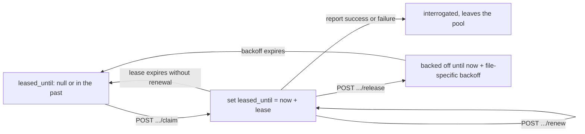

# File Leases for Multiple DHFS Instances (Leafcutter Ant)

**Epic Type:** Implementation Epic

Epic planning and implementation follow the [Epic Planning and Marathon SOP](https://ghga.pages.hzdr.de/internal.ghga.de/main/sops/development/epic_planning/).

## Scope

### Outline

A Data Hub runs one DHFS instance.
[Army Ant](./epic-0091-army-ant.md) made the *parts* of a single file process concurrently, but DHFS still works through files one at a time, so a hub whose bottleneck is compute cannot add throughput by adding instances.
That epic put multi-instance operation under "Not included" and called it a separate design challenge involving FIS.
This is that follow-up.

If a Data Hub were to attempt to run more than one instance today, each instance would receive the same unbounded list, and re-encrypt the same files.
[ADR-0050](../adrs/adr-0050-dhfs-instances-coordinate-through-file-leases.md) decides that instances coordinate through renewable file leases in FIS, and weighs the alternatives; this epic implements it.
Most of the new logic is in FIS.
DHFS claims files through a new endpoint with a claimant ID, renews the lease while it works, releases the file if interrogation is inconclusive, and stops sleeping between files.

### Included/Required

hexkit:

- Add `update_first` to the `Dao` protocol: it finds the first resource matching a filter in a given sort order and changes it, in one atomic call.
  See [The hexkit DAO method](#the-hexkit-dao-method).
- Implement it in the MongoDB provider, the in-memory DAO and the outbox `DaoPublisher`.

FIS:

- Add `leased_until`, `leased_by`, `claimed_at` and `times_claimed` to `FileUnderInterrogation`.
- Add `POST /rpc/storages/{storage_alias}/uploads/claim` so an instance can lease the next waiting file: it serves one file, sets `leased_until`, `leased_by`, `claimed_at` and `times_claimed`, and leaves everything else unchanged.
- Leave `GET /storages/{storage_alias}/uploads` as it is, a read-only list for a DHFS that predates this epic, and mark it deprecated with `deprecated=True` on the route.
- Add `GET /storages/{storage_alias}/validate-version` for `dhfs verify`.
- Add `POST /rpc/storages/{storage_alias}/uploads/{file_id}/renew` so an instance can extend its lease while it works on the file.
- Add `POST /rpc/storages/{storage_alias}/uploads/{file_id}/release` so an instance can hand a file back before its lease expires.
- Claim, renew and release each with one `update_first` call; see [The claim itself](#the-claim-itself).
- Add the compound index `{storage_alias: 1, state: 1, interrogated: 1, leased_until: 1, state_updated: 1}`.
  The `files` collection currently indexes only `object_id`.
- Add the configuration settings listed under [Configuration](#configuration).

DHFS:

- Generate a claimant ID once at startup, and send it in the body of every claim, renewal and release, so FIS can tell one instance of a hub from another; see [The claimant ID](#the-claimant-id).
- Claim one file per round through the claim endpoint, and stop calling the GET; see [Claiming in DHFS](#claiming-in-dhfs).
- Check the version in `dhfs verify` through the validate-version endpoint, and mock the lease calls there; see [`dhfs verify`](#dhfs-verify).
- Renew the lease from a background task while a file is in work, and stop that task before sending the report; see [The lease duration and renewal](#the-lease-duration-and-renewal).
- Call the release endpoint from the `InconclusiveError` branch of `interrogate_new_files()`, which today only logs, from the `ConclusiveError` branch when `report_failure` did not reach FIS, and after FIS refuses a renewal.
- Skip the poll interval after conclusively *or* inconclusively processing a file, and sleep only when the request for the next file comes back empty; see [Poll pacing](#poll-pacing).
- Add jitter of up to 10% to `min_run_interval_seconds`, as a constant rather than a setting, so instances rolled out together stop polling in lockstep.

### Optional

- Give `S3Cleaner` a minimum object age, which bounds the cleanup race listed under [Known limitations](#known-limitations).

### Not included

- Progress reporting with renewals; the hold cap covers an instance that is alive but stuck ([ADR-0050](../adrs/adr-0050-dhfs-instances-coordinate-through-file-leases.md#decision)).
- Serving more than one file per claim ([ADR-0050](../adrs/adr-0050-dhfs-instances-coordinate-through-file-leases.md#decision)).
- A give-up state after N failed attempts.
  [Shovelnose Guitarfish](./epic-0092-shovelnose-guitarfish.md) already gives Data Stewards a requeue path.
- Releasing the file in flight when the process is stopped, for example by SIGTERM ([ADR-0050](../adrs/adr-0050-dhfs-instances-coordinate-through-file-leases.md#decision)).
- Removing the GET.
  A later FIS release removes it; see [Rollout](#rollout).
- Per-instance identity in the JWT.
  `sub` is the storage alias, so two instances of one hub are indistinguishable to the authentication layer.
- Raising `replicaCount` for any hub.
  The chart already supports it; this epic only makes it safe.
  `deploy/charts/dhfs/values.yaml` is generated, so a hub that wants more instances raises `replicaCount` in `services/datahub-file-service/chart-values.yaml`.
  Again, that is only if they are using an orchestration layer comparable to Kubernetes.

## API Definitions

### RESTful/Synchronous

`GET /storages/{storage_alias}/uploads` is unchanged apart from being marked deprecated: it lists every waiting file and leases nothing.
Only a DHFS that predates this epic calls it.

The four new endpoints use the same Data Hub JWT and User-Agent check as the existing three Data Hub endpoints.
Each of the three POSTs takes the caller's claimant ID as its JSON body, `{"claimant_id": "<UUID4>"}`.
The claim takes no file ID, because FIS picks the file; renew and release name it in the path.

- `GET /storages/{storage_alias}/validate-version`:
  - *Tell the caller whether FIS accepts its DHFS version and its token.*
  - Reads and changes nothing.
  - Returns:
    - 204 if both checks pass
    - 426 if FIS rejects the DHFS version
    - 401 or 403 from the JWT check, as on the other Data Hub endpoints
- `POST /rpc/storages/{storage_alias}/uploads/claim`:
  - *Lease the next waiting file to the caller.*
  - Serves at most one file; see [The claim itself](#the-claim-itself).
  - Returns:
    - 200 with the file as `BaseFileInformation`, which is unchanged
    - 204 if no file is waiting
- `POST /rpc/storages/{storage_alias}/uploads/{file_id}/renew`:
  - *Tell FIS that the caller is still working on a claimed file.*
  - Sets `leased_until` to `now + LEASE_SECONDS`, and changes nothing else.
  - Applies only when the caller still holds the lease; see [Only the DHFS instance holding the file may renew or release it](#only-the-dhfs-instance-holding-the-file-may-renew-or-release-it).
  - Returns:
    - 204 on success
    - 404 if the file is unknown, or belongs to another storage alias
    - 409 if the caller no longer holds the lease, the file is no longer waiting for interrogation, or the claim has reached `max_lease_hold_seconds`.
      Unlike release, the caller acts on this answer: it stops working on the file.
      The response body says which case applies, for the log; DHFS handles all three the same way.
- `POST /rpc/storages/{storage_alias}/uploads/{file_id}/release`:
  - *Tell FIS to release a claimed file.*
  - Sets the backoff, and sets `leased_by` and `claimed_at` to null, so a delayed renewal cannot turn the backoff back into a lease.
  - Applies only when the caller still holds the lease; see [Only the DHFS instance holding the file may renew or release it](#only-the-dhfs-instance-holding-the-file-may-renew-or-release-it).
  - Returns:
    - 204 on success, and also when the caller no longer holds the lease, because the caller cannot act on the difference
    - 404 if the file is unknown, or belongs to another storage alias

The storage alias check is required.
`_require_data_hub_jwt` only proves the caller is that hub; it does not prove the file belongs to it.
`handle_interrogation_report` omits this check today, so do not copy it from there.

## Additional Implementation Details

### What is a Lease?

Basically, it's the value set in `leased_until`.
That value encodes both states that a file can be held in: when claimed or renewed, it's set to `now + lease`, and when released, it's set to `now + backoff`.
If set to `null`, it means the file has never been claimed, or was requeued by a Data Steward after conclusive interrogation failure.
A claim prevents FIS from sending the file to another DHFS instance until the lease expires.



Because a conclusive report (be it successful or not) already sets `interrogated=True`, which removes the file from the candidate set, the report path doesn't need lease logic at all.

### The claim query

```python
filter_ = {
    "storage_alias": storage_alias,
    "state": "inbox",
    "interrogated": False,
    # The null branch must come first: the in-memory DAO evaluates $or lazily and
    # its $lt is a plain Python comparison, which raises TypeError on None.
    # Also note that GSI-2689 has been created for this.
    "$or": [{"leased_until": None}, {"leased_until": {"$lt": now}}],
}
```

hexkit allows this.
`validate_find_filter` checks only that filter keys are model fields, and `validate_fields_in_model` drops keys starting with `$` (`libs/hexkit/src/hexkit/utils.py`), so a top-level `$or` passes.
Filter values are never inspected and go straight to pymongo.

`{"leased_until": None}` matches a missing field as well as a null one, so **no migration and no `DB_VERSION` bump are needed**.
A sentinel timestamp instead of null would need a backfill, because `$lt` against a Date matches neither null nor a missing field.
If the `$or` index union turns out to perform badly, the sentinel is the fallback, at the cost of that migration.

Sort ascending by `leased_until`, then by `state_updated`.
Null sorts before any date in both Mongo and the in-memory DAO, so never-claimed files come first and expired leases follow oldest-first.
The second key makes the order deterministic among files with the same `leased_until`.

### The hexkit DAO method

```python
async def update_first(
    self,
    *,
    filter_: Mapping[str, Any],
    changes: Mapping[str, Any],
    sort: list[str] | None = None,
) -> Dto:
```

- It selects the first resource that matches `filter_` in `sort` order, changes it and returns the changed resource, in one atomic call.
  It is the atomic form of `find_all(limit=1)` followed by `update`, so concurrent calls get different resources and none of them retries.
- `filter_` and `sort` work as in `find_all`.
- `changes` maps model fields to plain values and changes only those fields.
  Keys starting with `$` are MongoDB update operators, a documented extension in the same way as operators in filters.
  The in-memory DAO supports `$inc`, the only one FIS uses.
- It raises `NoHitsFoundError` when nothing matches, like `find_one`.
- The provider validates and serializes each plain value against its field's type before the call, and validates the returned document after it; operator values are the caller's responsibility.
- `DaoPublisher` publishes the returned document, so it needs no extra read.

The name follows hexkit's terms rather than pymongo's `find_one_and_update`.

### The claim itself

```python
claimed_file = await self._file_dao.update_first(
    filter_=filter_,  # the claim query above
    sort=["leased_until", "state_updated"],
    changes={
        "leased_until": now + timedelta(seconds=LEASE_SECONDS),
        "leased_by": claimant_id,
        "claimed_at": now,
        "$inc": {"times_claimed": 1},
    },
)
```

`NoHitsFoundError` means no file is waiting, and the claim endpoint returns 204.

The filter carries `state` and `interrogated`, and the call changes only the lease fields; [ADR-0050](../adrs/adr-0050-dhfs-instances-coordinate-through-file-leases.md#consequences) gives the reason.

Two further rules for the claim path:

- **Never write `state_updated`.**
  `process_file_upload` drops events whose `state_updated` is not newer than the stored one.
  A claim that bumped it would make FIS discard the genuine cancelled or archived event that follows, so `can_remove` would never be set and the object would never be cleaned up.
- **Increment `times_claimed` at claim time, not at release.**
  An instance that is OOM-killed never releases, so a counter advanced only on release would never count a file that keeps crashing its instance.
  The increment is the `$inc` in the same call.

### Only the DHFS instance holding the file may renew or release it

The claim stores `leased_by`, and renewal and release put the caller's claimant ID into their `update_first` filter ([ADR-0050](../adrs/adr-0050-dhfs-instances-coordinate-through-file-leases.md#decision)).
A release from any other instance changes nothing and FIS logs a warning; a renewal from any other instance gets a 409.
When the filter matches nothing, FIS reads the file once more to choose between 404 and the 409 or warning; that read only picks the response.
A release that finds `leased_by` null logs no warning: the file was already released, most often by a retry of the same release.
The warning says what it means: a lease expired while an instance was still working, because its renewals did not reach FIS for a whole lease.

### The claimant ID

DHFS generates the claimant ID with `uuid4()` once per process, at startup, and FIS stores it as `leased_by`.
It is not a setting, and not `service_instance_id` ([ADR-0050](../adrs/adr-0050-dhfs-instances-coordinate-through-file-leases.md#alternatives)).

DHFS logs its claimant ID at startup, in a record that also carries `service_instance_id` as `instance`, and in every claim, renewal and release log line.
FIS names `leased_by` in its warnings, so an operator can match a lease to the logs of the instance holding it.

### The lease duration and renewal

A lease lasts `LEASE_SECONDS`, a constant of 22 minutes in FIS, counted from the claim or from the latest renewal.
While DHFS works on a file, a background task renews the lease every `LEASE_RENEWAL_INTERVAL_SECONDS`, a constant of 4 minutes in DHFS.
[ADR-0050](../adrs/adr-0050-dhfs-instances-coordinate-through-file-leases.md#decision) gives the reasons for both values.
The two constants live in different services, so comment each with a reference to the other: the lease must stay several renewal intervals long.

The renewal task runs from the start of a file's interrogation until just before the report:

- **Stop renewing before sending the report.**
  `interrogate_file` calls `report_success` itself, so the task has to end inside it, or that call moves out to the caller.
  A renewal that arrives after the report gets a 409, which would otherwise cancel the report.
- **A 409 cancels the interrogation of that file.**
  Cancelling it runs the existing `finally` in `interrogate_file`, which aborts the multipart upload.
  DHFS then handles the file like an `InconclusiveError`: it releases the file and moves on.
  The release changes something only when the instance still holds the lease, which is the hold cap case, and there it sets the backoff.
- **Any other failure keeps the interrogation running.**
  On a connection error or a 5xx after retries, DHFS logs a warning and tries again at the next interval.

A renewal is an `update_first` whose filter holds the file ID, `leased_by`, `state`, `interrogated` and the hold cap, and whose change sets only `leased_until`.
Like the claim, it never writes `state_updated`.
It also succeeds after the lease has expired, as long as no other instance has claimed the file in the meantime.

The hold cap is the term `{"claimed_at": {"$gt": now - timedelta(seconds=max_lease_hold_seconds)}}` in that filter, so FIS refuses a renewal once the claim is older than the cap.

### Claiming in DHFS

Add a `CentralClient` method that posts the claim and returns the file, or `None` on 204.
In `interrogate_new_files()`, call it once per round in place of `_fetch_batch()` and the `for file in new_files` loop, and keep their error handling, including the `CriticalError` on 426.
Remove `fetch_new_uploads()`, since DHFS no longer calls the GET.

### `dhfs verify`

`run_dhfs_verification` checks that FIS accepts the DHFS version with `fetch_new_uploads()`.
Replace that call with a `CentralClient.validate_version()` method that calls the validate-version endpoint and raises `UpgradeRequiredError` on 426, so a verify run claims no file.
Verify then calls `interrogate_file` directly on a dummy file that FIS does not know.
Patch the renew and release calls there with `AsyncMock`, as `submit_interrogation_report` already is, so verify sends no lease calls for the dummy file.

### Poll pacing

`run_interrogator` sleeps out the remainder of `min_run_interval_seconds` after every round, whether or not the round did work.
Have `interrogate_new_files()` return whether it processed a file, and sleep only when it did not ([ADR-0050](../adrs/adr-0050-dhfs-instances-coordinate-through-file-leases.md#consequences)).
The `except Exception` round in `run_interrogator` counts as a round that processed nothing, so an unhandled error reaches the same sleep.

### Every path that ends without a report must release the file

A file is freed either by a report, which sets `interrogated=True`, or by a release.
Any path that produces neither leaves the file leased until expiry:

- `InconclusiveError` releases the file, which is the usual case.
- A renewal refused with a 409 cancels the interrogation and releases the file, as above.
- `ConclusiveError` where `report_failure` did not reach FIS must also release.
  `report_failure` catches `ConnectionFailedError`, `CentralAPIError` and bare `Exception` without re-raising, and logs "DHFS will try re-processing this file later".
  That message is wrong once leases exist: the file waits out its lease instead of the next 60 second poll.
  So `report_failure` must return whether the report reached FIS, and the caller must release when it did not.
- `report_success` catching a `CentralAPIError` must **not** release; the comment in `report_success` gives the reason.
  The file waits out its lease instead.
- A stopped or killed instance releases nothing and stops renewing, and the file waits out its lease ([ADR-0050](../adrs/adr-0050-dhfs-instances-coordinate-through-file-leases.md#decision)).

### Backoff

A release sets `leased_until = now + min(backoff_base * 2 ** (times_claimed - 1), backoff_cap)`.
It reads the file for `times_claimed`, then writes the backoff with an `update_first` filtered on the file ID and `leased_by`, which also sets `leased_by` and `claimed_at` to null.
Only a claim changes `times_claimed`, and a claim also changes `leased_by`, so the filter ensures the backoff comes from the current count.
Clearing `leased_by` makes a repeated release match nothing, which matters because the retry transport repeats a POST on 5xx and on connection failures.
A release always finds `times_claimed` at 1 or more, because only a claim sets `leased_by`, and every claim increments the counter.

`times_claimed` counts how often FIS handed the file out, including a claim stranded by a lost response and a claim the instance never started, so it runs ahead of the number of re-encryption attempts.
That is accurate enough for a backoff, and the name keeps anyone from reporting it to a Data Steward as a count of failed attempts.
This epic adds no give-up state, so the counter is the only signal that a file is stuck.
FIS must therefore log it: a warning at claim time, naming the file, once its count crosses a threshold constant.
A Data Steward uses that warning to decide whether to requeue the file through [Shovelnose Guitarfish](./epic-0092-shovelnose-guitarfish.md).

### Requeue

`_requeue_file` must also set `leased_until`, `leased_by` and `claimed_at` to null, and `times_claimed` to 0.
It already builds the new document from the event payload, which contains none of them, so this happens today by accident.
Make it explicit, because the same accident applies to the cancelled, failed and archived branch of `process_file_upload`.

### Configuration

All on FIS:

| Setting | Type | Default | Purpose |
|---|---|---|---|
| `max_lease_hold_seconds` | int | 259200 | Upper bound on how long one claim can be kept alive through renewals. |
| `claim_backoff_base_seconds` | int | 60 | First backoff after a release. |
| `claim_backoff_cap_seconds` | int | 3600 | Upper bound on the backoff. |

The lease length is a constant, not a setting ([ADR-0050](../adrs/adr-0050-dhfs-instances-coordinate-through-file-leases.md#decision)).
Set `max_lease_hold_seconds` to the longest single interrogation the team expects, since a stuck but live instance parks its file for that long.

### Known limitations

| Cause | Cost | Bound |
|---|---|---|
| A claim response is lost after the write, or a 500 is retried | One to three files leased to no instance; the pacing change makes claims, and so lost ones, far more frequent | One lease, 22 minutes |
| An instance stops or restarts mid-file: SIGTERM in a rolling update, SIGKILL, an OOM kill or a node failure | Its file waits; its multipart upload stays orphaned, as today: DHFS has no SIGTERM handler, so no `finally` runs | One lease per stopped instance, also when every instance of a hub restarts at once |
| An interrogation hangs while its renewal task keeps running | Its file waits, since FIS cannot tell it from an instance working on a very large file | `max_lease_hold_seconds`, 72 hours by default |
| One claim per file and immediate re-polling ([ADR-0050](../adrs/adr-0050-dhfs-instances-coordinate-through-file-leases.md#consequences)) | One claim per file instead of one GET per batch, plus one renewal every 4 minutes per working instance | One claim per file, as FIS already takes one report per file |
| A DHFS that predates leases lists through the GET and ignores leases ([ADR-0050](../adrs/adr-0050-dhfs-instances-coordinate-through-file-leases.md#consequences)) | During a hub's rolling update, the old pod can re-encrypt a file the new pod claimed, as two instances do today | The overlap of old and new pods in that rolling update |
| `report_success` catches a `CentralAPIError`, and DHFS stops renewing | The file waits for its lease to expire instead of the next poll | One lease, 22 minutes, up from one poll interval |
| Between `complete_upload` and FIS accepting the report, `check_if_removable` answers `True` for the re-encrypted object | A concurrent cleanup run deletes the object; each working instance exposes one | Unbounded until the optional minimum object age in `S3Cleaner` |
| `handle_interrogation_report` has no state guard, as today | A success report after a cancellation still publishes `interrogation_success` | Unchanged by leases; more instances make the window easier to hit |

### Rollout

1. hexkit adds `update_first`, before FIS or in the same change.
   FIS uses hexkit from the workspace, so it needs no hexkit release first; raise its floor from `hexkit >= 8.3.0` to the version that adds `update_first`.
2. FIS ships the claim, renew, release and validate-version endpoints, and marks the GET deprecated.
   The GET is otherwise unchanged, so every DHFS keeps working.
   The release notes announce that a later release removes the GET.
3. DHFS ships claiming, renewal, release and the new version check in `dhfs verify`.
   A hub raises `replicaCount` only once it runs this DHFS ([ADR-0050](../adrs/adr-0050-dhfs-instances-coordinate-through-file-leases.md#consequences)).
4. In a later release, after the hubs have upgraded, FIS raises `dhfs_version_constraint` to exclude every DHFS that lists, and removes the GET ([ADR-0050](../adrs/adr-0050-dhfs-instances-coordinate-through-file-leases.md#decision)).

### Generated docs

Regenerate `services/fis/openapi.yaml`, `config_schema.json`, `example_config.yaml` and the README config block with `just service-docs`.
The three settings also go into `services/fis/dev_config.yaml` and `tests_fis/fixtures/test_config.yaml` by hand.

### Testing

Existing tests that change:

- `test_process_file_upload_requeue` must gain assertions on the four reset fields.
- `CentralApiMock` raises `NotMockedError` for an unrouted path, so it needs claim, renew, release and validate-version routes, and loses the uploads route.
  The `test_interrogator.py` tests that set `on_fetch_new_uploads` move to the claim route, serving one file per call.
  Those that take the inconclusive path also need the release route: `test_file_not_in_inbox`, `test_etag_doesnt_match_local_md5`, `test_inbox_check_retryable_s3_errors_do_not_stop_the_batch` and `test_uncategorized_error_is_retried_not_reported`.
- The `test_central.py` tests that call `fetch_new_uploads()` move to the claim method: `test_central_api_unavailable`, `test_jwt_formation`, `test_responses_with_bad_format` and `test_500_response_handling`.
- The verifier tests move from `fetch_new_uploads()` to `validate_version()`: `test_run_dhfs_verification_pings_central_new_uploads_endpoint` in `unit/test_verifier.py`, and the fixture in `integration/test_verifier.py` that patches it.

The FIS tests of the GET stay as they are until FIS removes it: `test_list_uploads`, `test_get_files_not_yet_interrogated` and `test_list_uploads_records_spans`.
The claim endpoint gets its own span test next to `test_list_uploads_records_spans`, expecting a `routes.claim_upload` span under the server span and a `test.findAndModify` MongoDB span.

New unit tests, on the `rig` fixture, with the clock frozen rather than slept through:

- A claim serves and leases one file, a second claim returns 204, and a claim after the lease expires serves it again.
- The GET still lists every waiting file, leased or not, and changes nothing.
- Validate-version returns 204 for an accepted DHFS version with a valid JWT, 426 for a rejected version, and 401 or 403 for a missing or foreign JWT.
- Never-claimed files are served before expired ones.
- A renewal by the holder extends the lease from now, keeps `times_claimed`, `claimed_at` and `state_updated`, and also succeeds after expiry when no other instance has claimed the file.
- A renewal from another instance, for a file that is no longer waiting, or past `max_lease_hold_seconds` returns 409 and changes nothing.
- A renewal after a release returns 409, because the release cleared `leased_by`.
- Release applies the backoff, the backoff cap holds, and a repeated release changes nothing and logs no warning.
- Renewing or releasing a file that belongs to another storage alias is rejected.
- A cancelled event for a leased file does not resurrect it, and the file is not served again.
- A claim over a collection that holds a `leased_until=None` document, which catches the in-memory DAO's `$lt` behaviour.

New integration tests, on `JointFixture` with the Mongo testcontainer, since the in-memory DAO cannot prove these:

- N concurrent claims through `asyncio.gather` over N waiting files return N different files, and one more claim returns 204.
  Only this test proves that the claim is atomic in MongoDB.
- A renewal and a claim racing on an expired lease: exactly one of them wins.
- The claim filter matches a document inserted without `leased_until` at all, which proves no migration is needed.
- `explain()` on the claim query does not collection-scan.
  Assert the absence of a COLLSCAN rather than a single clean IXSCAN: `$or` plans as a SUBPLAN over one index scan per branch, with a blocking SORT on top.

New hexkit tests, for the MongoDB provider and the in-memory DAO alike:

- `update_first` respects the filter and the sort, changes only the given fields, applies `$inc`, and raises `NoHitsFoundError` when nothing matches.
- A plain value of the wrong type is rejected before anything is written.
- Concurrent calls against MongoDB return different resources.
- `DaoPublisher.update_first` publishes the returned document.

New DHFS tests:

- A round that processed a file polls again without sleeping, and a round that claimed nothing sleeps.
  Test the decision, not the wall clock.
- The claim method returns the file on 200 and `None` on 204.
  It and `validate_version()` raise `UpgradeRequiredError` on 426, `CentralAPIError` on other error statuses, and `ConnectionFailedError` when FIS is unreachable.
- `dhfs verify` calls only the validate-version endpoint, and sends no claim, renewal or release.
- The claimant ID stays the same for every claim, renewal and release of one process, and differs between two processes.
- Release is called for an inconclusive file, and for a conclusive one only when `report_failure` did not land; a failing release neither masks the original error nor stops the service.
- The renewal task renews while a file is in work and stops before the report.
  Drive it with a shortened interval or a fake clock, not the wall clock.
- A renewal refused with a 409 cancels the interrogation, aborts the multipart upload and releases the file.
- A renewal that fails with a connection error leaves the interrogation running.
- A release from an instance that no longer holds the lease leaves the lease untouched, and logs the warning.

## Human Resource/Time Estimation

Number of sprints required: 1

Number of developers required: 1 + LLM
