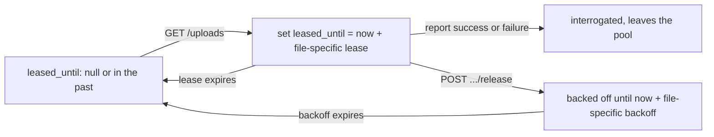

# File Leases for Multiple DHFS Replicas (Leafcutter Ant)

**Epic Type:** Implementation Epic

Epic planning and implementation follow the [Epic Planning and Marathon SOP](https://ghga.pages.hzdr.de/internal.ghga.de/main/sops/development/epic_planning/).

## Scope

### Outline

A Data Hub runs one DHFS replica.
[Army Ant](./epic-0091-army-ant.md) made the *parts* of a single file process concurrently, but DHFS still works through files one at a time, so a hub whose bottleneck is compute cannot add throughput by adding replicas.
That epic put multi-replica operation under "Not included" and called it a separate design challenge involving FIS.
This is that follow-up.

If a Data Hub were to attempt to run more than one replica today, each replica would receive the same unbounded list, and re-encrypt the same files.
This epic adds a lease to FIS: a file served to one replica is hidden from the next caller until the lease expires or the replica releases it.
Most of the new logic is in FIS.
DHFS sends a replica ID when requesting a new file, releases the file if interrogation is inconclusive, and stops sleeping between files.

### Included/Required

FIS:

- Add `leased_until`, `leased_by` and `times_claimed` to `FileUnderInterrogation`.
- Update the `GET /storages/{storage_alias}/uploads` handler to orchestrate file claims: serve one file, set `leased_until`, `leased_by` and `times_claimed`, and leave everything else unchanged.
- Add `POST /rpc/storages/{storage_alias}/uploads/{file_id}/release` so a replica can hand a file back before its lease expires.
- Add the compound index `{storage_alias: 1, state: 1, interrogated: 1, leased_until: 1, state_updated: 1}`.
  The `files` collection currently indexes only `object_id`.
- Add the configuration settings listed under [Configuration](#configuration).

DHFS:

- Send the service's existing `service_instance_id` on every claim and release, so FIS can tell one replica of a hub from another.
- Call the release endpoint from the `InconclusiveError` branch of `interrogate_new_files()`, which today only logs, and from the `ConclusiveError` branch when `report_failure` did not reach FIS.
- Release the file in flight on SIGTERM, in a single attempt that bypasses the retry transport.
- Skip the poll interval after conclusively *or* inconclusively processing a file, and sleep only when the request for the next file comes back empty.
  Serving one file per claim makes this required; see [Serving one file per claim requires the poll pacing change](#serving-one-file-per-claim-requires-the-poll-pacing-change).
- Add jitter of up to 10% to `min_run_interval_seconds`, as a constant rather than a setting, so replicas rolled out together stop polling in lockstep.

Deployment:

- Set `serviceInstanceId.fromPodName: true` in `services/datahub-file-service/chart-values.yaml`.
  The holder check is inert without it; see [Only the DHFS instance holding the file may release it](#only-the-dhfs-instance-holding-the-file-may-release-it).
  If a Data Hub isn't using Kubernetes, they'll need to ensure this `serviceInstanceId` is unique for every instance.

### Optional

- Give `S3Cleaner` a minimum object age, which bounds the cleanup race described under [The cleanup race widens](#the-cleanup-race-widens).
- Move `race_condition_retries` from `services/ucs/src/ucs/core/_rc_helper.py` into hexkit.
  Its docstring asks for that once a second service needs it.

### Not included

- Lease renewal or heartbeats.
  The lease is set once, at claim time.
- Serving more than one file per claim/claim request.
- A give-up state after N failed attempts.
  [Shovelnose Guitarfish](./epic-0092-shovelnose-guitarfish.md) already gives Data Stewards a requeue path.
- Per-replica identity in the JWT.
  `sub` is the storage alias, so two replicas of one hub are indistinguishable to the authentication layer.
- Raising `replicaCount` for any hub.
  The chart already supports it; this epic only makes it safe.
  `deploy/charts/dhfs/values.yaml` is generated, so a hub that wants more replicas changes `services/datahub-file-service/chart-values.yaml`.
  Again, that is only if they are using an orchestration layer comparable to Kubernetes.

## API Definitions

### RESTful/Synchronous

`GET /storages/{storage_alias}/uploads` keeps the same path, method and response model.
It now serves **at most one file**, and leases the file it serves.
The response shape still adheres to `BaseFileInformation`, which is unchanged.

New endpoint:

- `POST /rpc/storages/{storage_alias}/uploads/{file_id}/release`:
  - *Tell FIS to release a claimed file.*
  - Authenticated by the same Data Hub JWT and User-Agent check as the other three endpoints, and carries the caller's replica ID.
  - Applies only when the caller still holds the lease; see [Only the DHFS instance holding the file may release it](#only-the-dhfs-instance-holding-the-file-may-release-it).
  - Returns:
    - 204 on success, and also when the caller no longer holds the lease, because the caller cannot act on the difference
    - 404 if the file is unknown, or belongs to another storage alias

The storage alias check is required.
`_require_data_hub_jwt` only proves the caller is that hub; it does not prove the file belongs to it.
`handle_interrogation_report` omits this check today, so do not copy it from there.

## Additional Implementation Details

### What is a Lease?

Basically, it's the value set in `leased_until`.
That value encodes both states that a file can be held in: when claimed, it's set to `now + lease`, and when released, it's set to `now + backoff`.
If set to `null`, it means the file has never been claimed, or was requeued by a Data Steward after conclusive interrogation failure.
A claim prevents FIS from sending the file to another DHFS instance until the lease expires.



Because a conclusive report (be it successful or not) already sets `interrogated=True`, which removes the file from the candidate set, the report path doesn't need lease logic at all.

### The claim query

```python
filter_ = {
    "storage_alias": storage_alias,
    "state": "inbox",
    "interrogated": False,
    # The null branch must come first: the in-memory DAO evaluates $or lazily and
    # its $lt is a plain Python comparison, which raises TypeError on None.
    # Also note that GSI-2689 has been created for this.
    "$or": [{"leased_until": None}, {"leased_until": {"$lt": now}}],
}
```

hexkit allows this.
`validate_find_mapping` checks only that filter keys are model fields, and `validate_fields_in_model` drops keys starting with `$` (`libs/hexkit/src/hexkit/utils.py`), so a top-level `$or` passes.
Filter values are never inspected and go straight to pymongo.

`{"leased_until": None}` matches a missing field as well as a null one, so **no migration and no `DB_VERSION` bump are needed**.
A sentinel timestamp instead of null would need a backfill, because `$lt` against a Date matches neither null nor a missing field.
If the `$or` index union turns out to perform badly, the sentinel is the fallback, at the cost of that migration.

Sort ascending by `leased_until`, then by `state_updated`.
Null sorts before any date in both Mongo and the in-memory DAO, so never-claimed files come first and expired leases follow oldest-first.
The second key gives the window a deterministic order, so a claim pages through the same candidates each time.
Which of them a replica takes is then a random choice; see [The claim reads a window of candidates](#the-claim-reads-a-window-of-candidates).

### The claim itself

For each candidate, write the lease with an atomic check-and-set and skip the candidate if it fails:

```python
await self._file_dao.update(
    leased_file,
    precondition={
        "leased_until": value_just_read,
        "state": "inbox",
        "interrogated": False,
    },
)
```

`MongoDbDao.update` compiles the precondition into a single `replace_one`, so the check and the write are atomic.
Catch both `PreconditionFailedError` and `ResourceNotFoundError`: the provider distinguishes them with a second, non-atomic query, so a file deleted mid-claim surfaces as the latter.

The precondition must cover `state` and `interrogated`, not just `leased_until`.
`update()` replaces the whole document, and FIS runs the REST API and the outbox subscriber as two separate deployments (`fis` and `fis-consumer`).
Without those two keys, a claim that reads a file before a cancellation event and writes after it would resurrect `state="inbox", can_remove=False`.
[ADR-0005](../adrs/adr-0005-db-event-consistency.md) describes this read-modify-write hazard; here the two writers are different processes.

Two further rules for the claim path:

- **Never write `state_updated`.**
  `process_file_upload` drops events whose `state_updated` is not newer than the stored one.
  A claim that bumped it would make FIS discard the genuine cancelled or archived event that follows, so `can_remove` would never be set and the object would never be cleaned up.
- **Increment `times_claimed` at claim time, not at release.**
  A replica that is OOM-killed never releases, so a counter advanced only on release would leave a file that keeps failing retried at full speed forever.
  Incrementing at claim also makes the release endpoint idempotent, which matters because the retry transport repeats a POST on 5xx and on connection failures.

### Only the DHFS instance holding the file may release it

A release that is not checked against the current holder can clear a live lease for another holder.
Replica A claims a file, its lease expires while A is still working, B claims the file, and A then fails with an `InconclusiveError` and releases.
FIS overwrites B's lease with `now + backoff`, the next claim hands B's file to C, and two replicas interrogate the same file again.

So the claim stores `leased_by`, and a release applies only when the caller's replica ID matches it.
A release from any other replica changes nothing and FIS logs a warning.
The warning means a lease expired while a replica was still working, most often because `assumed_throughput_mib_per_second` is set too high, but also when S3 or the network degraded for that one file.

**Use the existing `service_instance_id` as the identifier, and stop setting it to a constant.**
hexkit already requires that setting and writes it into every log record as `instance` (`libs/hexkit/src/hexkit/log.py`), so reusing it adds no second identifier and lets a reader match a lease to the holder's own log lines.
Today the value is a fixed string: `services/datahub-file-service/dev_config.yaml` sets `"1"`, and the two demo instances use `"1"` and `"2"` for two different *hubs*, not two replicas.
Two replicas of one hub would then send the same value and every holder check would pass, so the failure above returns through configuration instead of code, and no warning is logged.

The chart already has the switch for this.
`serviceInstanceId.fromPodName` (`deploy/charts/dhfs/values.yaml`, default false) injects `DHFS_SERVICE_INSTANCE_ID` from the Downward API `metadata.name` (`deploy/charts/ghga-common/templates/_helpers.tpl:64-66`), and an environment variable takes precedence over the YAML file in hexkit's config order.
No member sets it today, so this epic must turn it on: without it, the first hub to raise `replicaCount` runs a holder check that never rejects anything.

Use the pod name rather than a UUID generated per process.
The pod name survives a container restart inside the same pod, so a container that is OOM-killed and restarted reclaims its own unexpired lease instead of waiting it out.
It also needs no code: `commandStyle: exec` runs without a shell, so `$HOSTNAME` is not reliably set, and a UUID would have to come from `socket.gethostname()` or the same Downward API variable anyway.

A pod that is deleted and rescheduled comes back under a new name and cannot reclaim anything.
That happens during a rollout, which the SIGTERM release covers instead.

### The lease duration

A claim serves one file, and that file carries its own lease, sized from its own bytes:

```python
lease_seconds = min(
    lease_base_seconds + encrypted_size_mib / assumed_throughput_mib_per_second,
    lease_cap_seconds,
)
```

`FileUnderInterrogation` already stores `encrypted_size`, so FIS needs nothing new to compute this.

The formula works only because DHFS starts the file as soon as it is served.
Serving several files at once would break it, since DHFS works through them serially and the later ones would be leased long before anything touched them.
So a claim serves one file, and no setting makes it serve more.

### One file per claim, but FIS's response is still in list format

The response stays `list[BaseFileInformation]`, now holding merely zero or one entry.
Keeping the list shape means DHFS needs no parsing change, and it leaves room to serve several files later should we do so.

DHFS's `for file in new_files` loop therefore needs no change: it iterates over zero or one item.
Leave the loop as it is.
`test_files_are_processed_one_at_a_time` (`tests/integration/test_interrogator.py:595`) already covers it, and keeping it lets FIS serve several files later without touching DHFS.

### Serving one file per claim requires the poll pacing change

`run_interrogator` sleeps out the remainder of `min_run_interval_seconds` after every round, whether or not the round did work.
One file per round therefore caps a replica at one file per interval: with the default of 60 seconds, a hub draining a thousand small files would take over sixteen hours per replica.

So DHFS must skip the sleep when the round processed a file, and sleep only when the claim came back empty.
Have `interrogate_new_files()` return whether it processed anything, and gate the existing sleep on that.

The backoff stops this from becoming a hot loop.
A file that fails inconclusively in a tenth of a second is released and backed off on the FIS side.
It is then absent from the next claim, which comes back empty and sends the replica to sleep.

The `except Exception` round in `run_interrogator` (`main.py:60`) reaches the same sleep.
It counts as a round that processed nothing, so an unhandled error does not spin the loop.

### Every path that ends without a report must release

A file is freed either by a report, which sets `interrogated=True`, or by a release.
Any path that produces neither leaves the file leased until expiry:

- `InconclusiveError` releases the file, which is the usual case.
- `ConclusiveError` where `report_failure` did not reach FIS must also release.
  `report_failure` catches `ConnectionFailedError`, `CentralAPIError` and bare `Exception` without re-raising (`core/interrogator.py:942-982`), and logs "DHFS will try re-processing this file later".
  That message is wrong once leases exist: the file waits out its lease instead of the next 60 second poll.
  So `report_failure` must return whether the report reached FIS, and the caller must release when it did not.
- `report_success` catching a `CentralAPIError` must **not** release.
  The comment at `interrogator.py:920-924` gives the reason: the round trip completed, so FIS may already have stored the report, and a second interrogation would use a different secret.
  Waiting is correct here, and the wait grows from 60 seconds to one lease.
  Listed under Known limitations.
- SIGTERM releases the file in flight.
  A pod killed with SIGKILL cannot, and the file waits out its lease.

The SIGTERM path is the largest piece of work in this epic, and raises the estimate to two sprints.
DHFS installs no signal handler today, and Python's default SIGTERM ends the process outright, so no `finally` runs, including the multipart abort at `core/interrogator.py:800-803`.
A killed replica therefore already leaves an orphaned upload behind.
Add a signal handler, cancel the in-flight interrogation, and release from a shutdown path.

That release must make **one attempt with a short timeout, outside the retry transport**.
`terminationGracePeriodSeconds` is unset for dhfs, so the window is the Kubernetes default of 30 seconds, shared with the multipart abort.
Three retries with `client_exponential_backoff_max` of 60 can exceed 30 seconds on their own.
A release sent through the normal transport would be killed mid-backoff and free nothing.

### The claim reads a window of candidates

Reading exactly one candidate and losing the check-and-set on it means the replica gets nothing and sleeps for a full `min_run_interval_seconds`, even on a hub with a thousand files waiting.
One file per claim is the worst case for contention, because every replica targets the same first row.

So the claim reads a window of candidates with `limit`, picks one at random, and takes the next random one when the check-and-set fails.
If it loses the whole window, it reads once more, since the window has moved; after a bounded number of rounds it gives up and returns nothing.

Picking at random is what keeps replicas off each other.
Walking the window top-down leaves every replica targeting the same first row, so each one has to lose a check-and-set before it finds work.
With a window of 50, two replicas that claim at the same moment pick the same file one time in 50.

Shuffle the window and walk the shuffled list, rather than calling `random.choice` once.
A single choice needs a second pick anyway when the check-and-set fails, and a shuffle gives those retries without re-reading.

The window is internal to the claim, and the endpoint still serves at most one file.
Make it a constant in FIS with a comment rather than a setting: its size follows from how many replicas contend, which an operator cannot judge.
Fifty candidates over at most two rounds is enough for any replica count a hub is likely to run, and 50 `FileUnderInterrogation` documents cost nothing to hold.
The sort still puts never-claimed files and the oldest expired leases in the window, so a file cannot be passed over indefinitely.

### Backoff

A release sets `leased_until = now + min(backoff_base * 2 ** max(times_claimed - 1, 0), backoff_cap)`.
Without a backoff, a file that fails in five seconds every time, one still being written to the inbox for example, is claimed, released and re-claimed in a tight loop by every replica.
The `max` guards the exponent: a release that arrives after `_requeue_file` has reset the counter would otherwise raise 2 to the power of -1 and back the file off by half the base.

`times_claimed` counts how often FIS handed the file out, including a claim stranded by a lost response and a claim the replica never started, so it runs ahead of the number of re-encryption attempts.
That is accurate enough for a backoff, and the name keeps anyone from reporting it to a Data Steward as a count of failed attempts.
This epic adds no give-up state, so the counter is the only signal that a file is stuck.
FIS must therefore log it: a warning at claim time, naming the file, once its count crosses a threshold constant.
A Data Steward uses that warning to decide whether to requeue the file through [Shovelnose Guitarfish](./epic-0092-shovelnose-guitarfish.md).

### Requeue

`_requeue_file` must also set `leased_until` and `leased_by` to null, and `times_claimed` to 0.
It already builds the new document from the event payload, which contains none of them, so this happens today by accident.
Make it explicit, because the same accident applies to the cancelled, failed and archived branch of `process_file_upload`.

### Configuration

All on FIS:

| Setting | Type | Default | Purpose |
|---|---|---|---|
| `lease_base_seconds` | int | 300 | Fixed part of the lease, covering setup and the poll interval. |
| `assumed_throughput_mib_per_second` | float | 25.0 | Divides the file's size into the variable part of the lease. |
| `lease_cap_seconds` | int | 21600 | Upper bound on any single lease, and so on how long a dead holder parks a file. |
| `claim_backoff_base_seconds` | int | 60 | First backoff after a release. |
| `claim_backoff_cap_seconds` | int | 3600 | Upper bound on the backoff. |

Set `assumed_throughput_mib_per_second` **below** what a hub really achieves.
Underestimating only makes the lease longer; overestimating expires it under a working replica and brings back the duplicate work this epic removes.
`dhfs verify` re-encrypts a dummy file and logs how long it took, so each hub can calibrate from its own measurement instead of this default.

**The cap bounds how long a dead holder can park a file, not how large a file the lease covers.**
One number cannot do both.
Covering a 5 TB file at 25 MiB/s takes roughly 58 hours, and a file out of circulation for two and a half days costs more than the duplicate work a lease prevents.
So choose a value the team can accept as an outage.
The default here is six hours.

At 25 MiB/s the cap takes effect above roughly 500 GB, and past that size the lease protects nothing.
Behaviour there is the same as today's: two replicas duplicate the work, one gets a 409 or a 500, and FIS logs one CRITICAL line.
The non-holder release warning names the file when that happens, so an operator can see it in the logs.
A file parked for days leaves no such trace.

A lease without renewal cannot cover a multi-terabyte file.
Heartbeats stay under Not included: they need a renewal endpoint, a renewal interval, progress reporting in DHFS and expiry rules under renewal, which is a second epic.
Write that epic once hubs regularly upload past the crossover above; the 5 TB figure comes from [Army Ant](./epic-0091-army-ant.md)'s part-sizing example, not from an upload anyone has seen.

### What running two replicas costs today

Throughput is not the only reason for a lease.
Two replicas finishing the same file do not produce a duplicate report, they produce a conflicting one: each re-encryption generates a new random secret, so `object_id` and both part checksum lists differ.
Which error the loser gets depends on the timing.
Arriving after the winner's report is stored, it takes the mismatch branch of `_check_if_report_is_duplicate`, which logs at CRITICAL and answers 409.
Arriving while the winner is still mid-report, it passes the duplicate check too, and both replicas deposit a secret with EKSS.
The loser's `insert` then raises `ResourceAlreadyExistsError`, which FIS answers with a 500 after deleting that secret again.
Either way a crash in that window leaks the loser's secret.

What the existing code does handle: no corrupted file record, no double-published event, and the loser's orphaned object is removed, because `check_if_removable` answers `True` for an object ID FIS does not know.
Uncoordinated replicas are wasteful and noisy, not unsafe.
A lease that expires too early costs CPU time and one CRITICAL log line, never data integrity.

### Known limitations

#### A lost response leases a file to nobody

The claim is a side effect of a GET that the client retries.
A response lost after the write, or a 500 retried three times, leaves one to three files leased to no worker, idle until the lease expires.
The pacing change makes DHFS poll far more often, so there are many more claims to lose.
`leased_by` covers the retried case, because the replica reclaims on its next claim the lease it already holds.
A claim whose response is lost to a replica that then dies still waits for expiry, bounded by `lease_cap_seconds`.

#### More requests against FIS

One file per claim plus immediate re-polling turns one GET per batch of work into one GET per file.
Draining a thousand files across four replicas means a thousand claims rather than a few hundred.
FIS already takes one report POST per file, so this is a change in degree, not in kind, but it is the first time the claim endpoint sees that volume.

#### A success report that returned an error now waits a lease

When `report_success` catches a `CentralAPIError`, DHFS deliberately leaves the file alone rather than re-interrogating it with a different secret.
That wait used to be one poll interval; it is now one lease, ended only by expiry.

#### The cleanup race widens

Between `complete_upload` and FIS accepting the report, the re-encrypted object is unknown to FIS, so `check_if_removable` answers `True` and a concurrent cleanup run deletes it.
One replica exposes one object at a time; several replicas expose several.
The optional minimum object age in `S3Cleaner` bounds this.

#### A late report for a cancelled file is still accepted

`handle_interrogation_report` has no state guard, so a success report arriving after a cancellation still publishes `interrogation_success`.
This is existing behaviour and leases do not change it, but more replicas make the window easier to hit.

### Rollout

FIS ships first.
Leases apply to every caller, so a DHFS that predates this epic keeps working; it never releases a file and waits out the lease on inconclusive ones.

Raise `dhfs_version_constraint` only after the hubs have upgraded, in a later release.
Raising it together with the feature is a flag day: a hub still on the old image gets 426, which DHFS turns into a `CriticalError`.
`run_interrogator` then returns, and the container crash-loops with no interrogation until that hub upgrades.
The same happens to the old pods during each hub's own rolling update.

If the epic must fit one sprint, cut the SIGTERM release, not the holder check.
Keep `serviceInstanceId.fromPodName`, which is one line and still recovers a container that restarts inside its pod.
A pod deleted mid-file then parks that file for up to `lease_cap_seconds`.

### What was checked and ruled out

Considered holding the lease in its own `fileLeases` collection, keyed by file ID.
That would keep lease state off the document the outbox subscriber replaces wholesale from a separate process, and a first claim would be a plain `insert()`.
Rejected because the candidate query could no longer filter on lease state in Mongo.
FIS would fetch every uninterrogated file for the hub and filter them in Python, the unbounded query this epic removes.
Taking over an expired lease also needs a check-and-set on the lease document, so the atomic-insert advantage only covers first claims.
Widening the precondition to include `state` and `interrogated` closes the cross-process hazard at a far lower cost.

Considered keeping a multi-file claim by sizing each file's lease from a prefix sum, so file *i* is leased for `base + (sizes through i) / throughput`.
That would preserve batching, which means no pacing change and no rise in request volume.
Rejected for three reasons.
One slow file stretches every lease behind it.
A replica that dies strands the whole batch for the full cumulative window instead of one file.
The lease also no longer describes the file it is attached to, which makes it harder to reason about later.

### Why the claim stays on GET

The claim mutates on a GET, and the retry transport repeats it.
`client_num_retries` is 3 over a set including 500, 502, 503 and 504, so one claim can strand up to three leases.
`leased_by` makes the repeat safe, because the same replica reclaims its own lease.

A `POST /storages/{storage_alias}/uploads/claim` with the GET left read-only would be cleaner, but it does not fit the rollout.
Leases have to bind every caller from the moment FIS ships, including a DHFS that predates this epic and only knows the GET.
A new endpoint would leave leases applying to nobody until every hub had upgraded, the flag day that deferring `dhfs_version_constraint` avoids.

Follow-ups: give the route a summary and docstring that say it claims rather than lists, rename `get_files_not_yet_interrogated` to match, and regenerate `services/fis/openapi.yaml`, `config_schema.json`, `example_config.yaml` and the README config block with `just service-docs`.
The five settings also go into `services/fis/dev_config.yaml` and `tests_fis/fixtures/test_config.yaml` by hand.

### Testing

Existing tests that change:

- `tests_fis/unit/test_core.py:340` `test_get_files_not_yet_interrogated` calls the method four times and expects the same files back.
  Rewrite it: the semantics are what changed.
- `tests_fis/unit/test_api.py:120` `test_list_uploads` inserts five files and expects five back, so it breaks once a claim serves one.
- `tests_fis/unit/test_core.py:282` `test_process_file_upload_requeue` must gain assertions on the three reset fields.
- Every DHFS test that takes the inconclusive path, once DHFS calls release: `CentralApiMock` raises `NotMockedError` for an unrouted path, so the mock needs a release route.
  Affected: `test_interrogator.py:254`, `:368`, `:701`, `:812`.

New unit tests, on the `rig` fixture, with the clock frozen rather than slept through:

- A claim serves and leases one file, a second claim returns none, and a claim after the lease expires serves it again.
- Never-claimed files are served before expired ones.
- A claim picks at random within the window: seed the RNG, or set up fewer files than the window holds and assert the set rather than the order.
- The lease is sized from the file's own `encrypted_size`, and the cap holds for a very large file.
- Release applies the backoff, the cap holds, and a repeated release is idempotent.
- Releasing a file that belongs to another storage alias is rejected.
- Two claims carrying the same `service_instance_id` count as one replica, which guards against the chart switch being off.
- A cancelled event for a leased file does not resurrect it, and the file is not served again.
- A claim over a collection that holds a `leased_until=None` document, which catches the in-memory DAO's `$lt` behaviour.

New integration tests, on `JointFixture` with the Mongo testcontainer, since the in-memory DAO cannot prove these:

- Two concurrent claims through `asyncio.gather` return disjoint sets whose union is everything available.
  Only this test proves the check-and-set.
- The claim filter matches a document inserted without `leased_until` at all, which proves no migration is needed.
- `explain()` on the claim query does not collection-scan.
  Assert the absence of a COLLSCAN rather than a single clean IXSCAN: `$or` plans as a SUBPLAN over one index scan per branch, with a blocking SORT on top.

New DHFS tests:

- A round that processed a file polls again without sleeping, and a round that claimed nothing sleeps.
  Test the decision, not the wall clock.
- A response holding more than one file is still processed in full, which guards the untouched loop.
- Release is called for an inconclusive file, and for a conclusive one only when `report_failure` did not land; a failing release neither masks the original error nor stops the service.
- A release from a replica that no longer holds the lease leaves the lease untouched, and logs the warning.
- SIGTERM releases the file in flight.

## Human Resource/Time Estimation

Number of sprints required: 2

Number of developers required: 1
