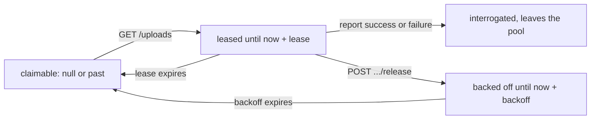

# File Leases for Multiple DHFS Replicas (Leafcutter Ant)

**Epic Type:** Implementation Epic

Epic planning and implementation follow the [Epic Planning and Marathon SOP](https://ghga.pages.hzdr.de/internal.ghga.de/main/sops/development/epic_planning/).

## Scope

### Outline

A Data Hub runs one DHFS replica.
[Army Ant](./epic-0091-army-ant.md) made the *parts* of a single file process concurrently, but DHFS still works through files one at a time, so a hub whose bottleneck is compute cannot add throughput by adding replicas.
That epic put multi-replica operation under "Not included" and called it a separate design challenge involving FIS.
This is that follow-up.

Two replicas today both call `GET /storages/{alias}/uploads`, receive the same unbounded list, and re-encrypt the same files.
This epic adds a lease to FIS: a file served to one replica is hidden from the next caller until the lease expires or the replica releases it.
Almost all of the change is in FIS, with just a few tweaks to DHFS.

### Included/Required

FIS:

- Add `leased_until` and `times_claimed` to `FileUnderInterrogation`.
- Turn the `GET /storages/{alias}/uploads` handler into a claim: serve one file, hide it from the next caller, and leave everything else unchanged.
- Add `POST /storages/{alias}/uploads/{file_id}/release` so a replica can hand a file back before its lease expires.
- Add a compound index covering the claim query.
  The `files` collection currently indexes only `object_id`.
- Add the configuration settings listed under [Configuration](#configuration).

DHFS:

- Call the release endpoint from the `InconclusiveError` branch of `interrogate_new_files()`, which today only logs.
- Skip the poll interval when a round processed a file, and sleep only when the claim came back empty.
  Serving one file per claim makes this required; see [Serving one file per claim requires the poll pacing change](#serving-one-file-per-claim-requires-the-poll-pacing-change).
- Add jitter to `min_run_interval_seconds`, so replicas rolled out together stop polling in lockstep.

### Optional

- Send a process-scoped replica ID in a request header and store it as `leased_by`, so FIS can serve the same replica its own unexpired leases again.
  This makes the claim idempotent and closes the gap described under [A lost response leases a file to nobody](#a-lost-response-leases-a-file-to-nobody).
  It also puts "which replica is stuck on this file" in the FIS logs.
- Release the file DHFS is holding when a `CriticalError` stops the service, and on SIGTERM.
- Give `S3Cleaner` a minimum object age, which bounds the cleanup race described under [The cleanup race widens](#the-cleanup-race-widens).
- Move `race_condition_retries` from `services/ucs/src/ucs/core/_rc_helper.py` into hexkit.
  Its docstring asks for that once a second service needs it.

### Not included

- Lease renewal or heartbeats.
  The lease is set once, at claim time.
- Serving more than one file per claim, and the parallel file processing inside a DHFS replica that would have to come first.
- A give-up state after N failed attempts.
  [Shovelnose Guitarfish](./epic-0092-shovelnose-guitarfish.md) already gives Data Stewards a requeue path.
- Per-replica identity in the JWT.
  `sub` is the storage alias, so two replicas of one hub are indistinguishable to the authentication layer.
- Raising `replicaCount` for any hub.
  The chart already supports it; this epic only makes it safe.
  `deploy/charts/dhfs/values.yaml` is generated, so a hub that wants more replicas changes `services/datahub-file-service/chart-values.yaml`.

## API Definitions

### RESTful/Synchronous

`GET /storages/{storage_alias}/uploads` keeps its path, method and response model.
It now serves at most one file, and leases the file it serves.
`BaseFileInformation` is unchanged, so DHFS parses the response exactly as before.

New endpoint:

- `POST /storages/{storage_alias}/uploads/{file_id}/release`:
  - *Hand a claimed file back to FIS before its lease expires.*
  - Authenticated by the same Data Hub JWT and User-Agent check as the other three endpoints.
  - Returns:
    - 204 on success
    - 404 if the file is unknown, or belongs to another storage alias

The alias check is required.
`_require_data_hub_jwt` only proves the caller is that hub; it does not prove the file belongs to it.
`handle_interrogation_report` omits this check today, so do not copy it from there.

## Additional Implementation Details

### What a lease is

One nullable field, `leased_until`, carries both states a file can be held in: a claim sets it to `now + lease`, a release sets it to `now + backoff`.
`null` means the file has never been claimed, or was requeued.



A conclusive report already sets `interrogated=True`, which removes the file from the candidate set, so neither report path needs lease handling.

### The claim query

```python
filter_ = {
    "storage_alias": storage_alias,
    "state": "inbox",
    "interrogated": False,
    # The null branch must come first: the in-memory DAO evaluates $or lazily and
    # its $lt is a plain Python comparison, which raises TypeError on None.
    "$or": [{"leased_until": None}, {"leased_until": {"$lt": now}}],
}
```

hexkit allows this.
`validate_find_mapping` checks only that filter keys are model fields, and `validate_fields_in_model` drops keys starting with `$` (`libs/hexkit/src/hexkit/utils.py:115`), so a top-level `$or` passes.
Filter values are never inspected and go straight to pymongo.

`{"leased_until": None}` matches a missing field as well as a null one, so **no migration and no `DB_VERSION` bump are needed**.
A sentinel timestamp instead of null would need a backfill, because `$lt` against a Date matches neither null nor a missing field.
If the `$or` index union turns out to perform badly, the sentinel is the fallback, at the cost of that migration.

Sort ascending by `leased_until`, then by `state_updated`.
Null sorts before any date in both Mongo and the in-memory DAO, so never-claimed files come first and expired leases follow oldest-first.
The second key breaks the tie among never-claimed files, which otherwise share one sort key and are handed out in the same order to every replica.

### The claim itself

For each candidate, write the lease with an atomic check-and-set and skip the candidate if it fails:

```python
await self._file_dao.update(
    leased_file,
    precondition={
        "leased_until": value_just_read,
        "state": "inbox",
        "interrogated": False,
    },
)
```

`MongoDbDao.update` compiles the precondition into a single `replace_one`, so the check and the write are atomic.
Catch both `PreconditionFailedError` and `ResourceNotFoundError`: the provider distinguishes them with a second, non-atomic query, so a file deleted mid-claim surfaces as the latter.

The precondition must cover `state` and `interrogated`, not just `leased_until`.
`update()` replaces the whole document, and FIS runs the REST API and the outbox subscriber as two separate deployments (`fis` and `fis-consumer`).
Without those two keys, a claim that reads a file before a cancellation event and writes after it would resurrect `state="inbox", can_remove=False`.

Two further rules for the claim path:

- **Never write `state_updated`.**
  `process_file_upload` drops events whose `state_updated` is not newer than the stored one.
  A claim that bumped it would make FIS discard the genuine cancelled or archived event that follows, so `can_remove` would never be set and the object would never be cleaned up.
- **Increment `times_claimed` at claim time, not at release.**
  A replica that is OOM-killed never releases, so a counter advanced only on release would leave a poison file retried at full speed forever.
  Incrementing at claim also makes the release endpoint idempotent, which matters because the retry transport repeats a POST on 5xx and on connection failures.

### The lease duration

A claim serves one file, and that file carries its own lease, sized from its own bytes:

```python
lease_seconds = min(
    lease_base_seconds + encrypted_size_mib / assumed_throughput_mib_per_second,
    lease_cap_seconds,
)
```

`FileUnderInterrogation` already stores `encrypted_size`, so FIS needs nothing new to compute this.

The formula holds only because DHFS starts the file as soon as it is served.
Serving several files at once would break it, since DHFS works through them serially and the later ones would be leased long before anything touched them.
That is the reason a claim serves one file, and the reason there is no setting to make it serve more.

### One file per claim, but still a list

The response stays `list[BaseFileInformation]`, now holding zero or one entry.
Keeping the list shape means DHFS needs no parsing change, and it leaves room to serve several files later without another API version.

DHFS's `for file in new_files` loop therefore needs no change at all: it iterates over zero or one item.
Leave it alone rather than unrolling it.
It costs nothing, `test_files_are_processed_one_at_a_time` (`tests/integration/test_interrogator.py:595`) already covers it, and it is what makes serving several files later a FIS-only change.

### Serving one file per claim requires the poll pacing change

`run_interrogator` sleeps out the remainder of `min_run_interval_seconds` after every round, whether or not the round did work.
One file per round therefore caps a replica at one file per interval: with the default of 60 seconds, a hub draining a thousand small files would take over sixteen hours per replica.

So DHFS must skip the sleep when the round processed a file, and sleep only when the claim came back empty.
The smallest form is to have `interrogate_new_files()` report whether it handled anything and gate the existing sleep on that.
This is the one item that moved from "not included" to required, and serving one file per claim is what forced it.

The backoff is what stops this from becoming a hot loop.
A file that fails inconclusively in a tenth of a second is released, backed off on the FIS side, and so absent from the next claim, which comes back empty and sends the replica to sleep.

### Candidates are not a batch

Reading exactly one candidate and losing the check-and-set on it means the replica gets nothing and sleeps for a full `min_run_interval_seconds`, even on a hub with a thousand files waiting.
One file per claim is the worst case for contention, because every replica targets the same first row.

So the claim reads a small window of candidates, walks down it, and returns the first one it wins.
If it loses the whole window, it reads once more, since the window has moved; after a bounded number of rounds it gives up and returns nothing.

This window is internal to the claim and has no bearing on what the endpoint serves, which is always at most one file.
Make it a constant in FIS with a comment, not a configuration setting: it is sized by how many replicas might contend, which no operator is in a position to tune.

### Backoff

A release sets `leased_until = now + min(backoff_base * 2 ** (times_claimed - 1), backoff_cap)`.
Without it, a file that fails in five seconds every time — one still being written to the inbox, say — is claimed, released and re-claimed in a tight loop by every replica.

The counter is named for what it measures, not for what it is used for.
It counts how often FIS handed the file out, which includes a claim stranded by a lost response and a claim the replica never got to work on, so it runs ahead of the number of times DHFS actually attempted a re-encryption.
That is accurate enough to drive a backoff, and the honest name keeps anyone from later reading it to a Data Steward as a count of failed attempts.
It is also the only signal that a file is stuck, since this epic adds no give-up state.

### Requeue

`_requeue_file` must also set `leased_until` to null and `times_claimed` to 0.
It already builds the new document from the event payload, which carries neither field, so this happens today by accident.
Make it explicit, because the same accident applies to the cancelled, failed and archived branch of `process_file_upload`.

### Configuration

All on FIS:

| Setting | Purpose |
|---|---|
| `lease_base_seconds` | Fixed part of the lease, covering setup and the poll interval. |
| `assumed_throughput_mib_per_second` | Divides the file's size into the variable part of the lease. |
| `lease_cap_seconds` | Upper bound on any single lease. |
| `claim_backoff_base_seconds` | First backoff after a release. |
| `claim_backoff_cap_seconds` | Upper bound on the backoff. |

### What running two replicas costs today

The lease is a throughput mechanism, but it is not only that.
Two replicas finishing the same file do not produce a duplicate report, they produce a conflicting one: each re-encryption draws a new random secret, so `object_id` and both part checksum lists differ.
`_check_if_report_is_duplicate` therefore takes the mismatch branch, logs at CRITICAL and answers 409, every single time.
Both replicas also deposit a secret with EKSS before either stores a report, and the loser's secret is deleted only if its cleanup path runs; a crash in that window leaks it.

What the existing code does handle: no corrupted file record, no double-published event, and the loser's orphaned object is removed, because `check_if_removable` answers `True` for an object ID FIS does not know.
So uncoordinated replicas are wasteful and noisy rather than unsafe — and a lease that expires too early costs CPU and one CRITICAL log line, never data integrity.

### Known limitations

#### A lost response leases a file to nobody

The claim is a side effect of a GET that the client retries.
A response lost after the write, or a 500 retried three times, leaves one to three files leased with no worker behind them, idle until the lease expires.
This is the sharpest remaining edge, because the pacing change makes DHFS poll far more often, so there are many more claims to lose.
The optional replica ID header fixes it; `lease_cap_seconds` bounds the damage without it.

#### More requests against FIS

One file per claim plus immediate re-polling turns one GET per batch of work into one GET per file.
Draining a thousand files across four replicas means a thousand claims rather than a few hundred.
FIS already takes one report POST per file, so this is a change in degree, not in kind, but it is the first time the claim endpoint sees that volume.

#### The cleanup race widens

Between `complete_upload` and FIS accepting the report, the re-encrypted object is unknown to FIS, so `check_if_removable` answers `True` and a concurrent cleanup run deletes it.
One replica exposes one object at a time; several replicas expose several.
The optional minimum object age in `S3Cleaner` bounds this.

#### A late report for a cancelled file is still accepted

`handle_interrogation_report` has no state guard, so a success report arriving after a cancellation still publishes `interrogation_success`.
This is existing behaviour and leases do not change it, but more replicas make the window easier to hit.

### Rollout

FIS ships first.
Leases apply to every caller, so a DHFS that predates this epic keeps working; it simply never releases a file and waits out the lease on inconclusive ones.

Raise `dhfs_version_constraint` only after the hubs have upgraded, in a later release.
Raising it together with the feature is a flag day: a hub still on the old image gets 426, which DHFS turns into a `CriticalError`, and `run_interrogator` returns and the container crash-loops with no interrogation at all until that hub upgrades.
The same happens to the old pods during each hub's own rolling update.

### What was checked and ruled out

Considered holding the lease in its own `fileLeases` collection, keyed by file ID.
That would keep lease state off the document the outbox subscriber replaces wholesale from a separate process, and a first claim would be a plain `insert()`.
Rejected because the candidate query would no longer be able to filter on lease state in Mongo: FIS would have to fetch every uninterrogated file for the hub and then filter, which is the unbounded query this epic exists to remove.
Taking over an expired lease also needs a check-and-set on the lease document, so the atomic-insert advantage only covers first claims.
Widening the precondition to include `state` and `interrogated` closes the cross-process hazard at a far lower cost.

### Testing

Existing tests that change:

- `tests_fis/unit/test_core.py:340` `test_get_files_not_yet_interrogated` calls the method four times and expects the same files back.
  Rewrite it: the semantics are what changed.
- `tests_fis/unit/test_api.py:120` `test_list_uploads` inserts five files and expects five back, so it breaks once a claim serves one.
- `tests_fis/unit/test_core.py:282` `test_process_file_upload_requeue` must gain assertions on the two reset fields.
- Every DHFS test that takes the inconclusive path, once DHFS calls release: `CentralApiMock` raises `NotMockedError` for an unrouted path, so the mock needs a release route.
  Affected: `test_interrogator.py:254`, `:368`, `:701`, `:812`.

New unit tests, on the `rig` fixture, with the clock frozen rather than slept through:

- A claim serves and leases one file, a second claim returns none, and a claim after the lease expires serves it again.
- Never-claimed files are served before expired ones.
- The lease is sized from the file's own `encrypted_size`, and the cap holds for a very large file.
- Release applies the backoff, the cap holds, and a repeated release is idempotent.
- Releasing a file that belongs to another storage alias is rejected.
- A cancelled event for a leased file does not resurrect it, and the file is not served again.
- A claim over a collection that holds a `leased_until=None` document, which is what catches the in-memory DAO's `$lt` behaviour.

New integration tests, on `JointFixture` with the Mongo testcontainer, since the in-memory DAO cannot prove these:

- Two concurrent claims through `asyncio.gather` return disjoint sets whose union is everything available.
  This is the only test that proves the check-and-set.
- The claim filter matches a document inserted without `leased_until` at all, which is what proves no migration is needed.
- `explain()` on the claim query uses the compound index and does not collection-scan.

New DHFS tests:

- A round that processed a file polls again without sleeping, and a round that claimed nothing sleeps.
  Test the decision, not the wall clock.
- A response holding more than one file is still processed in full, which guards the untouched loop.
- Release is called for an inconclusive file and never for a conclusive one, and a failing release neither masks the original error nor stops the service.

## Human Resource/Time Estimation

Number of sprints required: 1

Number of developers required: 1
