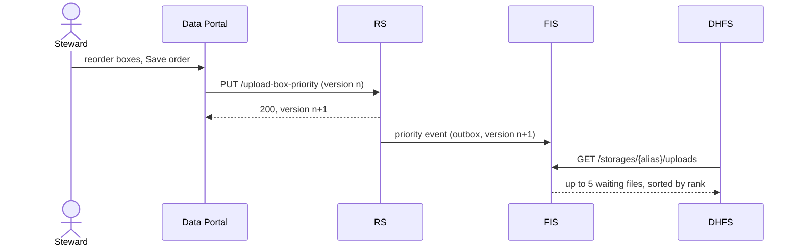

# Upload Box Prioritization for Re-encryption (Shoebill)

**Epic Type:** Implementation Epic

Epic planning and implementation follow the [Epic Planning and Marathon SOP](https://ghga.pages.hzdr.de/internal.ghga.de/main/sops/development/epic_planning/).

## Scope

### Outline

DHFS re-encrypts files in whatever order FIS returns them, and FIS returns them in no defined order.
This epic lets a data steward rank research data upload boxes in the Data Portal, so that DHFS re-encrypts all files of a higher-ranked box before any file of a lower-ranked one.
Files in unranked boxes come after all files in ranked boxes, with no order among them.

RS stores the box ranking as one list and publishes it through the outbox.
FIS consumes it, and its existing `GET /storages/{storage_alias}/uploads` endpoint returns at most five waiting files, sorted by rank.
DHFS processes them in that order, and asks again right after a batch, instead of waiting for the next poll interval.

### Included/Required

- **RS** must store the priority list as a single document, holding an ordered list of entries, a `version` counter, `changed_by` and `last_changed`.
  Each entry holds the research data upload box ID and its file upload box ID, because data stewards rank research data upload boxes and FIS knows only file upload boxes.
  Index 0 is the highest priority.
  `changed_by` and `last_changed` mirror the research data upload box fields of the same names: the ID of the steward whose save, archival or deletion changed the list, and the time from `now_utc_ms_prec()`.
  Every change that increments `version` sets both.
- RS must expose the list to data stewards through a read and a replace endpoint (see [API definitions](#api-definitions)).
  The replace endpoint must reject a request whose `version` does not match the stored one, so that two stewards editing at the same time cannot overwrite each other unnoticed.
  Each saved edit increments the `version` counter.
- RS must reject a list with duplicate boxes, unknown boxes, or boxes that are already `"archived"`.
- RS must remove a box from the list when the box is deleted or archived.
  Each removal increments `version` (reiterating that from a few lines above, just to be clear).
- RS must publish the document through the outbox (`MongoKafkaDaoPublisherFactory`), with a fixed key on a compacted topic, so a FIS instance that starts later still receives the current list.
- RS must write an audit record for every change to the list, through a new `AuditRepositoryPort` method next to `log_box_updated()`, e.g. `log_box_priority_updated()`.
  The record has `action` `"U"`, `entity` `"UploadBoxPriority"`, `entity_id` `"global"`, and the ID of the steward who saved, archived or deleted.
  Its description names the new `version` and the old and new order of research data upload box IDs, so the audit log alone can reconstruct the history.
  A removal because of archival or deletion gets its own record, next to the existing box record.
- **ghga-event-schemas** must define the payload schema for the priority list's event, as well as a config class for the new topic.
- **FIS** must consume the priority events and store the list, ignoring any event whose `version` is not higher than the stored one.
  RS never deletes the document; if a `deleted` event arrives anyway, FIS must treat it as an empty list.
- FIS must store `box_id` (the file upload box ID) on each file.
  It is already part of the `FileUpload` event, and FIS currently drops it.
  The field is optional with default `None`, because files stored before this epic lack it until the backfill below.
- FIS must fill in a missing `box_id` when it receives a `FileUpload` event for a file it already has, even if the event is not newer than the stored file.
  This branch lets a UCS republish backfill the field (see [Rollout](#rollout)).
- FIS must sort not-yet-interrogated ("waiting") files with a MongoDB aggregation, as described in [Sorting the waiting files](#sorting-the-waiting-files).
- FIS must return at most five files per request, set by a hardcoded constant, e.g. `MAX_FILES_PER_REQUEST = 5`, not a config setting.
  At hundreds of thousands of waiting files, an unbounded response would move every file from MongoDB to FIS and on to DHFS on each poll.
- **DHFS** must process the files in the order FIS returns them.
  It already does so today; this just reiterates that requirement.
- DHFS must skip the `min_run_interval_seconds` wait after a round in which it concluded at least one file, whether it succeeded or reported a failure.
  It must still wait after a round in which FIS returned no file, or every file ended with an `InconclusiveError`.
- **Data Portal** must offer a page where data stewards view and edit the list, as described in [Data Portal page](#data-portal-page).
- **Testbed** must cover the feature end to end, as described in [Testbed](#testbed).
- The testbed must assert the order in which DHFS interrogates files.

### Optional

- RS may expose each box's position in the list on the research data upload box responses, so a client can show it without a second request.

### Not included

- Single-file responses.
  Epic 94 (Leafcutter Ant) lowers the cap to one file, together with the changes that requires.
- No order within a box, and no order among unranked boxes.
  Files of the same rank are ordered by `_id` only, so that the result is deterministic.
- Running more than one DHFS instance per storage alias.
  FIS has no claim mechanism, so two instances would receive and process the same file.
  Epic 94 (Leafcutter Ant) adds what multi-instance operation needs.
- Prioritizing individual files.
- A priority list per storage alias.
  The list is global, and FIS filters by storage alias before ranking, so each Data Hub sees the global order restricted to its own files.

## User Journeys

All journeys are a data steward's; no other role sees the page or the endpoints.
The [basic prototype](./prototype.html) walks through each of them, including the error paths.

1. **View the order.**
   The steward opens **Manage Box Priority** from the Upload Box Manager.
   The page loads the priority list and the boxes, and shows the ranked boxes in order and every other non-archived box as unranked.
   It also shows the version, and who last changed the order and when.
2. **Rank a box.**
   The steward clicks **Add** on an unranked box, which appends it to the bottom of the order, then drags it or uses its buttons to place it.
   **Save order** stores the new order; the page shows the new version, the steward as the last to change it, and a confirmation.
3. **Unrank a box.**
   The steward clicks **Remove** on a ranked box, which moves it back to the unranked boxes, and saves.
4. **Discard edits.**
   **Discard changes** restores the last saved order.
   Leaving the page with unsaved edits asks for confirmation first.
5. **Another steward saved first.**
   The save fails with a version conflict.
   The page keeps the steward's edits on screen and offers **Reload latest order**, which replaces them with the stored order; the steward applies their edits again.
6. **A box was archived or deleted meanwhile.**
   The save fails because a box the steward added no longer exists or is archived.
   The page removes that box from the edited order, keeps the other edits, and asks the steward to save again.
7. **The save fails for another reason.**
   The page keeps the edits and asks the steward to try again.
8. **Files follow the order (no user action).**
   RS publishes the saved order; FIS stores it within seconds; each DHFS gets files in the new order from its next request.



## API Definitions

### RESTful/Synchronous

RS gets two endpoints on a new router.
Both require the Data Steward role through `StewardAuthContext`, like the existing steward-only RS endpoints, and both answer `401` without a valid token and `403` without the role.

- `GET /upload-box-priority`: return the current priority list.
  - `200`: the stored document, with `version`, `entries`, `changed_by` and `last_changed` as in the [event payload](#payload-schemas-for-events).
    If no list has been saved yet, the body is `{"version": 0, "entries": [], "changed_by": null, "last_changed": null}`, so the Data Portal needs no special case beyond the empty change fields.
- `PUT /upload-box-priority`: replace the priority list.
  The body holds `version`, the version the steward edited, and `box_ids`, the ordered research data upload box IDs.
  RS resolves each file upload box ID itself.
  - `200`: the stored document with its new `version`, `changed_by` and `last_changed`.
    It returns the document instead of `204`, which the other RS write endpoints use, so the Data Portal can take the new values without a second request.
  - `404`: a box ID that does not exist.
  - `409`: either `version` does not match the stored one, or a box is archived.
    Each case gets its own `HttpCustomExceptionBase` subclass and `exception_id`, so the Data Portal can tell them apart and offer a reload only for the version conflict.
  - `422`: a malformed body, or a box ID that appears twice.

FIS keeps its paths and response models unchanged.
The list from `GET /storages/{storage_alias}/uploads` now holds at most five files, and its order, undefined until now, follows the rank, which DHFS relies on (see [Sorting the waiting files](#sorting-the-waiting-files)).

### Payload Schemas for Events

The outbox publishes the stored document on a new topic, e.g. `upload-box-priority`, keyed by the fixed document ID.
The event types are the outbox's `upserted` and `deleted`.

```json
{
  "id": "global",
  "version": 7,
  "changed_by": "2b6f1c9e-3d4a-4e5b-8c7d-9e0f1a2b3c4d",
  "last_changed": "2026-10-14T13:02:11.482Z",
  "entries": [
    {
      "research_data_upload_box_id": "4f0b3c1e-8a9d-4b7e-9c2a-1d3e5f7a9b0c",
      "file_upload_box_id": "a1c2e3f4-5b6d-4e8f-9a0b-1c2d3e4f5a6b"
    },
    {
      "research_data_upload_box_id": "7d8e9f0a-1b2c-4d3e-8f4a-5b6c7d8e9f0a",
      "file_upload_box_id": "0e1f2a3b-4c5d-4e6f-8a7b-9c0d1e2f3a4b"
    }
  ]
}
```

FIS reads only `version` and `entries[].file_upload_box_id`.

## Additional Implementation Details

### Why one list

The main alternative was a rank field on each research data upload box, propagated to FIS through the existing box events.
Moving one box then rewrites the rank of every box between its old and new position, and readers can see a half-updated order, since MongoDB updates several documents without a transaction.
A single document changes in one write, carries the full state in one event, and lets consumers apply events idempotently.

Another alternative was to relay requests from RS to UCS and update all FileUploads within each affected box.
However, this is too clumsy and heavy-handed to be seriously considered.

### Sorting the waiting files

FIS should not use the hexkit DAO protocol to sift through the waiting files.
We need to perform a `$match` on `state` and `storage_alias`, try to find the box ID's rank in the priority collection (if applicable), and rank file results accordingly.
This can be done partially with a DAO and partially in memory, but requires either A) loading all waiting files into memory and ranking them there, or B) performing multiple queries (e.g. one for prioritized boxes and one for unprioritized boxes, or similar).
As the number of waiting files grows, so too does the amount of data we would have to pull back from the DB only to drop 99% of it.
Instead, we should add an outbound port, e.g. `InterrogationQueuePort`, and a MongoDB adapter that uses `ConfiguredMongoClient` directly, and allow the DB to perform the filtering and sorting.
`services/mass/src/mass/adapters/outbound/aggregator.py` and `services/ucs/src/ucs/adapters/outbound/box_stats.py` follow the same pattern.

```python
pipeline = [
    {"$match": {"storage_alias": storage_alias, "state": "inbox", "interrogated": False}},
    {"$lookup": {
        "from": priority_collection_name,
        "pipeline": [{"$match": {"_id": PRIORITY_DOC_ID}}, {"$project": {"_id": 0, "entries": 1}}],
        "as": "priority",
    }},
    {"$set": {"rank": {"$indexOfArray": [
        {"$ifNull": [{"$first": "$priority.entries.file_upload_box_id"}, []]},
        "$box_id",
    ]}}},
    {"$set": {"unprioritized": {"$eq": ["$rank", -1]}}},
    {"$sort": {"unprioritized": 1, "rank": 1, "_id": 1}},
    {"$limit": MAX_FILES_PER_REQUEST},
    {"$project": {"priority": 0, "rank": 0, "unprioritized": 0}},
]
```

- The `$lookup` does not depend on the file document, so MongoDB runs it once per query.
- `$indexOfArray` compares BSON types.
  If `file_upload_box_id` and `box_id` are stored with different types, such as a binary UUID and a string, every file counts as unprioritized and no error occurs.
  We could add a test to cover this with both values written through the hexkit DAOs, but it's not necessary.
  The most likely reason this kind of mixup would happen is a future Migration that writes a string directly to the DB.
  However, in that case it should be caught by model validation.
- The adapter must map `_id` back to `id` itself.
  Define both collection names as constants, as UCS does with `FILE_UPLOADS_COLLECTION`, and pass them to the DAO factory and the adapter alike.
- The aggregation is chosen because of the `$limit`.
  MongoDB combines it with the `$sort` and keeps only the top five documents in memory, so five documents cross the network and are validated per request.
  Sorting in Python after a DAO query would fetch and validate every waiting file first.
  Epic 94 lowers the limit to one.

### DHFS loop

`Interrogator.interrogate_new_files()` processes the files of a batch one after another, and `run_interrogator()` in `services/datahub-file-service/src/dhfs/main.py` waits for the rest of `min_run_interval_seconds` after every round.
`interrogate_new_files()` must tell the caller whether it concluded at least one file, and `run_interrogator()` must skip the wait if it did.

An `InconclusiveError` leaves the file uninterrogated in FIS, so the next request returns it again.
Waiting after a round in which every file was inconclusive keeps DHFS from requesting the same batch in a tight loop.
A file that stays inconclusive does not block the rest of its batch, as today.
It does take one of the five places in every batch, since it keeps its rank.
Five such files in the highest ranks fill every batch and stall interrogation for that storage alias, until a file stops failing or a data steward moves its box.
Epic 94's release backoff removes this; until then, it is a known limitation.

### Data Portal page

Add a page at `/upload-box-manager/priority`, linked from the Upload Box Manager and guarded like it by `guardDataSteward()`; register the route before `:id`, which would otherwise match it.
The header shows the version and "Last changed by <name> on <date>", resolving `changed_by` to a display name and a link to `/user-manager/<id>` as the upload box detail page does, with the plain ID as fallback; before the first save it shows "No edit history yet".
The page shows two panels: the ranked boxes in priority order on the left, and the remaining boxes on the right, with a search field and an **Add** button per box.
Archived boxes appear in neither panel.
Each ranked row shows its rank, title, storage alias, state and file count, and the steward re-ranks a row by dragging it (Angular CDK `cdkDropList`, already a dependency) or with move up, move down, move to top and remove buttons for keyboard users.
While a row is dragged, a bar in the gap between two rows marks where it will land; after a move, the row stays highlighted for about 1.5 seconds so the eye can find it again.
Edits stay local until **Save order** sends `PUT /upload-box-priority` with the version the page loaded; **Discard changes** restores the saved order, and a `canDeactivate` guard asks before the steward leaves with unsaved edits.
The page loads the boxes with the existing `GET /upload-boxes`, and drops any ranked ID that matches no box or an archived box, so that it never sends one back.
The responses to a save are handled as follows, and the [basic prototype](./prototype.html) shows each of them:

- `409` with the version conflict's `exception_id`: the page says another steward saved a newer order and offers to reload it; the steward then repeats their edit.
- `409` for an archived box, or `404` for a deleted one: the page removes that box from the edited order, keeps the other edits, and asks the steward to save again.
- Any other error: the page keeps the edits and asks the steward to try again.

The wireframe below shows the layout; the prototype shows the behavior, without styling.

```text
Upload Box Manager / Re-encryption Priority
Manage Box Priority                                  [Discard changes] [Save order]
Files in ranked boxes are re-encrypted first, highest rank first.
Version 7, last changed by _Steward A_ on 2026-10-14 15:02

| You have unsaved changes to the priority order.                                 |

+- Priority order ---------------------------------+ +- Unranked boxes ------------+
| :: (1) Box B                    [^] [v] [^^] [x] | | [Search by title, storage ] |
|        Tuebingen - locked - 8 files              | |                             |
|==================================================| | Box C               [Add]   |
| :: (2) Box A                    [^] [v] [^^] [x] | |   Heidelberg - 35 files     |
|        Heidelberg - open - 120 files             | | Box E               [Add]   |
|                                                  | |   Tuebingen - 12 files      |
| :: (3) Box D                    [^] [v] [^^] [x] | |                             |
|        Koeln - open - 60 files                   | | Archived boxes are not      |
|                                                  | | listed.                     |
| Drag a row or use the buttons to change its rank.| |                             |
+--------------------------------------------------+ +-----------------------------+

::    drag handle          ===  drop position while dragging
[^] [v]  move up, down     [^^] move to top          [x] remove from priority
```

### States

The priority list:

| State | Meaning | Changes on |
|---|---|---|
| Not stored yet | RS returns version `0`, no entries, and `null` for `changed_by` and `last_changed`; FIS ranks no file | the first save |
| Version `n` | The stored order, with who changed it last and when | a save, or RS removing an archived or deleted box (`n + 1` each, with `changed_by` and `last_changed` set) |

A box and the list:

| Box state | Can be added | Stays in the list |
|---|---|---|
| `open` | yes | yes |
| `locked` | yes; its files can still be waiting for re-encryption | yes |
| `archived` | no (`409`) | no; RS removes it on archival |
| deleted | no (`404`) | no; RS removes it on deletion |

Archiving a box that is not ranked leaves the list and its `version` unchanged.
RS writes the box and the list separately, so a crash between the two can leave a stale entry.
It does no harm: FIS has no waiting files for an archived or deleted box, and the Data Portal drops the entry before saving.

A file in FIS:

| `box_id` | Rank |
|---|---|
| `None` (stored before this epic, before the republish) | unranked |
| a box not in the list | unranked |
| a box in the list | that box's position |

The Data Portal page: loading, load failed, no box ranked, saved (no edits), unsaved edits, saving (buttons disabled), saved with confirmation, version conflict, box no longer available, and save failed.
The prototype shows each of these except loading and load failed.

### Decisions

| Decision | Reason | Details |
|---|---|---|
| One document holds the whole order | One write and one event per change; no half-updated order | [Why one list](#why-one-list) |
| Entries hold both box IDs | Stewards rank research data upload boxes; FIS knows only file upload boxes | [Included/Required](#includedrequired) |
| Optimistic concurrency with `version` | Two stewards cannot overwrite each other unnoticed; FIS drops stale events | [API definitions](#api-definitions) |
| Outbox, not `PersistentKafkaPublisher` | The list is current state, not an event that starts a flow | [Included/Required](#includedrequired) |
| Locked boxes can be ranked | Their files can still be waiting | [States](#states) |
| Every change to the list writes an audit record | The order decides which data is processed first, so who changed it must be traceable | [Included/Required](#includedrequired) |
| The document carries `changed_by` and `last_changed` | The page shows who changed the order last; the audit log is not readable from the page | [Data Portal page](#data-portal-page) |
| One global list, not one per storage alias | FIS filters by storage alias first, so each Data Hub sees the global order | [Not included](#not-included) |
| Sort in MongoDB with an aggregation, capped at five files | Only five documents leave MongoDB per request | [Sorting the waiting files](#sorting-the-waiting-files) |
| Backfill `box_id` by a UCS republish, not a migration | Uses the existing `publish-events --all`; no cross-database access | [Rollout](#rollout) |
| A priority change does not interrupt a batch | At most five files run with the old order | [Not included](#not-included) |
| The page shows each box's total file count | No endpoint provides the number of waiting files | [Data Portal page](#data-portal-page) |

### Open questions

1. **Status code for an archived box in a save:** `409`, as RS uses for other state violations such as `HttpStateChangeError`, or `422`?
   The spec uses `409`.
2. **Saving an unchanged order:** should RS increment `version` and publish an event, or return the stored document unchanged?
   Recommended: return it unchanged, so FIS receives no event that changes nothing.
3. **Waiting-file counts on the page:** stewards would see which boxes still have files to re-encrypt, but RS has no such count; it needs data from FIS.
   Recommended: leave it out of this epic.

### Rollout

ghga-event-schemas needs no release of its own: the service images build it from source ([releases](../../releases.md)).

1. Deploy DHFS.
   The new DHFS works against a FIS from before this epic, because it skips the wait only after concluding a file.
   It goes first because of the cap: a DHFS from before this epic waits out `min_run_interval_seconds` after every batch, so against the new FIS it processes at most five files per interval, about 7,200 files per day at the default of 60 seconds.
2. Deploy RS and FIS.
   FIS ranks nothing until the first priority event arrives, so the order of these two does not matter.
3. Run `ucs publish-events --all` to republish every file upload.
   FIS fills in `box_id` for the files it already stores.
   Only files still waiting for interrogation need it, since the selection reads no other files.
4. Deploy the Data Portal.
   It needs the RS endpoints from step 2.

No database migration is needed: `box_id` defaults to `None`, and the republish fills it in.

### Testing

- FIS: the aggregation over ranked, unranked and missing-priority cases, against `MongoDbFixture`.
  Files of the same box, and files of unranked boxes, come out in ascending `_id` order.
  With more than five waiting files, it returns exactly the five highest-ranked.
  `InMemDao` cannot run the pipeline, so unit tests of the interrogation handler use a fake of the new port.
- FIS: stale priority events are ignored; a republished `FileUpload` event fills in a missing `box_id` and changes nothing else.
- RS: version conflict, validation errors, and removal of a box from the list when it is archived or deleted.
- RS: a save sets `changed_by` to the saving steward, and an automatic removal to the steward who archived or deleted the box; both set `last_changed`.
- RS: a save and an automatic removal each write one audit record with the old and new order, but if a save is rejected then no audit log is created.
- DHFS: the wait is skipped after a round that concluded at least one file, and kept after an empty response or a round in which every file was inconclusive.
- FIS: a `deleted` priority event leaves every file unranked.
- Data Portal: reordering by drag and by buttons, adding and removing boxes, discard, the leave guard, the "Last changed by" line before and after the first save, dropping stale IDs on load, and each save error from [Data Portal page](#data-portal-page), against a mocked RS.

### Testbed

The upload features (`testbed/features/20x_*.feature`) go through RS and read FIS's MongoDB directly, so they can check every step up to FIS.
The features run in number order and share their boxes: 200 creates and deletes boxes, and 203 archives the rest.
A new feature numbered after 203 therefore finds no box it can rank, so it creates its own, as `502_data_portal_uploads.feature` does.

API, in a new feature, e.g. `204_upload_box_priority.feature`, with its own boxes:

- The data steward reads the list, replaces it, and gets the new `version`, their own ID as `changed_by`, and a `last_changed`.
- Replacing it fails with `409` for a stale `version`, `404` for an unknown box and `422` for a duplicate box.
- After a replace, FIS's priority document reaches the new `version` within a timeout.
- FIS stores `box_id` on files uploaded during the run.

Removal, in the existing features, which already archive and delete boxes:

- `200_upload_initiated.feature`: rank the box before the deletion scenario, and assert that it leaves the list afterwards.
- `203_upload_completed.feature`: rank the box before the archival scenario, and assert that it leaves the list afterwards.

Data Portal, in `502_data_portal_uploads.feature`, before the scenario that maps and archives the box:

- The data steward opens **Manage Box Priority**, adds the primary box, moves it once by dragging and once with a button, and saves.
- The page shows the new version and "Last changed by" with the steward's name.
- After the archival scenario, the box appears in neither panel.

Audit records are covered by the RS tests; the testbed has no access to them so far.

Interrogation order, in feature 204:

- DHFS polls on its own schedule and interrogates a file soon after upload, so files of two boxes are rarely waiting at the same time.
  The scenario therefore uploads all its files while DHFS is idle, for example by setting a long `min_run_interval_seconds` for the run.
- It uses two boxes in one storage, ranks the second one, and uploads two files to each.
- DHFS interrogates both files of the ranked box first, then both files of the unranked box.
- Within each box, the files are interrogated in ascending `_id` order.
- The order is read from `state_updated` of the files in FIS's MongoDB, because DHFS processes one file at a time.

## Human Resource/Time Estimation

Number of sprints required: 1

Number of developers required: 2
