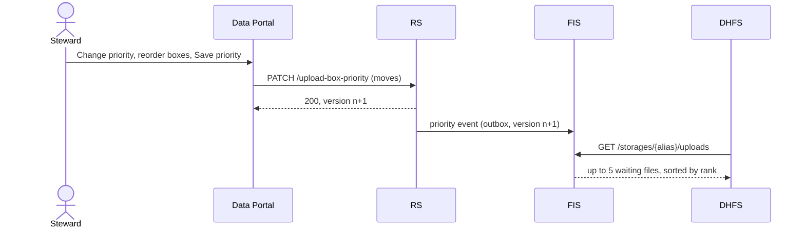

# Upload Box Prioritization for Re-encryption (Shoebill)

**Epic Type:** Implementation Epic

Epic planning and implementation follow the [Epic Planning and Marathon SOP](https://ghga.pages.hzdr.de/internal.ghga.de/main/sops/development/epic_planning/).

## Scope

### Outline

DHFS re-encrypts files in whatever order FIS returns them, and FIS returns them in no defined order.
This epic puts every research data upload box that is not archived into one priority order, and lets data stewards change that order in the Data Portal.
DHFS then re-encrypts all files of a box before any file of a box further down the order.
A new box joins the end of the order, and a box leaves the order when it is archived or deleted.

RS stores the order as one list and publishes it through the outbox.
FIS consumes it, and its existing `GET /storages/{storage_alias}/uploads` endpoint returns at most five waiting files, sorted by rank.
DHFS processes them in that order, and asks again right after a batch, instead of waiting for the next poll interval.

### Included/Required

- **RS** must store the priority order as a single document, holding an ordered list of entries, a `version` counter, `changed_by` and `last_changed`.
  The list holds one entry for every research data upload box that is not archived.
  Each entry holds the research data upload box ID and its file upload box ID, because data stewards rank research data upload boxes and FIS knows only file upload boxes.
  Index 0 is the highest priority.
  `changed_by` and `last_changed` mirror the research data upload box fields of the same names: the ID of the steward whose action changed the list, and the time from `now_utc_ms_prec()`.
  Every change that increments `version` sets both.
- RS must offer data stewards two endpoints, one to read the list and one to change the order (see [API definitions](#api-definitions)).
  A change is a list of moves, each of which puts a box before another box, or at the end.
  RS applies the moves in order to the list as it is stored at that moment.
  So if another steward saved in between, the changes of both stewards are kept, and the second save does not fail.
  RS applies every move, even a move of a box that was archived or deleted in the meantime.
  Later moves in the same save can refer to that box, so RS drops such boxes only after the last move (see [API definitions](#api-definitions)).
  RS skips a move only if it cannot place the box, because the box it should go before is not in the list.
  The response lists the skipped moves.
  Each save that changes the list increments the `version` counter.
  If a save leaves the list unchanged, it doesn't cause any changes in the database: RS returns the stored document without incrementing `version`, publishing an event or writing an audit record.
- RS must add a box to the end of the list when the box is created, and remove it when the box is deleted or archived.
  Each addition and removal increments `version` (reiterating that from a few lines above, just to be clear).
- RS must 'repair' the list upon every update, and once when the REST app starts.
  The repair drops entries for boxes that are archived or no longer exist, and adds missing non-archived boxes to the end, oldest `last_changed` first.
  On a save, RS adds the missing boxes before it applies the moves, and drops the entries after the last move.
  A crash between writing a box and writing the list can leave such entries, or such gaps (see [States](#states)), which the repair step aims to heal.
  The repair at startup also fills the list with the boxes that existed before this epic, and since the action is triggered by the system, it sets `changed_by` to `null`.
- RS must publish the document through the outbox (`MongoKafkaDaoPublisherFactory`), with a fixed key on a compacted topic, so a FIS instance that starts later still receives the current list.
- RS must write an audit record for every change to the list, through a new `AuditRepositoryPort` method next to `log_box_updated()`, e.g. `log_box_priority_updated()`.
  The record has `action` `"U"`, `entity` `"UploadBoxPriority"`, `entity_id` `"global"`, and the ID of the steward who saved, created, archived or deleted, or no ID for a repair done at startup.
  Its description names the new `version` and the old and new order of research data upload box IDs, so the audit log alone can reconstruct the history.
  An addition or removal because of creation, archival or deletion gets its own record, next to the existing box record.
- **ghga-event-schemas** must define the payload schema for the priority list's event, as well as a config class for the new topic.
- **FIS** must consume the priority events and store the list, ignoring any event whose `version` is not higher than the stored one.
  RS never deletes the document; if a `deleted` event arrives anyway, FIS must treat it as an empty list.
- FIS must store `box_id` (the file upload box ID) on each file.
  It is already part of the `FileUpload` event, and FIS currently drops it.
  The field is optional with default `None`, because files stored before this epic lack it until the backfill below.
- FIS must fill in a missing `box_id` when it receives a `FileUpload` event for a file it already has, even if the event is not newer than the stored file.
  This branch lets a UCS republish backfill the field (see [Rollout](#rollout)).
- FIS must sort not-yet-interrogated ("waiting") files with a MongoDB aggregation, as described in [Sorting the waiting files](#sorting-the-waiting-files).
- FIS must return at most five files per request, set by a hardcoded constant, e.g. `MAX_FILES_PER_REQUEST = 5`, not a config setting.
  At hundreds of thousands of waiting files, an unbounded response would move every file from MongoDB to FIS and on to DHFS on each poll.
- **DHFS** must process the files in the order FIS returns them.
  It already does so today; this just reiterates that requirement.
- DHFS must skip the `min_run_interval_seconds` wait after a round in which it concluded at least one file, whether it succeeded or reported a failure.
  It must still wait after a round in which FIS returned no file, or every file ended with an `InconclusiveError`.
- **Data Portal** must show each box's position in the Upload Box Manager and let data stewards change the order there, as described in [Upload Box Manager](#upload-box-manager).
- **Testbed** must cover the feature end to end, as described in [Testbed](#testbed).
- The testbed must assert the order in which DHFS interrogates files.

### Optional

- RS may expose each box's position in the list on the research data upload box responses, so a client can show it without a second request.
  The Upload Box Manager does not need this, because it loads the priority list itself.

### Not included

- Single-file responses.
  Epic 94 (Leafcutter Ant) lowers the cap to one file, together with the changes that requires.
- No order within a box.
  Files of the same box are ordered by `_id` only, so that the result is deterministic.
- Running more than one DHFS instance per storage alias.
  FIS has no claim mechanism, so two instances would receive and process the same file.
  Epic 94 (Leafcutter Ant) adds what multi-instance operation needs.
- Prioritizing individual files.
- A priority list per storage alias.
  The list is global, and FIS filters by storage alias before ranking, so each Data Hub sees the global order restricted to its own files.

## User Journeys

Only data stewards can see box priority or use the endpoints.
The [basic prototype](./prototype.html) walks through each journey.

1. **See where a box is in the queue.**
   The Upload Box Manager has a new **Priority** column.
   It shows the position of each box that is not archived, starting at 1, and is empty for archived boxes.
   The steward can sort the list by this column.
2. **Change the order.**
   The steward clicks **Change priority**.
   The list is replaced by the reorder view, which shows all non-archived boxes in priority order.
   The view also shows the version of the order, and who changed it last and when.
   The steward drags boxes, or uses their buttons, to move them.
   **Save priority** sends the changes and switches back to the list, which confirms the new version.
3. **Cancel.**
   **Cancel** throws away the changes and switches back to the list.
   If the steward tries to leave the page with unsaved changes, the page asks first.
4. **The order changed in the meantime.**
   Another steward saved, or a box was created or archived, while this steward was editing.
   The save still works, because RS applies the changes to the newer order.
   The page tells the steward that the saved order also contains other changes.
   A box that was archived in the meantime is not in the saved order, even if the steward moved it.
5. **A change no longer applies.**
   For example, the steward moved a box before another box that was archived or deleted in the meantime.
   RS no longer knows where that other box was, so it skips the move.
   The save works without that move, and the page tells the steward how many changes were skipped.
6. **The save fails.**
   The page stays in the reorder view, keeps the changes and asks the steward to try again.
7. **A new box joins the queue (no user action).**
   When a steward creates a box, RS adds it to the end of the order.
8. **Files are processed in the new order (no user action).**
   RS publishes the saved order, and FIS stores it within seconds.
   From its next request on, each DHFS gets files in the new order.



## API Definitions

### RESTful/Synchronous

RS gets two endpoints on a new router.
Both require the Data Steward role through `StewardAuthContext`, like the existing steward-only RS endpoints, and both answer `401` without a valid token and `403` without the role.

- `GET /upload-box-priority`: return the current priority list.
  - `200`: the stored document, with `version`, `entries`, `changed_by` and `last_changed` as in the [event payload](#payload-schemas-for-events).
    If no list has been saved yet, the body is `{"version": 0, "entries": [], "changed_by": null, "last_changed": null}`, so the Data Portal needs no special case beyond the empty change fields.
- `PATCH /upload-box-priority`: move boxes in the priority order, as described below.
  - `200`: `{"priority": ..., "skipped": [...], "includes_other_changes": ...}`.
    `priority` is the stored document after the save, and `skipped` lists the moves RS skipped, as the page sent them.
    `includes_other_changes` is `true` if the list changed after the version the page loaded.
    The other RS write endpoints answer `204`.
    This one returns the document, so the Data Portal can show the new order without another request.
  - `422`: the body is malformed, for example with a missing field.
  - `500`: the write collided with other writes three times in a row, or another error occurred.

The request body for `PATCH /upload-box-priority` holds `version`, which is the version the page loaded, and `moves`, which RS applies in order:

```json
{
  "version": 7,
  "moves": [
    {"box_id": "4f0b3c1e-8a9d-4b7e-9c2a-1d3e5f7a9b0c", "before": "7d8e9f0a-1b2c-4d3e-8f4a-5b6c7d8e9f0a"},
    {"box_id": "1a2b3c4d-5e6f-4a7b-8c9d-0e1f2a3b4c5d", "before": null}
  ]
}
```

- A move puts the box `box_id` directly before the box `before`, or at the end if `before` is `null`.
  Both are research data upload box IDs.
- If `box_id` is not in the list, the move inserts it, so that later moves can refer to it.
- RS skips a move if `before` is neither `null` nor in the list, or if `before` is the box itself.
  If RS skips a move, it still applies the moves after it.
- `version` does not have to match the stored version.
  RS only uses it to set `includes_other_changes`.
- RS handles a save in four steps:
  1. Read the list, and add missing non-archived boxes to the end, where the page also shows them.
  2. Apply the moves in order.
  3. Drop the entries for boxes that are unknown, archived or deleted.
  4. Write the result, but only if the stored `version` is still the one RS read.
     If another write came first, RS starts again, up to three times, as box updates already do (`race_condition_retries`).
- If the result is the same as the stored list, RS writes nothing (see [Included/Required](#includedrequired)).

RS drops boxes only after the last move, because a later move can refer to a box that is gone.
For example, the stored list is `A, B, C, D, E`, and box `X` was archived while the steward was editing.
The steward moved `X` before `E`, then `A` before `X`, then `B` before `A`.
RS applies all three moves, which gives `C, D, B, A, X, E`, and then drops `X`, which gives `C, D, B, A, E`.
If RS dropped `X` first, it would skip the first two moves, and the result would be `B, A, C, D, E`.

FIS keeps its paths and response models unchanged.
The list from `GET /storages/{storage_alias}/uploads` now holds at most five files, and its order, undefined until now, follows the rank, which DHFS relies on (see [Sorting the waiting files](#sorting-the-waiting-files)).

### Payload Schemas for Events

The outbox publishes the stored document on a new topic, e.g. `upload-box-priority`, keyed by the fixed document ID.
The event types are the outbox's `upserted` and `deleted`.

```json
{
  "id": "global",
  "version": 7,
  "changed_by": "2b6f1c9e-3d4a-4e5b-8c7d-9e0f1a2b3c4d",
  "last_changed": "2026-10-14T13:02:11.482Z",
  "entries": [
    {
      "research_data_upload_box_id": "4f0b3c1e-8a9d-4b7e-9c2a-1d3e5f7a9b0c",
      "file_upload_box_id": "a1c2e3f4-5b6d-4e8f-9a0b-1c2d3e4f5a6b"
    },
    {
      "research_data_upload_box_id": "7d8e9f0a-1b2c-4d3e-8f4a-5b6c7d8e9f0a",
      "file_upload_box_id": "0e1f2a3b-4c5d-4e6f-8a7b-9c0d1e2f3a4b"
    }
  ]
}
```

FIS reads only `version` and `entries[].file_upload_box_id`.

## Additional Implementation Details

### Why one list

The main alternative was a rank field on each research data upload box, sent to FIS with the existing box events.
If the ranks have gaps between them, as in Jira's LexoRank, a move only writes the moved box.
But RS writes boxes often: on every file event from UCS, and on every edit, lock, unlock, and archival.
If a move increments the box's `version`, a steward who edits the same box at that time gets a `409`.
If it does not, another write can undo the move, because it replaces the whole box with the copy it read before the move (`replace_one`).
When no gap is left, RS has to renumber every box and publish one event for each.
FIS would also have to consume every box event, only to find the few that change a rank.

A single document changes in one write, carries the full state in one event, and lets consumers apply events idempotently.
The downside is that RS must keep the list consistent with the boxes.
It adds a box to the list when the box is created, and removes it when the box is archived or deleted.
Each of these actions therefore writes twice, and RS repairs the list in case it crashes between the two writes.

Another alternative was to relay requests from RS to UCS and update all FileUploads within each affected box.
However, this is too clumsy and heavy-handed to be seriously considered.

### Sorting the waiting files

FIS should not use the hexkit DAO protocol to sift through the waiting files.
We need to perform a `$match` on `state` and `storage_alias`, try to find the box ID's rank in the priority collection (if applicable), and rank file results accordingly.
This can be done partially with a DAO and partially in memory, but requires either A) loading all waiting files into memory and ranking them there, or B) performing multiple queries (e.g. one for prioritized boxes and one for unprioritized boxes, or similar).
As the number of waiting files grows, so too does the amount of data we would have to pull back from the DB only to drop 99% of it.
Instead, we should add an outbound port, e.g. `InterrogationQueuePort`, and a MongoDB adapter that uses `ConfiguredMongoClient` directly, and allow the DB to perform the filtering and sorting.
`services/mass/src/mass/adapters/outbound/aggregator.py` and `services/ucs/src/ucs/adapters/outbound/box_stats.py` follow the same pattern.

```python
pipeline = [
    {"$match": {"storage_alias": storage_alias, "state": "inbox", "interrogated": False}},
    {"$lookup": {
        "from": priority_collection_name,
        "pipeline": [{"$match": {"_id": PRIORITY_DOC_ID}}, {"$project": {"_id": 0, "entries": 1}}],
        "as": "priority",
    }},
    {"$set": {"rank": {"$indexOfArray": [
        {"$ifNull": [{"$first": "$priority.entries.file_upload_box_id"}, []]},
        "$box_id",
    ]}}},
    {"$set": {"unprioritized": {"$eq": ["$rank", -1]}}},
    {"$sort": {"unprioritized": 1, "rank": 1, "_id": 1}},
    {"$limit": MAX_FILES_PER_REQUEST},
    {"$project": {"priority": 0, "rank": 0, "unprioritized": 0}},
]
```

- The `$lookup` does not depend on the file document, so MongoDB runs it once per query.
- `$indexOfArray` compares BSON types.
  If `file_upload_box_id` and `box_id` are stored with different types, such as a binary UUID and a string, every file counts as unprioritized and no error occurs.
  We could add a test to cover this with both values written through the hexkit DAOs, but it's not necessary.
  The most likely reason this kind of mixup would happen is a future Migration that writes a string directly to the DB.
  However, in that case it should be caught by model validation.
- The adapter must map `_id` back to `id` itself.
  Define both collection names as constants, as UCS does with `FILE_UPLOADS_COLLECTION`, and pass them to the DAO factory and the adapter alike.
- The aggregation is chosen because of the `$limit`.
  MongoDB combines it with the `$sort` and keeps only the top five documents in memory, so five documents cross the network and are validated per request.
  Sorting in Python after a DAO query would fetch and validate every waiting file first.
  Epic 94 lowers the limit to one.

### DHFS loop

`Interrogator.interrogate_new_files()` processes the files of a batch one after another, and `run_interrogator()` in `services/datahub-file-service/src/dhfs/main.py` waits for the rest of `min_run_interval_seconds` after every round.
`interrogate_new_files()` must tell the caller whether it concluded at least one file, and `run_interrogator()` must skip the wait if it did.
A priority change applies from DHFS's next request, so at most the five files of the current batch are processed in the old order.

An `InconclusiveError` leaves the file uninterrogated in FIS, so the next request returns it again.
Waiting after a round in which every file was inconclusive keeps DHFS from requesting the same batch in a tight loop.
A file that stays inconclusive does not block the rest of its batch, as today.
It does take one of the five places in every batch, since it keeps its rank.
Five such files in the highest ranks fill every batch and stall interrogation for that storage alias, until a file stops failing or a data steward moves its box.
Epic 94's release backoff removes this; until then, it is a known limitation.

### Upload Box Manager

The Upload Box Manager (`/upload-box-manager`, guarded by `guardDataSteward()`) gets a list mode and a reorder mode, but no new route.
It already loads all boxes with `GET /upload-boxes`, and now also loads the priority list with `GET /upload-box-priority`.
It ignores entries that match no box or an archived box.
If a non-archived box is missing from the list, the page shows it after the listed boxes, oldest `last_changed` first, which is where the next repair puts it.

**List mode** is the current list plus a sortable **Priority** column.
The column shows each non-archived box's position, starting at 1, and is empty for archived boxes.
Sorting by it puts archived boxes last.
The list already sorts and pages in the browser (`upload-box-manager-list.ts`), so the column needs no further RS change.
If the priority list fails to load, the column stays empty, **Change priority** is disabled, and the page shows a message.

**Reorder mode** opens when the steward clicks **Change priority**.
It replaces the filters, the table and the paginator with one list of all non-archived boxes in priority order.
Reorder mode has no paging, filters or column sorting, because they don't work with reordering.
A box cannot be dragged to another page, and "move up" would skip boxes that are hidden.

The header shows the version and "Last changed by <name> on <date>".
The page turns `changed_by` into a display name with a link to `/user-manager/<id>`, as the upload box detail page does.
If that fails, it shows the plain ID.
If `changed_by` is `null` because of a repair at startup, the header shows "Last changed automatically on <date>".
Before the first write, the header shows "No edit history yet".
The page takes these values from the priority document, because it cannot read the audit log.

Each row shows the box's position, title, storage alias, state and file count.
The steward drags a row to move it (Angular CDK `cdkDropList`, already a dependency).
The move up, move down and move to top buttons do the same for keyboard users.
While the steward drags a row, a bar between two rows shows where the row will be dropped.
After a move, the row stays highlighted for about 1.5 seconds, so the steward can find it again.

The page records each move, in the order the steward makes them.
A move's `before` is the box that is now directly below the moved box, or `null` if the moved box is now last.
If the moves bring the order back to the one the page loaded, the page discards them and disables **Save priority**.

**Save priority** sends the moves and the loaded version with `PATCH /upload-box-priority`.
If RS answers `200`, the page switches to list mode, shows the order from the response, and confirms the new version.
It adds a note in two cases:

- If `includes_other_changes` is `true`: "The saved order includes changes made since you started editing."
- If `skipped` is not empty: "<n> of your changes no longer applied and were skipped, for example because a box was archived in the meantime."

If the save fails, the page stays in reorder mode, keeps the changes, and asks the steward to try again.
**Cancel** throws away the changes and switches to list mode.
A `canDeactivate` guard asks before the steward leaves the page with unsaved changes.
The [basic prototype](./prototype.html) shows both modes and each response, without styling.

List mode, with the new column and button (the other columns stay the same):

```text
Upload Box Manager                                                [Change priority]
[Filters                                                                          ]
```

Reorder mode:

```text
| Priority ^ | Title | State    | Files | Location   | Last change      | Details |
|------------|-------|----------|-------|------------|------------------|---------|
| 1          | Box B | locked   | 8     | Tuebingen  | 2026-10-12 09:40 | [>]     |
| 2          | Box A | open     | 120   | Heidelberg | 2026-10-14 11:20 | [>]     |
| 3          | Box D | open     | 60    | Koeln      | 2026-10-10 16:05 | [>]     |
| 4          | Box C | open     | 35    | Heidelberg | 2026-10-13 08:15 | [>]     |
| 5          | Box E | open     | 12    | Tuebingen  | 2026-10-11 14:30 | [>]     |
|            | Box G | archived | 40    | Heidelberg | 2026-10-01 12:00 | [>]     |
                                             Upload boxes per page: 25   1 - 6 of 6

Upload Box Manager / Change priority                 [Cancel] [Save priority]
Files of boxes higher up are re-encrypted first.
Version 7, last changed by _Steward A_ on 2026-10-14 15:02

| You have unsaved changes to the priority order.                          |

+- Priority order --------------------------------------+
| :: (1) Box B                             [^] [v] [^^] |
|        Tuebingen - locked - 8 files                   |
|=======================================================|
| :: (2) Box A                             [^] [v] [^^] |
|        Heidelberg - open - 120 files                  |
|                                                       |
| :: (3) Box D                             [^] [v] [^^] |
|        Koeln - open - 60 files                        |
|                                                       |
| :: (4) Box C                             [^] [v] [^^] |
|        Heidelberg - open - 35 files                   |
|                                                       |
| :: (5) Box E                             [^] [v] [^^] |
|        Tuebingen - open - 12 files                    |
|                                                       |
| Drag a row or use the buttons to change its position. |
+-------------------------------------------------------+

::    drag handle          ===  drop position while dragging
[^] [v]  move up, down     [^^] move to top
```

### States

The priority list:

| State | Meaning | Changes on |
|---|---|---|
| Not stored yet | RS returns version `0`, no entries, and `null` for `changed_by` and `last_changed`; FIS ranks no file | the repair when RS starts, if any non-archived box exists |
| Version `n` | The stored order, with who changed it last and when | a save that changes the list, a box being created, archived or deleted, or a repair (`n + 1` each, setting `changed_by` and `last_changed`) |

A box and the list:

| Box state | In the list | Can be moved |
|---|---|---|
| `open` | yes; RS adds it when the box is created | yes |
| `locked` | yes; its files can still be waiting for re-encryption | yes |
| `archived` | no; RS removes it on archival | its moves still apply, so that later moves can refer to it; RS drops it after the last move |
| deleted | no; RS removes it on deletion | its moves still apply, so that later moves can refer to it; RS drops it after the last move |

RS writes the box and the list separately.
If RS crashes between the two writes, the list can miss a new box, or keep an entry for an archived or deleted box.
FIS sorts the files of a missing box after the files of all listed boxes, which is also where the repair puts the box.
FIS has no waiting files for an archived or deleted box.
The next write to the list, or the next start of RS, repairs the list.

A file in FIS:

| `box_id` | Rank |
|---|---|
| `None` (stored before this epic, before the republish) | after all listed boxes |
| a box missing from the list | after all listed boxes |
| a box in the list | that box's position |

The Upload Box Manager:

- List mode: loading, load failed, priority not loaded (column empty, **Change priority** disabled), and loaded.
  After a save, the loaded list also shows the confirmation, plus a note about other changes, skipped changes, or both.
- Reorder mode: no changes (**Save priority** disabled), unsaved changes, saving (buttons disabled), and save failed.

The prototype shows each of these except loading and the two load failures.

### Decisions

| Decision | Reason | Details |
|---|---|---|
| One document holds the whole order | A save is one write and one event. FIS only gets priority changes, and box writes don't touch the order | [Why one list](#why-one-list) |
| Every non-archived box is in the order | There is one queue. A new box joins its end, and no box waits in a group without an order | [Included/Required](#includedrequired) |
| Entries hold both box IDs | Stewards rank research data upload boxes; FIS knows only file upload boxes | [Included/Required](#includedrequired) |
| A save sends moves, not the whole list | If two stewards save at the same time, both keep their changes and neither has to redo anything | [API definitions](#api-definitions) |
| On a save, RS drops archived and deleted boxes after the last move, not before | A later move in the same save can refer to such a box | [API definitions](#api-definitions) |
| `version` on the document | FIS drops stale events. RS notices when two of its own writes collide. The page can tell whether the order changed after it loaded | [API definitions](#api-definitions) |
| A save that leaves the list unchanged is a no-op | FIS gets no event that changes nothing, and `changed_by` still names the steward who last changed the order | [API definitions](#api-definitions) |
| RS repairs the list on every write and when it starts | RS can't write a box and the list in one transaction. The repair at startup also fills the list with the boxes that existed before this epic | [Included/Required](#includedrequired) |
| Outbox, not `PersistentKafkaPublisher` | The list is current state, not an event that starts a flow | [Included/Required](#includedrequired) |
| Locked boxes stay in the order | Their files can still be waiting | [States](#states) |
| Every change to the list writes an audit record | The order decides which data is processed first, so who changed it must be traceable | [Included/Required](#includedrequired) |
| The document carries `changed_by` and `last_changed` | The page shows who changed the order last; the audit log is not readable from the page | [Upload Box Manager](#upload-box-manager) |
| The order is edited in the Upload Box Manager, not on a separate page | Stewards see a box's place in the queue in the list they already use, and that list already holds every box | [Upload Box Manager](#upload-box-manager) |
| Reorder mode shows every non-archived box, without paging, filters or sorting | Reordering needs the whole order on one screen | [Upload Box Manager](#upload-box-manager) |
| One global list, not one per storage alias | FIS filters by storage alias first, so each Data Hub sees the global order | [Not included](#not-included) |
| Sort in MongoDB with an aggregation, capped at five files | Only five documents leave MongoDB per request | [Sorting the waiting files](#sorting-the-waiting-files) |
| Backfill `box_id` by a UCS republish, not a migration | Uses the existing `publish-events --all`; no cross-database access | [Rollout](#rollout) |
| The page shows each box's total file count | No endpoint provides the number of waiting files | [Upload Box Manager](#upload-box-manager) |

### Open questions

1. **Waiting-file counts on the page:** stewards would see which boxes still have files to re-encrypt, but RS has no such count; it needs data from FIS.
   Recommended: leave it out of this epic.
2. **Initial order:** in which order does the repair at startup add the boxes that existed before this epic?
   Boxes have no creation date.
   Recommended: oldest `last_changed` first, and data stewards correct the order on the page afterwards.

### Rollout

ghga-event-schemas needs no release of its own: the service images build it from source ([releases](../../releases.md)).

1. Deploy DHFS.
   The new DHFS works against a FIS from before this epic, because it skips the wait only after concluding a file.
   It goes first because of the cap: a DHFS from before this epic waits out `min_run_interval_seconds` after every batch, so against the new FIS it processes at most five files per interval, about 7,200 files per day at the default of 60 seconds.
2. Deploy RS and FIS.
   FIS ranks nothing until the first priority event arrives, so the order of these two does not matter.
   When RS starts, it fills the list with all non-archived boxes and publishes it.
3. Run `ucs publish-events --all` to republish every file upload.
   FIS fills in `box_id` for the files it already stores.
   Only files still waiting for interrogation need it, since the selection reads no other files.
4. Deploy the Data Portal.
   It needs the RS endpoints from step 2.

No database migration is needed: `box_id` defaults to `None`, and the republish fills it in.

### Testing

- FIS: the aggregation against `MongoDbFixture`, for files of listed boxes, files without `box_id`, and an empty or missing priority list.
  Files of the same box, and files without a listed box, come out in ascending `_id` order.
  With more than five waiting files, it returns exactly the five highest-ranked.
  `InMemDao` cannot run the pipeline, so unit tests of the interrogation handler use a fake of the new port.
- FIS: stale priority events are ignored; a republished `FileUpload` event fills in a missing `box_id` and changes nothing else.
- FIS: after a `deleted` priority event, files come out in `_id` order only.
- RS: a move, both when it applies and when it is skipped.
  Moves apply in order, and a skipped move does not stop the moves after it.
- RS: a move of an unknown, archived or deleted box still applies, later moves that refer to that box apply too, and RS drops the box after the last move.
  A move before such a box is skipped if no earlier move in the same save placed the box.
- RS: a save based on an older `version` is applied to the stored list and sets `includes_other_changes`.
  A write that collides with another write is retried with a fresh read.
- RS: RS adds a box to the end of the list when the box is created, and removes it when the box is archived or deleted.
- RS: the repair drops entries for archived or deleted boxes, and adds missing boxes to the end, oldest `last_changed` first.
  On a save, it adds the missing boxes before the moves and drops the entries after them.
  It runs on every write and at startup, and at startup it sets `changed_by` to `null` and writes nothing if the list is already complete.
- RS: a save sets `changed_by` to the saving steward, and an addition or removal to the steward who created, archived or deleted the box; all of them set `last_changed`.
- RS: a save that changes the list, an addition, a removal and a repair each write one audit record with the old and new order.
  A save whose moves leave the list unchanged returns the stored document and leaves `version`, `changed_by` and `last_changed` unchanged, with no event and no audit record.
- DHFS: the wait is skipped after a round that concluded at least one file, and kept after an empty response or a round in which every file was inconclusive.
- Data Portal, against a mocked RS:
  - the Priority column, and sorting by it
  - switching between the two modes
  - the move that a drag and each button record
  - discarding the moves when the order is back to the loaded one
  - **Cancel** and the leave guard
  - the "Last changed" line before the first write, after a repair at startup, and after a save
  - ignoring entries for archived or deleted boxes, and showing missing boxes at the end
  - the notes about other changes and skipped changes
  - a failed save

### Testbed

The upload features (`testbed/features/20x_*.feature`) go through RS and read FIS's MongoDB directly, so they can check every step up to FIS.
The features run in number order and share their boxes: 200 creates and deletes boxes, and 203 archives the rest.
A new feature numbered after 203 therefore finds no box it can move, so it creates its own, as `502_data_portal_uploads.feature` does.

API, in a new feature, e.g. `204_upload_box_priority.feature`, with its own boxes:

- The data steward creates two boxes and reads the list, which has both boxes at the end.
- The data steward saves a move that puts the second box before the first.
  The response has the new `version`, the steward's ID as `changed_by`, a `last_changed`, and `includes_other_changes` set to `false`.
- A second save with the same, now outdated `version` is still applied, and its response has `includes_other_changes` set to `true`.
- A save moves an unknown box, then moves a listed box before the unknown box.
  The listed box ends up where the unknown box was moved to, and the stored list does not contain the unknown box.
- A move before an unknown box comes back in `skipped`, and the other moves in the same save are applied.
- A move that leaves the list unchanged returns the same `version`.
- A malformed body fails with `422`.
- After a save, FIS's priority document reaches the new `version` within a timeout.
- FIS stores `box_id` on files uploaded during the run.

Additions and removals, in the existing features, which already create, archive and delete boxes:

- `200_upload_initiated.feature`: assert that the box is in the list after it is created, and that it leaves the list after the deletion scenario.
- `203_upload_completed.feature`: assert that the box leaves the list after the archival scenario.

Data Portal, in `502_data_portal_uploads.feature`, before the scenario that maps and archives the box:

- The data steward opens the Upload Box Manager, clicks **Change priority**, moves the primary box once by dragging and once with a button, and saves.
- The Priority column shows the box at the position it was moved to.
- The reorder view shows the new version and "Last changed by" with the steward's name.
- After the archival scenario, the box's Priority cell is empty, and the box is in neither panel of the reorder view.

Audit records are covered by the RS tests; the testbed has no access to them so far.

Interrogation order, in feature 204:

- DHFS polls on its own schedule and interrogates a file soon after upload, so files of two boxes are rarely waiting at the same time.
  The scenario therefore uploads all its files while DHFS is idle, for example by setting a long `min_run_interval_seconds` for the run.
- It uses two boxes in one storage, moves the second box before the first, and uploads two files to each.
- DHFS interrogates both files of the second box first, then both files of the first box.
- Within each box, the files are interrogated in ascending `_id` order.
- The order is read from `state_updated` of the files in FIS's MongoDB, because DHFS processes one file at a time.

## Human Resource/Time Estimation

Number of sprints required: 1

Number of developers required: 2
